---

---

# agent-sandbox核心原理

## 核心设计思想

在设计Sandbox时面临如下问题：
- 沙箱应该如何抽象？
- 沙箱应该如何调度？
- 沙箱如何被访问？
- 沙箱的隔离如何实现？
- 沙箱的网络策略如何实现？


完全基于k8s进行设计，为k8s补充沙箱原语。k8s的调度的基本单位为Pod，在agent-sandbox中，沙箱被抽象化为：`存储+网络策略+沙箱标识+Pod`。沙箱必须具备两个核心能力：
- 隔离性： 在agent-sandbox中，隔离委托给RuntimeClass，通过Kata，gVisor等运行时来实现隔离性。Kata通过伪装为Pod的microVM来实现隔离性。
    - 工作负载必须运行在强隔离环境中，防止恶意代码逃逸容器以访问宿主机节点
    - 资源限制：工作负载必须受资源约束，防止Sandbox过度消耗CPU/内存/存储资源，影响节点。
- 网络安全： 沙箱的入站和出站必须受到管控，不能随意访问未授权的网络，不能向未授权的网络传输数据。
    - 防止跨租户网络攻击，被攻陷的Sandbox通过网络攻击另一个Sandbox

沙箱是有状态的，沙箱是有身份的。沙箱是有生命周期的（创建、暂停、恢复、定时删除等）。


网络是通过k8s的NetworkPolicy来实现沙箱的入站与出站管控。沙箱的调度依赖k8s的调度器，沙箱元数据存储依赖k8s的etcd。好处是可以复用k8s的这些基础资源管理，网络以及调度等能力，但也带来了弊端，就是无法突破k8s的上限，性能以及部分功能会受限于k8s本身设计的限制。k8s原始设计是为了Pod而设计以及优化的。Pod这类负载的特征是长时间稳定运行。但是由AI带来的智能体沙箱负载特征与之相悖，突发，空闲，高密度等，与之带来相关负载特性设计优化。

## agent-sandbox核心路径

使用路径：

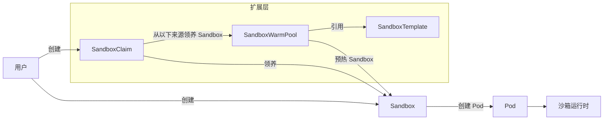

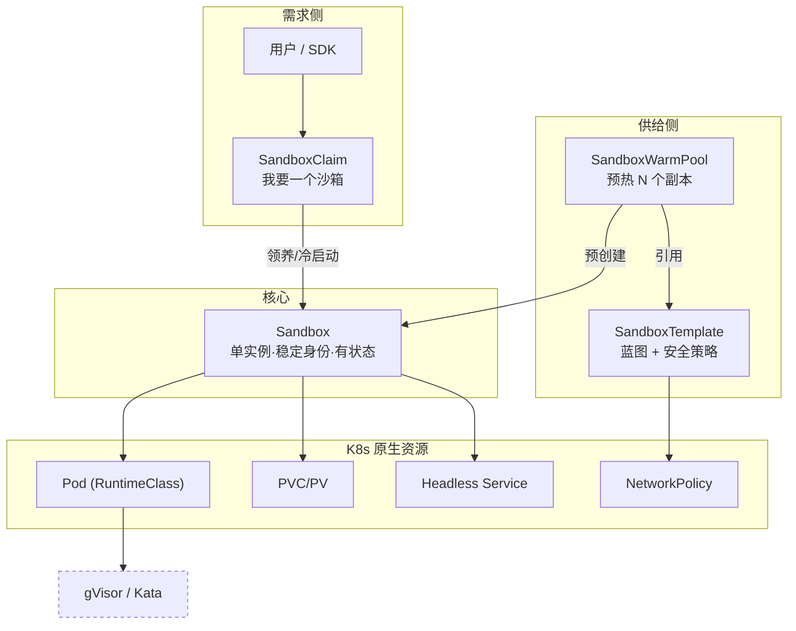

Agent Sandbox 是 sandbox orchestrator，不自己实现隔离，而是通过 RuntimeClass 把隔离交给 gVisor/Kata。

Agent Sandbox 本身只是编排层——它管理的是带 RuntimeClass 的 Pod，真正的内核级隔离来自底层选用的沙箱运行时（gVisor 或 Kata Containers）。如果集群节点上没装这两个之一，Pod 会回退到普通 runc 运行，隔离强度只剩容器命名空间级别，跑不可信代码（AI Agent 生成的任意执行）时风险明显放大。

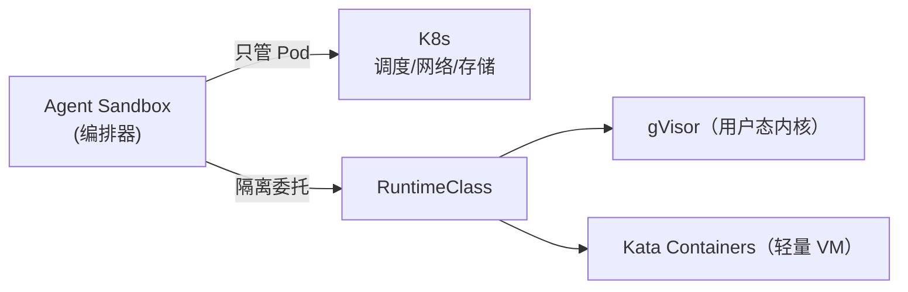

> 容器运行时类（Runtime Class）： 你可以在不同的Pod设置不同的 RuntimeClass，以提供性能与安全性之间的平衡。

### 沙箱模板SandboxTemplate

沙箱模板定义沙箱这个“Pod”的整体形态，包括存储网络以及治理边界。 沙箱模板决定沙箱工作负载的可复用蓝图，它本身不创建任何运行时资源，不创建沙箱。真正的实例化交给沙箱预热池。

直白一点说沙箱模板规定了沙箱内跑的什么样的Pod(含隔离运行时例如是kata还是gVisor等)，挂什么存储，沙箱的网络策略。

> [NetworkPolicy](https://kubernetes.io/zh-cn/docs/reference/kubernetes-api/policy-resources/network-policy-v1/)描述针对一组 Pod 所允许的网络流量。Kubernetes的Pod级L3/L4防火墙。默认情况下，集群内任何Pod能连任何Pod的任何端口。在多租户/跑不可信代码的场景里，这是灾难。沙箱里跑的是 LLM 生成的代码——必须假设它是恶意的。SandboxTemplate 控制器据此生成一个模板级共享策略，用于限制沙箱的网络访问。它不是"每个沙箱一条策略"，而是每个模板一条共享策略：

沙箱模板是批量化运行沙箱的前提，是管理沙箱的基础，是后续其他功能的基础。例如对该沙箱模板生成的所有沙箱统一设置网络策略等。

#### 定义

> 后期如果增加其他的功能，可能需要扩展当前的`SandboxTemplate`定义。

`SandboxTemplate`定义：

- `SandboxBlueprint`: 定义与 SandboxSpec 共享的工作负载配置。
  - `PodTemplate`： 必填项，描述将在沙箱中创建的Pod
  - `VolumeClaimTemplates`: 可选，创建 sandbox 时，会根据这些模板创建 PVC。
  - `Service`: 可选，service 控制控制器是否应为Sandbox工作负载自动创建一个headless Service。设置为true启用，设置为false则显式禁用并删除该Service。
- `NetworkPolicy`: 定义要应用到由该模板创建的沙箱上的网络策略。每个 Template 只创建一个共享的 NetworkPolicy。具体行为由 NetworkPolicyManagement 字段决定：
  - 若 Management 为 "Unmanaged"：该字段被完全忽略。
  - 若 Management 为 "Managed"（默认）且该字段被省略（nil）：控制器会自动应用严格的安全默认策略：
    * 入站（Ingress）：仅允许来自 Sandbox Router 的流量。
    * 出站（Egress）：仅允许公网。阻断内网 IP（RFC1918）、元数据服务器等。
  - 若 Management 为 "Managed" 且该字段已提供：控制器应用你自定义的规则。
- `NetworkPolicyManagement`：定义控制器是否管理该 NetworkPolicy。
  - Managed： 确保存在一个共享 NetworkPolicy：spec.networkPolicy 省略时用安全默认（入站仅允许 router、出站仅公网），提供时用你的规
  - Unmanaged： 完全跳过 NetworkPolicy 的创建；若本模板此前创建过，则删除它
- `EnvVarsInjectionPolicy`： 控制 SandboxClaim 是否可以为由该模板创建的sandbox设置环境变量（spec.env）。环境变量在Pod创建之前就已固化进去；无法注入到一个已经运行中的预热池Pod。因此，在此处允许注入（Allowed 或 Overrides）只按claim生效：任何实际设置了spec.env 的 claim 都会被强制冷启动一个全新的 Sandbox，无法领养预热池中的 Sandbox。未设置任何环境变量的 claim 仍可正常使用预热池。
  - Disallowed（默认）：claim 不得设置任何环境变量；指定了`spec.env` 的claim会被拒绝。
  - Allowed：claim 可以添加模板中尚未定义的环境变量，但不得修改模板中已定义的同名变量的值。
  - Overrides：claim 可以添加新的环境变量，并覆盖模板中已定义的同名变量的值。
    。

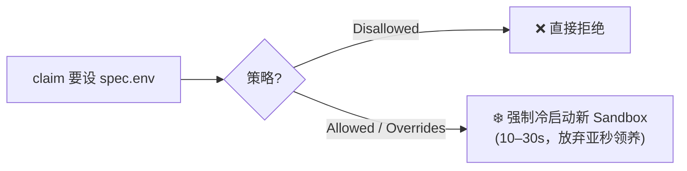

- `VolumeClaimTemplatesPolicy` ：允许 SandboxClaim 注入或覆盖模板中定义的 volume claim template。若设为 Disallowed，则SandboxClaim只要指定了任何 volume claim template 就会被拒绝。
  - Disallowed： 禁止 SandboxClaim 指定任何 volume claim template。
  - Allowed： 允许 SandboxClaim 注入新的 volume claim template，但不允许覆盖已有的。
  - Overrides：允许SandboxClaim注入新的并覆盖已有的volume claim template。

示例：

```yaml
# Ubuntu 24.04 预热池示例
---
apiVersion: extensions.agents.x-k8s.io/v1beta1
kind: SandboxTemplate
metadata:
  name: ubuntu-sandbox-template
  namespace: agent-sandbox-test
spec:
  podTemplate:
    metadata:
      labels:
        app: ubuntu-sandbox
    spec:
      # 无 API 访问需求：控制器对模板供给的沙箱也会默认置 false，这里显式写出便于审阅
      automountServiceAccountToken: false
      # 裸 ubuntu 镜像没有常驻服务，靠 sleep infinity 撑住 PID 1；
      # 不要用 restartPolicy: Always 之外的花样，OnFailure 对 sleep 等价。
      restartPolicy: OnFailure
      # 集群内实际存在的 RuntimeClass（kubectl get runtimeclass）：
      #   kata-qemu / kata-clh / kata-dragonball / gvisor
      # 没有装 Kata/runsc 就把这一行删掉，用默认 runc。
      runtimeClassName: kata-dragonball
      securityContext:
        # Kata 下仍是 VM 边界，但保持非 root + 无提权是低成本的好习惯
        # runAsNonRoot: false
        seccompProfile:
          type: RuntimeDefault
      containers:
        - name: ubuntu
          image: ubuntu:24.04
          imagePullPolicy: IfNotPresent
          command: ["/bin/bash", "-lc"]
          args:
            - |
              # 就绪标记先落盘，再做"业务初始化"（装包、拉代码、起 agent 进程…）
              touch /tmp/.ready
              echo "ubuntu sandbox $(hostname) ready at $(date)"
              exec sleep infinity
          readinessProbe:
            # 裸镜像没有 HTTP 端口，只能用 exec 探针；
            # tcpSocket 也不行——没有监听端口。
            exec:
              command: ["test", "-f", "/tmp/.ready"]
            initialDelaySeconds: 0
            periodSeconds: 2
            failureThreshold: 3
          resources:
            requests:
              cpu: "250m"
              # Kata 每个 Pod 是一个轻量 VM，内存开销高于普通容器
              memory: "1Gi"
            limits:
              cpu: "2"
              memory: "2Gi"
          securityContext:
            allowPrivilegeEscalation: false
            capabilities:
              drop: ["ALL"]

  # 每个 Sandbox 会按 <template 内的 name>-<sandbox 名> 创建独立 PVC。
  # 注意：Pool 里每个预热成员都会各自占一块卷，replicas 越大占用越多。
  # ⚠️ 必须显式写 storageClassName：本集群的 local-path 没有 is-default-class 注解，
  #    不写会永远停在 Pending，进而导致 sandbox Pod 无法启动。
  volumeClaimTemplates:
    - metadata:
        name: sandbox-workdir
      spec:
        storageClassName: local-path
        accessModes: ["ReadWriteOnce"]
        resources:
          requests:
            storage: 1Gi

  # ==========================================================================
  # 模板级策略（SandboxTemplateSpec 顶层字段，与 podTemplate 同级）
  # 这 4 项都不在 SandboxBlueprint 里，因此改它们不会让池内已有沙箱被判为陈旧。
  # ==========================================================================

  # ① 谁管理 NetworkPolicy：Managed（默认）/ Unmanaged
  #   Managed  ：控制器确保存在一个共享 NP，PodSelector 由控制器填死（按 template hash）
  #   Unmanaged：控制器完全不建 NP（若之前建过则删除），交给 Cilium 等外部方案
  networkPolicyManagement: Managed

  # ② 共享 NetworkPolicy 的具体规则（受限子集：只能写 ingress / egress，
  #    podSelector 与 policyTypes 由控制器接管，不可在此指定）
  #    省略本字段 = 使用控制器内置的安全默认值（与下面这份规则等价）：
  #      入站：仅允许 agent-sandbox-system 中的 sandbox-router
  #      出站：仅允许公网，阻断 RFC1918 与 169.254.0.0/16（云元数据服务）
  #    注意：安全默认会连 CoreDNS 一起阻断，因此容器内按域名联网会失败；
  #          必要时在 egress 里显式放行 kube-system 的 53 端口。
  networkPolicy:
    ingress:
      - from:
          # namespaceSelector 与 podSelector 写在同一个数组元素里 = AND 关系
          - namespaceSelector:
              matchLabels:
                kubernetes.io/metadata.name: agent-sandbox-system
            podSelector:
              matchLabels:
                app: sandbox-router
    egress:
      # 放行公网 IPv4，排除内网与元数据网段
      - to:
          - ipBlock:
              cidr: 0.0.0.0/0
              except:
                - 10.0.0.0/8
                - 172.16.0.0/12
                - 192.168.0.0/16
                - 169.254.0.0/16
      # 放行公网 IPv6
      - to:
          - ipBlock:
              cidr: ::/0
              except:
                - fc00::/7
                - fe80::/10
      # 如需要集群内 DNS 解析，取消下面注释
      # - to:
      #     - namespaceSelector:
      #         matchLabels:
      #           kubernetes.io/metadata.name: kube-system
      #   ports:
      #     - protocol: UDP
      #       port: 53
      #     - protocol: TCP
      #       port: 53

  # ③ SandboxClaim 能否为本模板创建的 sandbox 设置环境变量（spec.env）
  #   Disallowed（默认）：禁止，claim 带 env 会被拒绝
  #   Allowed          ：只能新增模板未定义的变量，不能覆盖同名变量
  #   Overrides        ：可新增，也可覆盖模板已定义的同名变量
  #   ⚠️ env 在 Pod 创建前固化，因此真正带了 env 的 claim 会强制冷启动（10-30s），
  #      无法领养预热池；不带 env 的 claim 仍是亚秒级热领养。
  envVarsInjectionPolicy: Allowed

  # ④ SandboxClaim 能否注入/覆盖 volume claim template
  #   Disallowed（默认）：claim 指定任何 volumeClaimTemplates 就会被拒绝
  #   Allowed          ：可新增，不能覆盖模板已有的
  #   Overrides        ：可新增并覆盖
  #   本模板已定义 sandbox-workdir，且 PVC 不可回退，建议保持 Disallowed 以保住热领养。
  volumeClaimTemplatesPolicy: Disallowed
```

应用后我们查看沙箱模板的资源：

```sh
(sandbox) postgres$ kubectl get sandboxtemplates -n agent-sandbox-test   -o custom-columns='NS:.metadata.namespace,NAME:.metadata.name,REFHASH:.metadata.labels.agents\.x-k8s\.io/sandbox-template-ref-hash'
NS                   NAME                      REFHASH
agent-sandbox-test   python-sandbox-template   d274c066
agent-sandbox-test   ubuntu-sandbox-template   d0f04de1
(sandbox) postgres$ kubectl get networkpolicy -n agent-sandbox-test 
NAME                                     POD-SELECTOR                                         AGE
python-sandbox-template-network-policy   agents.x-k8s.io/sandbox-template-ref-hash=d274c066   2d1h
ubuntu-sandbox-template-network-policy   agents.x-k8s.io/sandbox-template-ref-hash=d0f04de1   39s
```

#### 控制器

`SandboxTemplate`的控制器：
核心步骤：

1. 根据沙箱模板名计算哈希，给沙箱模板打身份标签`SandboxTemplateRef` （身份锚点，podSelector引用同一个值）。有了这个身份标签，预热池才能知道引用哪个沙箱模板。
2. 根据配置创建NetworkPolicy，保证该模板有且只有一个NetworkPolicy，且它只能选中该模板派生的Pod。

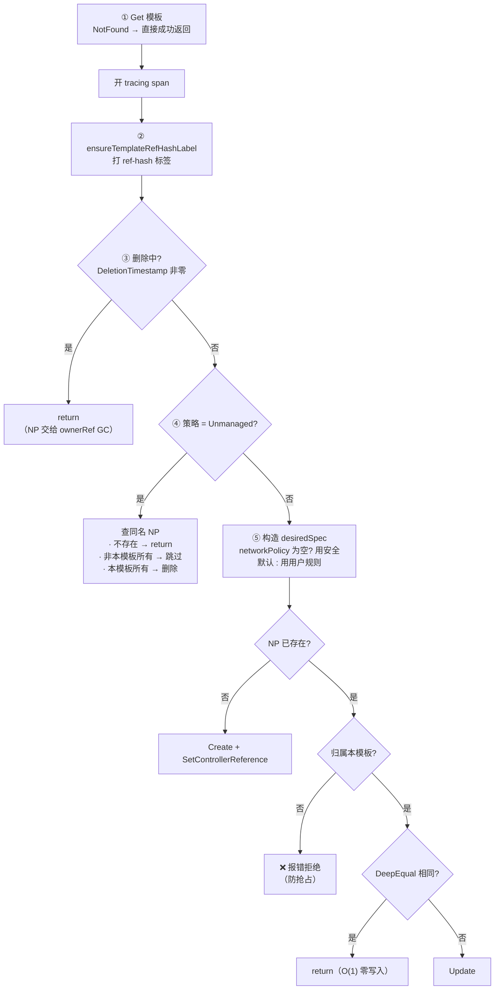

### 预热池SandboxWarmPool

预热池是加快用户调用沙箱响应时间的关键。没有预热池，只能冷启动沙箱，耗时较长，秒级。

冷启动链路：

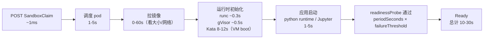

而预热池，先预先创建好沙箱，用户需要沙箱时直接从预热池中领取即可。耗时短，可压缩到毫秒级。当前预热池也是有代价的，预热池会占用资源，即使当前没有在使用也会占用额定的资源。

#### SandboxWarmPool定义

`SandboxWarmPool`定义：

- `Replica`: 预热池中沙箱的数量，默认1个。
- `SandboxTemplateRef`: 引用的沙箱模板SandboxTemplate，必填。
- `SandboxWarmPoolUpdateStrategy`： 控制池如何替换其陈旧的沙箱。当由所引用的SandboxTemplate推导出的有效 SandboxBlueprint（或 sandboxTemplateRef 的名称）发生变化时，该沙箱被视为陈旧；仅元数据变更（注解或标签）不会使沙箱陈旧，也永远不会触发替换。它只作用于仍归池所有（即未被领养）的沙箱。一旦某个沙箱被SandboxClaim领养，所有权即转移到该claim，池便不再管理或替换它。默认为OnReplenish。
  - OnReplenish： 会原地保留陈旧的、未被领养的沙箱。只有当该沙箱被手动删除，或被SandboxClaim领养（这会将其从池中移除并触发补充）时，陈旧的沙箱才会被替换为全新的一个。已被领养的沙箱永远不会被触碰。
  - Recreate： 会立即删除陈旧的、未被领养的沙箱，使池中只保留与当前模板匹配的全新沙箱。已被领养的沙箱永远不会被触碰。该策略仅对模板中 SandboxBlueprint 的变更生效。对注解、标签或模板级策略的变更不会触发重建。

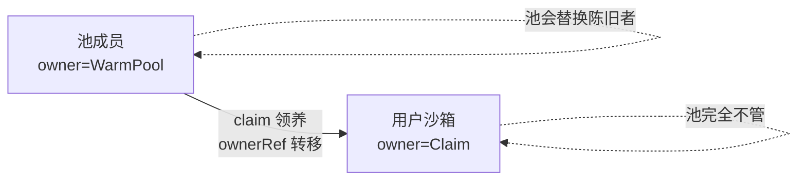

示例：

```yaml
apiVersion: extensions.agents.x-k8s.io/v1beta1
kind: SandboxWarmPool
metadata:
  name: ubuntu-sandbox-pool
  namespace: agent-sandbox-test
spec:
  replicas: 2
  # 名称必须与上面 SandboxTemplate.metadata.name 完全一致，且同 namespace
  sandboxTemplateRef:
    name: ubuntu-sandbox-template
  # updateStrategy.type：模板蓝图变更后如何替换池内陈旧的预热沙箱
  #   OnReplenish（默认）：陈旧成员留在池里继续被领养，等被领走或删除后
  #                        补货时才用新蓝图创建
  #   Recreate          ：立即删除陈旧成员并按新蓝图重建（修安全问题用这个）
  # 注意：只对 SandboxBlueprint（podTemplate / volumeClaimTemplates / service）
  #       的变更生效；改注解、标签或模板级策略都不会触发替换。
  updateStrategy:
    type: OnReplenish

```

#### 控制器

预热池控制器，需要解决如何使预热池中保持额定数量的沙箱。预热池如何进行沙箱数量的增减，当沙箱模板变更时，预热池如何对陈旧沙箱进行变更，当用户沙箱被领养时，如何将沙箱从预热池中移除，如何补充沙箱数量。当预热池中的沙箱数量特别大时，以及当用户大量进行Claim时，如何进行平衡，使得预热池补充沙箱减少对用户正在进行沙箱的领养的影响。例如当用户从预热池申领了一批沙箱后，预热沙箱池并不是立刻就进行补充，而是延迟补充沙箱，并不一次性同时补充大量沙箱，而是让补充沙箱的过程变成平滑的流。给与一个参数配置，补位沙箱的最高补位速率（每秒创建沙箱的个数）。

控制器核心逻辑：

1. 确保预热池中有指定数量的沙箱，按照指定的策略去确保，如果当前沙箱数量不足，则进行补位，如果沙箱数量多了则删除一定数量的沙箱，正常情况下，补位的情况更多，需要根据补位策略进行补位，例如给正在申领的Claim让路，延迟补位，限制补位速率等。
2. 当沙箱模板发生变更时，按照指定的策略，更新预热池中的沙箱

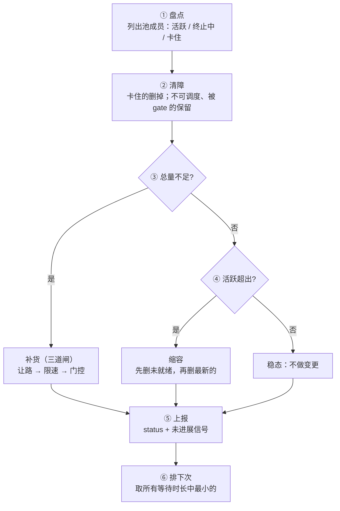

创建沙箱的核心调用栈：

```go
// 预热池控制器调谐
SandboxWarmPoolReconciler.Reconcile(ctx context.Context, req ctrl.Request)
--> SandboxWarmPoolReconciler.reconcilePool(ctx, warmPool)
        // 根据沙箱模板SandboxTemplate（包括Pod template, volume claim template，NetworkPolicy等）构造沙箱CR
    --> SandboxWarmPoolReconciler.buildSandboxCR(warmPool, poolNameHash, template, currentPodTemplateHash, currentSandboxBlueprintHash)
        --> SandboxWarmPoolReconciler.createPoolSandbox(ctx, warmPool, sandboxCR)
            --> SandboxWarmPoolReconciler.Create(ctx, sandbox)
// k8s控制器调谐，生成Pod等资源

```

查看日志：

```json
kubectl logs -n agent-sandbox-system deploy/agent-sandbox-controller   | grep ubuntu-sandbox-pool | jq .
{
  "level": "info",
  "ts": "2026-10-29T05:21:59Z",
  "msg": "Pool status",
  "controller": "sandboxwarmpool",
  "controllerGroup": "extensions.agents.x-k8s.io",
  "controllerKind": "SandboxWarmPool",
  "SandboxWarmPool": {
    "name": "ubuntu-sandbox-pool",
    "namespace": "agent-sandbox-test"
  },
  "namespace": "agent-sandbox-test",
  "name": "ubuntu-sandbox-pool",
  "reconcileID": "ea5464f6-6cf1-4dff-9142-d84192d34974",
  "desired": 2,
  "current": 0,
  "terminating": 0,
  "unschedulable": 0,
  "poolName": "ubuntu-sandbox-pool",
  "poolNameHash": "389e64c1"
}
{
  "level": "info",
  "ts": "2026-10-29T05:21:59Z",
  "msg": "Creating new pool sandboxes",
  "controller": "sandboxwarmpool",
  "controllerGroup": "extensions.agents.x-k8s.io",
  "controllerKind": "SandboxWarmPool",
  "SandboxWarmPool": {
    "name": "ubuntu-sandbox-pool",
    "namespace": "agent-sandbox-test"
  },
  "namespace": "agent-sandbox-test",
  "name": "ubuntu-sandbox-pool",
  "reconcileID": "ea5464f6-6cf1-4dff-9142-d84192d34974",
  "count": 2
}
{
  "level": "info",
  "ts": "2026-10-29T05:21:59Z",
  "msg": "Created new pool sandbox",
  "controller": "sandboxwarmpool",
  "controllerGroup": "extensions.agents.x-k8s.io",
  "controllerKind": "SandboxWarmPool",
  "SandboxWarmPool": {
    "name": "ubuntu-sandbox-pool",
    "namespace": "agent-sandbox-test"
  },
  "namespace": "agent-sandbox-test",
  "name": "ubuntu-sandbox-pool",
  "reconcileID": "ea5464f6-6cf1-4dff-9142-d84192d34974",
  "sandbox": "ubuntu-sandbox-pool-qqn2x",
  "poolName": "ubuntu-sandbox-pool"
}
{
  "level": "info",
  "ts": "2026-10-29T05:21:59Z",
  "msg": "Created new pool sandbox",
  "controller": "sandboxwarmpool",
  "controllerGroup": "extensions.agents.x-k8s.io",
  "controllerKind": "SandboxWarmPool",
  "SandboxWarmPool": {
    "name": "ubuntu-sandbox-pool",
    "namespace": "agent-sandbox-test"
  },
  "namespace": "agent-sandbox-test",
  "name": "ubuntu-sandbox-pool",
  "reconcileID": "ea5464f6-6cf1-4dff-9142-d84192d34974",
  "sandbox": "ubuntu-sandbox-pool-v9zg5",
  "poolName": "ubuntu-sandbox-pool"
}
{
  "level": "info",
  "ts": "2026-10-29T05:21:59Z",
  "msg": "Creating a new PVC",
  "controller": "sandbox",
  "controllerGroup": "agents.x-k8s.io",
  "controllerKind": "Sandbox",
  "Sandbox": {
    "name": "ubuntu-sandbox-pool-v9zg5",
    "namespace": "agent-sandbox-test"
  },
  "namespace": "agent-sandbox-test",
  "name": "ubuntu-sandbox-pool-v9zg5",
  "reconcileID": "68ca447d-3b7f-4e00-85b2-948f417bde63",
  "PVC.Namespace": "agent-sandbox-test",
  "PVC.Name": "sandbox-workdir-ubuntu-sandbox-pool-v9zg5"
}
{
  "level": "info",
  "ts": "2026-10-29T05:21:59Z",
  "msg": "Updated SandboxWarmPool status",
  "controller": "sandboxwarmpool",
  "controllerGroup": "extensions.agents.x-k8s.io",
  "controllerKind": "SandboxWarmPool",
  "SandboxWarmPool": {
    "name": "ubuntu-sandbox-pool",
    "namespace": "agent-sandbox-test"
  },
  "namespace": "agent-sandbox-test",
  "name": "ubuntu-sandbox-pool",
  "reconcileID": "ea5464f6-6cf1-4dff-9142-d84192d34974",
  "replicas": 0,
  "readyReplicas": 0
}
{
  "level": "info",
  "ts": "2026-10-29T05:21:59Z",
  "msg": "Pool status",
  "controller": "sandboxwarmpool",
  "controllerGroup": "extensions.agents.x-k8s.io",
  "controllerKind": "SandboxWarmPool",
  "SandboxWarmPool": {
    "name": "ubuntu-sandbox-pool",
    "namespace": "agent-sandbox-test"
  },
  "namespace": "agent-sandbox-test",
  "name": "ubuntu-sandbox-pool",
  "reconcileID": "b069f6c6-3a05-4a9b-ad43-6710023280b7",
  "desired": 2,
  "current": 2,
  "terminating": 0,
  "unschedulable": 0,
  "poolName": "ubuntu-sandbox-pool",
  "poolNameHash": "389e64c1"
}
{
  "level": "info",
  "ts": "2026-10-29T05:21:59Z",
  "msg": "Updated SandboxWarmPool status",
  "controller": "sandboxwarmpool",
  "controllerGroup": "extensions.agents.x-k8s.io",
  "controllerKind": "SandboxWarmPool",
  "SandboxWarmPool": {
    "name": "ubuntu-sandbox-pool",
    "namespace": "agent-sandbox-test"
  },
  "namespace": "agent-sandbox-test",
  "name": "ubuntu-sandbox-pool",
  "reconcileID": "b069f6c6-3a05-4a9b-ad43-6710023280b7",
  "replicas": 2,
  "readyReplicas": 0
}
{
  "level": "info",
  "ts": "2026-10-29T05:21:59Z",
  "msg": "Pool status",
  "controller": "sandboxwarmpool",
  "controllerGroup": "extensions.agents.x-k8s.io",
  "controllerKind": "SandboxWarmPool",
  "SandboxWarmPool": {
    "name": "ubuntu-sandbox-pool",
    "namespace": "agent-sandbox-test"
  },
  "namespace": "agent-sandbox-test",
  "name": "ubuntu-sandbox-pool",
  "reconcileID": "5efee12d-fdfb-4745-85aa-71261c8eeefe",
  "desired": 2,
  "current": 2,
  "terminating": 0,
  "unschedulable": 0,
  "poolName": "ubuntu-sandbox-pool",
  "poolNameHash": "389e64c1"
}
{
  "level": "info",
  "ts": "2026-10-29T05:21:59Z",
  "msg": "Creating a new Pod",
  "controller": "sandbox",
  "controllerGroup": "agents.x-k8s.io",
  "controllerKind": "Sandbox",
  "Sandbox": {
    "name": "ubuntu-sandbox-pool-v9zg5",
    "namespace": "agent-sandbox-test"
  },
  "namespace": "agent-sandbox-test",
  "name": "ubuntu-sandbox-pool-v9zg5",
  "reconcileID": "68ca447d-3b7f-4e00-85b2-948f417bde63",
  "Pod.Namespace": "agent-sandbox-test",
  "Pod.Name": "ubuntu-sandbox-pool-v9zg5"
}
{
  "level": "info",
  "ts": "2026-10-29T05:21:59Z",
  "msg": "Found Pod",
  "controller": "sandbox",
  "controllerGroup": "agents.x-k8s.io",
  "controllerKind": "Sandbox",
  "Sandbox": {
    "name": "ubuntu-sandbox-pool-v9zg5",
    "namespace": "agent-sandbox-test"
  },
  "namespace": "agent-sandbox-test",
  "name": "ubuntu-sandbox-pool-v9zg5",
  "reconcileID": "4d73bf8f-f8b0-4bc6-8739-a423783e731f",
  "Pod.Namespace": "agent-sandbox-test",
  "Pod.Name": "ubuntu-sandbox-pool-v9zg5"
}
{
  "level": "info",
  "ts": "2026-10-29T05:21:59Z",
  "msg": "Found Pod",
  "controller": "sandbox",
  "controllerGroup": "agents.x-k8s.io",
  "controllerKind": "Sandbox",
  "Sandbox": {
    "name": "ubuntu-sandbox-pool-v9zg5",
    "namespace": "agent-sandbox-test"
  },
  "namespace": "agent-sandbox-test",
  "name": "ubuntu-sandbox-pool-v9zg5",
  "reconcileID": "7f856ed0-7468-4545-bc9a-1a546822905f",
  "Pod.Namespace": "agent-sandbox-test",
  "Pod.Name": "ubuntu-sandbox-pool-v9zg5"
}
{
  "level": "info",
  "ts": "2026-10-29T05:21:59Z",
  "msg": "Pool status",
  "controller": "sandboxwarmpool",
  "controllerGroup": "extensions.agents.x-k8s.io",
  "controllerKind": "SandboxWarmPool",
  "SandboxWarmPool": {
    "name": "ubuntu-sandbox-pool",
    "namespace": "agent-sandbox-test"
  },
  "namespace": "agent-sandbox-test",
  "name": "ubuntu-sandbox-pool",
  "reconcileID": "1f676377-2ba4-43a4-8681-1aec605ed2e6",
  "desired": 2,
  "current": 2,
  "terminating": 0,
  "unschedulable": 0,
  "poolName": "ubuntu-sandbox-pool",
  "poolNameHash": "389e64c1"
}
{
  "level": "info",
  "ts": "2026-10-29T05:21:59Z",
  "msg": "Creating a new PVC",
  "controller": "sandbox",
  "controllerGroup": "agents.x-k8s.io",
  "controllerKind": "Sandbox",
  "Sandbox": {
    "name": "ubuntu-sandbox-pool-qqn2x",
    "namespace": "agent-sandbox-test"
  },
  "namespace": "agent-sandbox-test",
  "name": "ubuntu-sandbox-pool-qqn2x",
  "reconcileID": "483c1389-47cf-45ef-9c8a-28e64e5c2473",
  "PVC.Namespace": "agent-sandbox-test",
  "PVC.Name": "sandbox-workdir-ubuntu-sandbox-pool-qqn2x"
}
{
  "level": "info",
  "ts": "2026-10-29T05:21:59Z",
  "msg": "Creating a new Pod",
  "controller": "sandbox",
  "controllerGroup": "agents.x-k8s.io",
  "controllerKind": "Sandbox",
  "Sandbox": {
    "name": "ubuntu-sandbox-pool-qqn2x",
    "namespace": "agent-sandbox-test"
  },
  "namespace": "agent-sandbox-test",
  "name": "ubuntu-sandbox-pool-qqn2x",
  "reconcileID": "483c1389-47cf-45ef-9c8a-28e64e5c2473",
  "Pod.Namespace": "agent-sandbox-test",
  "Pod.Name": "ubuntu-sandbox-pool-qqn2x"
}

// ...
```

### 申领沙箱SandboxClaim

用户通过`SandboxClaim`申领沙箱。申领沙箱时需要指定预热池，即从哪个预热池中申领沙箱。

#### 定义

`SandboxClain`定义：

- `SandboxWarmPoolRef` : 指定引用的预热池，从哪个预热池申领沙箱
- `Lifecycle`: 生命周期，何时以及何种策略关闭`SandboxClaim`
- `Env`： 定义要注入到沙箱中的环境变量列表
- `VolumeClaimTemplates`:  指定要为该沙箱创建的持久卷申请（PVC）列表。 指定该字段会强制冷启动，因为预热池中的pod没有这些卷。

示例：

```yaml
apiVersion: extensions.agents.x-k8s.io/v1beta1
kind: SandboxClaim
metadata:
  name: ubuntu-claim-1
  namespace: agent-sandbox-test
spec:
  # 必填：从哪个池领沙箱。必须与池同 namespace，且名称完全一致。
  warmPoolRef:
    name: ubuntu-sandbox-pool

  # ---------------------------------------------------------------------------
  # 以下均为可选字段，默认全部不写即可。取消注释后即为"进阶用法"。
  # 注意：env 与 volumeClaimTemplates 都会让你放弃热领养 → 强制冷启动。
  # ---------------------------------------------------------------------------

  # ① 生命周期：何时过期、过期后怎么收尾
  lifecycle:
  #   # 绝对到期时间（RFC3339）。到点后控制器会删除底层 Sandbox 资源。
  #   # 不写 = claim 永不过期（沙箱长期占用池容量，最常见的资源泄漏来源）。
    shutdownTime: "2026-10-30T12:00:00Z"
  #
  #   # 任务结束（Sandbox 的 Finished 条件为 True）后再保留多久，单位秒。
    ttlSecondsAfterFinished: 600
  #
  #   # 过期后 claim 对象本身怎么处理：
  #   #   Retain（默认）：拆掉 Sandbox/Pod/Service，但保留 claim 对象
  #   #                   （status 显示 Expired，便于审计与查历史）
  #   #   Delete        ：直接删 claim，级联删除 Sandbox
  #   #   DeleteForeground：等底层资源彻底清理完才删 claim，
  #   #                     期间可用"对象是否还存在"观测关闭进度
    shutdownPolicy: Retain
```

#### 控制器

SandboxClaim控制器，核心逻辑：

1. 给用户一个满足条件的沙箱。如果满足条件，就从预热池中申领一个沙箱，如果不满足条件，则进行冷启动，创建一个沙箱。

- 这里面有较多细节，比如，如果用户注册了环境变量或新声明了PVC则进行冷启动。
- 从预热池中领养沙箱
  - 移除warmpool标签，使该sandbox不再出现在预热池的查询结果中
  - 移除warmpool的默认驱逐注解，使领养后的sandbox在承载活跃状态后不会被集群自动扩缩容缩容掉。
  - 把所有权从 SandboxWarmPool 转移给 SandboxClaim

2. 判断当前SandboxClaim是否到期，如果到期，则按照预定策略进行删除操作。

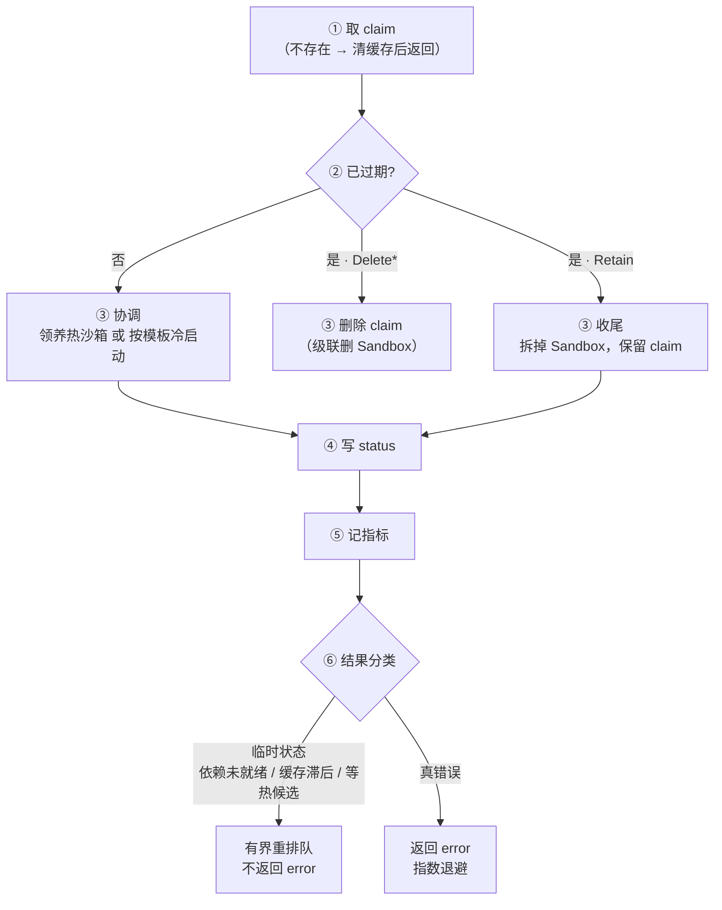

核心流程：

```go
SandboxClaimReconciler.Reconcile(ctx context.Context, req ctrl.Request)
--> SandboxClaimReconciler.reconcileActive(ctx, claim)
        // 优先从预热池领养
    --> SandboxClaimReconciler.getOrCreateSandbox(ctx, claim, nil)
        // 如果没有预热池候选者，则引用沙箱模板以及Claim声明冷启动创建沙箱
    --> SandboxClaimReconciler.createSandbox(ctx, claim, template)
```

`reconcileActive`的核心流程：

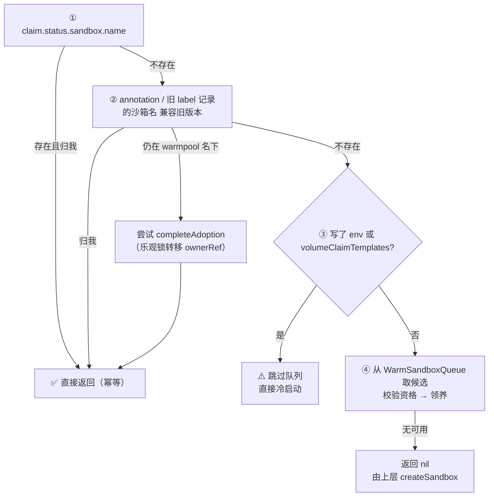

### 沙箱Sandbox

沙箱Sandbox是一个有稳定身份，有生命周期的相对安全的隔离的运行环境，是对一种为适应Agent工作负载的抽象。

#### 定义

`Sandbox`：

- `PodTemplate`: 将在沙箱中创建的Pod
- `VolumeClaimTemplates` : sandbox pod 允许引用的 claim 列表。创建 sandbox 时，会根据这些模板创建 PVC。
- `Service`:  为Sandbox 工作负载自动创建一个headless Service
- `Lifecycle`: 沙箱何时关闭。
  - `ShutdownTime`： Sandbox到期的绝对时间。当到期后控制器会删除沙箱的底层资源（Pod，Service），然后对Sandbox对象本身应用shutdownPolicy。若未设置，Sandbox永不过期，会一直存在到被显式删除。
  - `ShutdownPolicy`: shutdownPolicy 决定 Sandbox 对象本身在过期时（即到达
    shutdownTime 时）会怎样。无论该策略如何，底层资源（Pod、Service）在过期时总会被删除；shutdownPolicy 只管辖Sandbox 对象
    - Retain（默认）：资源被拆除后保留Sandbox对象。其live status字段会被清空，并设置reason为SandboxExpired的Ready=False条件，使过期状态可被观测。
    - Delete：底层资源移除后，Sandbox 对象也会被删除。
- `OperatingMode`: 指定Sandbox的期望运行状态
  - Running(默认值)： 控制器会保持一个Pod处于运行状态。
  - Suspended: 挂起，暂停，终止后端Pod，但保留Sandbox对象及其卷，以便之后恢复。

示例：

```yaml
---
apiVersion: agents.x-k8s.io/v1beta1
kind: Sandbox
metadata:
  name: demo-sandbox
  namespace: agent-sandbox-test
spec:
  podTemplate:
    metadata:
      labels:
        app: demo-sandbox
    spec:
      # 无 API 访问需求 → 不要挂载 SA token（裸用路径控制器不会自动置 false，需自己写）
      automountServiceAccountToken: false
      # 集群已装 Kata（kubectl get runtimeclass）。
      # 想要"硬件级隔离"用它；不需要隔离就删掉这行，走默认 runc。
      #   gvisor / kata-qemu / kata-clh / kata-dragonball / kata-fc
      runtimeClassName: kata-dragonball
      # 没装 Kata/runsc 时删掉上面这行；OnFailure 对 sleep 与 Always 等价
      restartPolicy: OnFailure
      securityContext:
        seccompProfile:
          type: RuntimeDefault
      containers:
        - name: sandbox
          # 节点上已有该镜像（imagePullPolicy: IfNotPresent，无外网也能起）
          image: ubuntu:24.04
          imagePullPolicy: IfNotPresent
          command: ["/bin/bash", "-lc"]
          args:
            - |
              # 先落就绪标记，再做"业务初始化"（装包、拉代码、起 agent 进程…）
              touch /tmp/.ready
              echo "sandbox $(hostname) ready at $(date)"
              exec sleep infinity
          readinessProbe:
            # 裸镜像没有监听端口 → 只能用 exec 探针（tcpSocket 不可用）
            exec:
              command: ["test", "-f", "/tmp/.ready"]
            periodSeconds: 2
            failureThreshold: 3
          resources:
            requests:
              cpu: "250m"
              # Kata 下每个 Pod 是一台轻量 VM，内存开销高于普通容器
              memory: "1Gi"
            limits:
              cpu: "2"
              memory: "2Gi"
          securityContext:
            allowPrivilegeEscalation: false
            capabilities:
              drop: ["ALL"]

  # ---------------------------------------------------------------------------
  # 以下均为可选，默认不写。取消注释即为进阶用法。
  # ---------------------------------------------------------------------------

  # ① 是否创建 headless Service（三态）：
  #   不写   → 保留已有 Service（向后兼容），不新建
  #   true   → 创建，名字 = Sandbox 名；status.service / serviceFQDN 才有值
  #   false  → 显式禁用并删除该 Service
  # 注意：开 Service 后名字会作为 DNS label，必须 <= 63 字符（API 有 CEL 校验）。
  # service: true

  # ② 挂载持久卷
  # PVC 命名规则为 <这里 name>-<sandbox 名>，例如 data-demo-sandbox。
  # ⚠️ 本集群 local-path 不是默认 StorageClass，必须显式写 storageClassName，
  #    否则 PVC 会永久 Pending，Pod 起不来。
  # ⚠️ volumeClaimTemplates 创建后不可修改（API 层 CEL 强制不可变）。
  # volumeClaimTemplates:
  #   - metadata:
  #       name: data
  #     spec:
  #       storageClassName: local-path
  #       accessModes: ["ReadWriteOnce"]
  #       resources:
  #         requests:
  #           storage: 1Gi

  # ③ 生命周期：何时到期、到期后对象怎么处理
  # ⚠️ 层级陷阱：Sandbox 的 Lifecycle 在 Go 里是【匿名内嵌 + json:",inline"】的，
  #    两个字段直接挂在 spec 下，没有 lifecycle 这一层。
  #    写成 spec.lifecycle.xxx 会报 unknown field "spec.lifecycle"。
  #    （对比 SandboxClaim：那边是命名字段，才写作 spec.lifecycle.shutdownTime）
  shutdownTime: "2026-10-29T17:00:00Z"   # RFC3339 绝对时间；不写则永不过期
  shutdownPolicy: Delete                 # Retain（默认，保留对象便于审计）/ Delete
  # 到期的执行顺序：先无条件拆 Pod 与 Service，再按 shutdownPolicy 处理对象本身。

  # ④ 主动暂停（不是删除！）
  # 拆掉 Pod，但保留 Sandbox 对象与卷，之后改回 Running 即可恢复、数据仍在。
  # operatingMode: Suspended


```

应用后，查看Sandbox创建情况：

```sh
postgres$ kubectl get sandbox -n agent-sandbox-test 
NAME                        READY   REASON              AGE
demo-sandbox                True    DependenciesReady   6m44s
ubuntu-sandbox-pool-qqn2x   True    DependenciesReady   162m
ubuntu-sandbox-pool-v9zg5   True    DependenciesReady   162m
ubuntu-sandbox-pool-wt65h   True    DependenciesReady   56m
```

查看Pod:

```sh
sandbox$ kubectl get pods -n agent-sandbox-test 
NAME                        READY   STATUS    RESTARTS   AGE
demo-sandbox                1/1     Running   0          4m39s
ubuntu-sandbox-pool-qqn2x   1/1     Running   0          160m
ubuntu-sandbox-pool-v9zg5   1/1     Running   0          160m
ubuntu-sandbox-pool-wt65h   1/1     Running   0          54m
```

将`operatingMode`设置为Suspended后

```sh
postgres$ kubectl get sandbox -n agent-sandbox-test 
NAME                        READY   REASON              AGE
demo-sandbox                False   SandboxSuspended    7m14s
```

观察Pod，Pod已被删除

```sh
postgres$ kubectl get pods -n agent-sandbox-test 
NAME                        READY   STATUS    RESTARTS   AGE
ubuntu-sandbox-pool-qqn2x   1/1     Running   0          163m
ubuntu-sandbox-pool-v9zg5   1/1     Running   0          163m
ubuntu-sandbox-pool-wt65h   1/1     Running   0          57m
```

#### 控制器

核心是构造Sandbox，运行一个沙箱。

1. 判断沙箱是否到期，如果到期，则按相关逻辑进行处理，
2. 根据沙箱声明生成Sandbox，构造相关子资源，例如Pod，PVC等
3. 根据沙箱状态判断是应该暂停还是恢复，如果暂停，则关闭Pod，保留Sandbox，如果是恢复，则运行Pod。

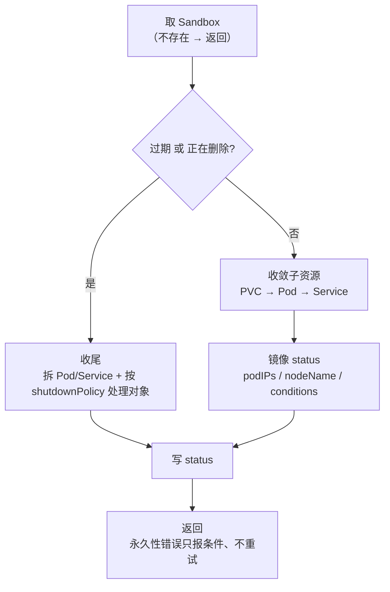

核心流程：

```go
SandboxReconciler.Reconcile(ctx context.Context, req ctrl.Request)
--> checkSandboxExpiry(sandbox, time.Now())  // 检查Sandbox是否过期
    if expired  // 如果过期了
       r.handleSandboxExpiry(ctx, sandbox)  // Delete Pod，Service, 根据关闭策略决定是否删除Sandbox资源本身
    else
      r.reconcileChildResources(ctx, sandbox, wd) // 调谐沙箱的各子资源
      --> r.reconcilePVCs(ctx, sandbox, nameHash)  // 调谐PVC
      --> r.reconcilePod(ctx, sandbox, nameHash, wd) // 调谐Pod
      --> r.reconcileService(ctx, sandbox, nameHash) // 调谐Service
```

### 沙箱运行时sandboxd

`sandboxd`是由KEP-539.2定义的可移植沙箱运行时守护进程。它运行在沙箱 Pod 内，并暴露混合运行时 API：

```
sandboxd (runtime daemon)
├── gRPC  :9090  →  ProcessService    (streaming process I/O)
└── HTTP  :8080  →  FilesystemService (stateless file operations & runtime probes)
```

沙箱内的守护进程，沙箱内运行时API，是客户端SDK与由 `agent-sandbox` 管理的隔离沙箱运行时之间的交互接口。

> KEP-539.2（agent-sandbox提议的沙箱运行时接口标准）对标E2B的envd以及OpenSandbox的execd。实现进程执行、流式IO、文件操作等功能。目前各产品的功能渐进趋同。也是后续可能的开发点之一，增加功能或直接运行其他运行时。

沙箱运行时接口标准定义了Agent与沙箱内部的交互接口——执行命令、读写文件等。直接决定了SDK是否能够通用，否则用户会被绑定在特定运行时实现上。Agent应当能够说"运行这段代码"或"读取这个文件"，而无需关心沙箱是本地Docker容器、GKE 上安全的 gVisor Pod，还是 Firecracker microVM。

核心能力如下：
**核心执行**

- `Run(command string) -> Result`：执行 shell 命令。
- `Kill(sessionId string)`：终止正在运行的进程。
- `StreamOutput(sessionId string) -> Stream`：实时流式传输 `stdout`/`stderr`。
- `StreamInput(sessionId string, data bytes)`：向正在运行的进程发送输入（`stdin`）。

**文件系统操作**

- `Write(path string, content bytes)`：上传/写入文件。
- `Read(path string) -> bytes`：下载/读取文件。
- `List(path string) -> []FileEntry`：列出目录内容及元数据。
- `Stat(path string) -> FileMetadata`：获取文件详细信息。
- `Watch(path string) -> Stream[WatchEvent]`：订阅实时文件系统变更（对工作区同步至关重要）。

**有状态代码解释（Jupyter）**
与原始进程执行不同，AI agent 经常需要在共享的有状态上下文中执行 Python 代码片段。我们提议对以下能力提供一等支持：

- `CreateContext() -> ContextId`：初始化一个有状态的执行会话（例如附加到 Jupyter kernel）。
- `ExecuteCode(ContextId, code string) -> ExecutionResult`：在该上下文中运行代码，并返回丰富的输出（文本、图像、图表）。

sandboxd可以作为Sandbox的专用运行时容器，也可以注入到现有的应用镜像中。独立的sidecar并不推荐，命令在该sidecar内运行，无法使用相邻容器中的二进制文件；容器共享Pod网络和挂载的卷，但不共享根文件系统。即将sandboxd部署到哪里，决定了你的命令在哪里执行以及由哪些可用的二进制。推荐的用法是Agent调用的工具存在于哪个容器中，就将sandboxd部署到哪个容器中。

#### 使用方式：重建镜像

对于简单的场景，sandboxd可直接作为Pod的主容器运行，命令在sandboxd自己的容器里执行。

但对复杂场景或大多数场景，需要重建镜像。sandboxd基础镜像很精简，基础 sandboxd 镜像（debian:bookworm-slim）自带 shell 与 coreutils，但不含任何语言运行时。要添加工具，请基于 sandboxd 镜像构建你自己的镜像。

例如：

```docker
FROM us-central1-docker.pkg.dev/k8s-staging-images/agent-sandbox/sandboxd:latest-main
USER root
RUN apt-get update && apt-get install -y nodejs npm python3
USER 1000
```

对于复杂的任务执行，当sandboxd无法满足时，需要自己构建镜像。构建时需要将`FROM sandboxd` sandboxd构建进去。

这就相当于基于sandboxd去构建Agent的沙箱运行时，Agent需要在沙箱中调用的工具，代码执行环境都需要基于sandboxd镜像去重新构建。

```yaml
apiVersion: extensions.agents.x-k8s.io/v1beta1
kind: SandboxTemplate
metadata:
  name: sandboxd-template
  namespace: default
spec:
  podTemplate:
    spec:
      # The sandbox runs untrusted agent code; it needs no API access.
      automountServiceAccountToken: false
      restartPolicy: "OnFailure"
      securityContext:
        runAsNonRoot: true
        # Ensure the shared emptyDir is writable by the non-root runtime user.
        fsGroup: 1000
      containers:
        - name: sandboxd
          image: us-central1-docker.pkg.dev/k8s-staging-images/agent-sandbox/sandboxd:latest-main
          imagePullPolicy: IfNotPresent
          securityContext:
            runAsUser: 1000
            runAsGroup: 1000
            runAsNonRoot: true
            allowPrivilegeEscalation: false
            capabilities:
              drop:
                - ALL
          resources:
            requests:
              cpu: 100m
              memory: 128Mi
            limits:
              cpu: 500m
              memory: 512Mi
          ports:
            - containerPort: 8080  # REST filesystem + probes
            - containerPort: 9090  # gRPC ProcessService
          # sandboxd binds 0.0.0.0 (default), so the kubelet httpGet probe
          # reaches /v1/health on the pod network.
          readinessProbe:
            httpGet:
              path: /v1/health
              port: 8080
          volumeMounts:
            - name: workspace
              mountPath: /workspace
      # A co-located workload container may be added as a CLIENT of the
      # sandboxd API (reaching it over pod-local networking) — but note that
      # a shared volume shares files, not binaries: exec'd commands still run
      # in the sandboxd container above and cannot see a neighboring
      # container's tools. See deploy/README.md.
      volumes:
        - name: workspace
          emptyDir: {}
```

#### 使用方式：initContainer注入二进制

通过initContainer把sandboxd的二进制拷贝到共享卷，由你现有的、工具丰富的应用镜像把它作为command运行。无需对应用镜像做任何改动。代价：agent代码运行在你完整的应用镜像里， 并且 sandboxd 作为该容器的主进程（PID 1）运行。

```yaml
# Ubuntu 24.04 + 注入 sandboxd 的预热池示例（拓扑 B：不重建应用镜像）
#
# 思路：initContainer 把 sandboxd 二进制拷进共享卷，主容器用 ubuntu:24.04 的
#       文件系统 + 该二进制作为 PID 1。命令执行发生在主容器里，因此
#       agent 需要的工具必须在 ubuntu 镜像中（或用别的工具镜像替换 image）。
---
apiVersion: extensions.agents.x-k8s.io/v1beta1
kind: SandboxTemplate
metadata:
  name: ubuntu-sandbox-template
  namespace: agent-sandbox-test
spec:
  podTemplate:
    metadata:
      labels:
        app: ubuntu-sandbox
    spec:
      # 无 API 访问需求：控制器对模板供给的沙箱也会默认置 false，这里显式写出便于审阅
      automountServiceAccountToken: false
      # 主进程是 sandboxd（常驻不退出），OnFailure 足够；只有异常退出才重启
      restartPolicy: OnFailure
      # 集群内实际存在的 RuntimeClass（kubectl get runtimeclass）：
      #   kata-qemu / kata-clh / kata-dragonball / gvisor
      # 没有装 Kata/runsc 就把这一行删掉，用默认 runc。
      runtimeClassName: kata-dragonball
      securityContext:
        # Kata 下仍是 VM 边界，但保持非 root + 无提权是低成本的好习惯
        seccompProfile:
          type: RuntimeDefault
        # 持久卷由 local-path 供给，容器以 uid/gid 1000 运行，
        # 这里补齐卷的组权限，避免 /workspace 不可写
        fsGroup: 1000
      initContainers:
        # 唯一引用 sandboxd 镜像的地方：只把二进制拷进 emptyDir，
        # 应用镜像（下面的 ubuntu）本身不被修改。
        # 该镜像为本地构建产物（sandboxd 源码在 packages/sandboxd/）：
        #   CGO_ENABLED=0 go build -ldflags="-s -w" -o sandboxd ./packages/sandboxd/cmd/sandboxd
        #   镜像：FROM debian + COPY sandboxd /usr/local/bin/sandboxd
        # 已通过 ctr 导入 node2 / node3；GCR 的官方镜像在本网络不可达。
        - name: install-sandboxd
          image: docker.io/library/sandboxd-bin:local
          imagePullPolicy: IfNotPresent
          command: ["/bin/sh", "-c", "cp /usr/local/bin/sandboxd /sandboxd-bin/sandboxd"]
          securityContext:
            runAsUser: 1000
            runAsGroup: 1000
            runAsNonRoot: true
            allowPrivilegeEscalation: false
            capabilities:
              drop:
                - ALL
          resources:
            requests:
              cpu: 100m
              memory: 128Mi
            limits:
              cpu: 500m
              memory: 512Mi
          volumeMounts:
            - name: sandboxd-bin
              mountPath: /sandboxd-bin
      containers:
        - name: ubuntu
          image: ubuntu:24.04
          imagePullPolicy: IfNotPresent
          # 直接以注入的 sandboxd 作为主进程：REST :8080 + gRPC :9090
          command:
            - /sandboxd-bin/sandboxd
            - --root-dir=/workspace
            - --rest-port=8080
            - --grpc-port=9090
          securityContext:
            runAsUser: 1000
            runAsGroup: 1000
            runAsNonRoot: true
            allowPrivilegeEscalation: false
            capabilities:
              drop:
                - ALL
          resources:
            requests:
              cpu: 100m
              memory: 128Mi
            limits:
              cpu: 500m
              memory: 512Mi
          ports:
            - containerPort: 8080  # REST filesystem + probes
            - containerPort: 9090  # gRPC ProcessService
          readinessProbe:
            httpGet:
              path: /v1/health
              port: 8080
          volumeMounts:
            # 只读挂载：沙箱内执行的命令不得替换这个二进制
            # （否则会在下次容器重启时被执行）
            - name: sandboxd-bin
              mountPath: /sandboxd-bin
              readOnly: true
            # 挂持久卷；卷名必须等于 volumeClaimTemplates 里的 metadata.name，
            # 控制器会创建名为 <name>-<sandbox 名> 的 PVC 并注入同名 volume
            - name: sandbox-workdir
              mountPath: /workspace
      volumes:
        - name: sandboxd-bin
          emptyDir: {}
        # 注意：workspace 不再用 emptyDir，改由下面的 PVC 提供，保证数据持久

  # 每个 Sandbox 会按 <template 内的 name>-<sandbox 名> 创建独立 PVC。
  # 注意：Pool 里每个预热成员都会各自占一块卷，replicas 越大占用越多。
  # 必须显式写 storageClassName：本集群的 local-path 没有 is-default-class 注解，
  # 不写会永远停在 Pending，进而导致 sandbox Pod 无法启动。
  volumeClaimTemplates:
    - metadata:
        name: sandbox-workdir
      spec:
        storageClassName: local-path
        accessModes: ["ReadWriteOnce"]
        resources:
          requests:
            storage: 1Gi

  service: true

  # ==========================================================================
  # 模板级策略（SandboxTemplateSpec 顶层字段，与 podTemplate 同级）
  # 这 4 项都不在 SandboxBlueprint 里，因此改它们不会让池内已有沙箱被判为陈旧。
  # ==========================================================================

  # ① 谁管理 NetworkPolicy：Managed（默认）/ Unmanaged
  #   Managed  ：控制器确保存在一个共享 NP，PodSelector 由控制器填死（按 template hash）
  #   Unmanaged：控制器完全不建 NP（若之前建过则删除），交给 Cilium 等外部方案
  networkPolicyManagement: Managed

  # ② 共享 NetworkPolicy 的具体规则（受限子集：只能写 ingress / egress，
  #    podSelector 与 policyTypes 由控制器接管，不可在此指定）
  networkPolicy:
    ingress:
      # sandbox-router（HTTP 代理入口）
      - from:
          # namespaceSelector 与 podSelector 写在同一个数组元素里 = AND 关系
          - namespaceSelector:
              matchLabels:
                kubernetes.io/metadata.name: agent-sandbox-system
            podSelector:
              matchLabels:
                app: sandbox-router
      # 同 namespace 的客户端直连 sandboxd（SDK 的 in-cluster-service 模式）：
      # 只放行 8080（REST）与 9090（gRPC）。若客户端在别的 namespace，
      # 请把下面的 name 换成对应取值。
      - from:
          - namespaceSelector:
              matchLabels:
                kubernetes.io/metadata.name: agent-sandbox-test
        ports:
          - protocol: TCP
            port: 8080
          - protocol: TCP
            port: 9090
    egress:
      # 放行公网 IPv4，排除内网与元数据网段
      - to:
          - ipBlock:
              cidr: 0.0.0.0/0
              except:
                - 10.0.0.0/8
                - 172.16.0.0/12
                - 192.168.0.0/16
                - 169.254.0.0/16
      # 放行公网 IPv6
      - to:
          - ipBlock:
              cidr: ::/0
              except:
                - fc00::/7
                - fe80::/10
      # 放行集群内 DNS（CoreDNS 在 10.x，被上面的 except 排除，必须单独放行）
      - to:
          - namespaceSelector:
              matchLabels:
                kubernetes.io/metadata.name: kube-system
        ports:
          - protocol: UDP
            port: 53
          - protocol: TCP
            port: 53

  # ③ SandboxClaim 能否为本模板创建的 sandbox 设置环境变量（spec.env）
  #   Disallowed（默认）：禁止，claim 带 env 会被拒绝
  #   Allowed          ：只能新增模板未定义的变量，不能覆盖同名变量
  #   Overrides        ：可新增，也可覆盖模板已定义的同名变量
  #   ⚠️ env 在 Pod 创建前固化，因此真正带了 env 的 claim 会强制冷启动（10-30s），
  #      无法领养预热池；不带 env 的 claim 仍是亚秒级热领养。
  envVarsInjectionPolicy: Allowed

  # ④ SandboxClaim 能否注入/覆盖 volume claim template
  #   Disallowed（默认）：claim 指定任何 volumeClaimTemplates 就会被拒绝
  #   Allowed          ：可新增，不能覆盖模板已有的
  #   Overrides        ：可新增并覆盖
  #   本模板已定义 sandbox-workdir，且 PVC 不可回退，建议保持 Disallowed 以保住热领养。
  volumeClaimTemplatesPolicy: Disallowed
---
apiVersion: extensions.agents.x-k8s.io/v1beta1
kind: SandboxWarmPool
metadata:
  name: ubuntu-sandbox-pool
  namespace: agent-sandbox-test
spec:
  replicas: 2
  # 名称必须与上面 SandboxTemplate.metadata.name 完全一致，且同 namespace
  sandboxTemplateRef:
    name: ubuntu-sandbox-template

```

我们到沙箱中看一下：

```sh
postgres@slpc:~/works/opensource/agent-sandbox/dbnotes/kubernetes/sandbox$ kubectl get pods -n agent-sandbox-test 
NAME                        READY   STATUS    RESTARTS   AGE
ubuntu-sandbox-pool-95rpj   1/1     Running   0          111s
ubuntu-sandbox-pool-p9cxv   1/1     Running   0          74s
ubuntu-sandbox-pool-xgvzd   1/1     Running   0          69s
postgres@slpc:~/works/opensource/agent-sandbox/dbnotes/kubernetes/sandbox$ kubectl exec -it -n agent-sandbox-test ubuntu-sandbox-pool-xgvzd -- /bin/bash
Defaulted container "ubuntu" out of: ubuntu, install-sandboxd (init)
ubuntu@ubuntu-sandbox-pool-xgvzd:/$ ls
bin  boot  dev  etc  home  lib  lib64  media  mnt  opt  proc  root  run  sandboxd-bin  sbin  srv  sys  tmp  usr  var  workspace
ubuntu@ubuntu-sandbox-pool-xgvzd:/$ cd workspace/
ubuntu@ubuntu-sandbox-pool-xgvzd:/workspace$ ls
ubuntu@ubuntu-sandbox-pool-xgvzd:/workspace$ cd ..
ubuntu@ubuntu-sandbox-pool-xgvzd:/$ ls
bin  boot  dev  etc  home  lib  lib64  media  mnt  opt  proc  root  run  sandboxd-bin  sbin  srv  sys  tmp  usr  var  workspace
ubuntu@ubuntu-sandbox-pool-xgvzd:/$ cd sandboxd-bin/
ubuntu@ubuntu-sandbox-pool-xgvzd:/sandboxd-bin$ ls
sandboxd
ubuntu@ubuntu-sandbox-pool-xgvzd:/sandboxd-bin$ ps -ef
UID          PID    PPID  C STIME TTY          TIME CMD
ubuntu         1       0  0 06:41 ?        00:00:00 /sandboxd-bin/sandboxd --root-dir=/workspace --rest-port=8080 --grpc-port=9090
ubuntu         7       0  0 06:42 ?        00:00:00 /bin/bash
ubuntu        14       7 20 06:43 ?        00:00:00 ps -ef

```

查看归属，预热池2个，已被申领走1个：

```sh
postgres@slpc:~$ kubectl get sandboxes -A \
  -o custom-columns='NS:.metadata.namespace,NAME:.metadata.name,OWNER_KIND:.metadata.ownerReferences[0].kind,OWNER:.metadata.ownerReferences[0].name'
NS                   NAME                        OWNER_KIND        OWNER
agent-sandbox-test   ubuntu-sandbox-pool-95rpj   SandboxClaim      ubuntu-claim-1
agent-sandbox-test   ubuntu-sandbox-pool-p9cxv   SandboxWarmPool   ubuntu-sandbox-pool
agent-sandbox-test   ubuntu-sandbox-pool-xgvzd   SandboxWarmPool   ubuntu-sandbox-pool

```
