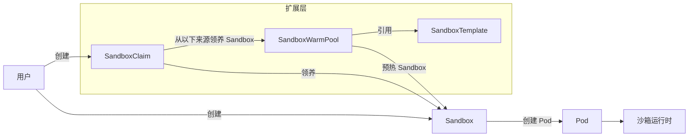
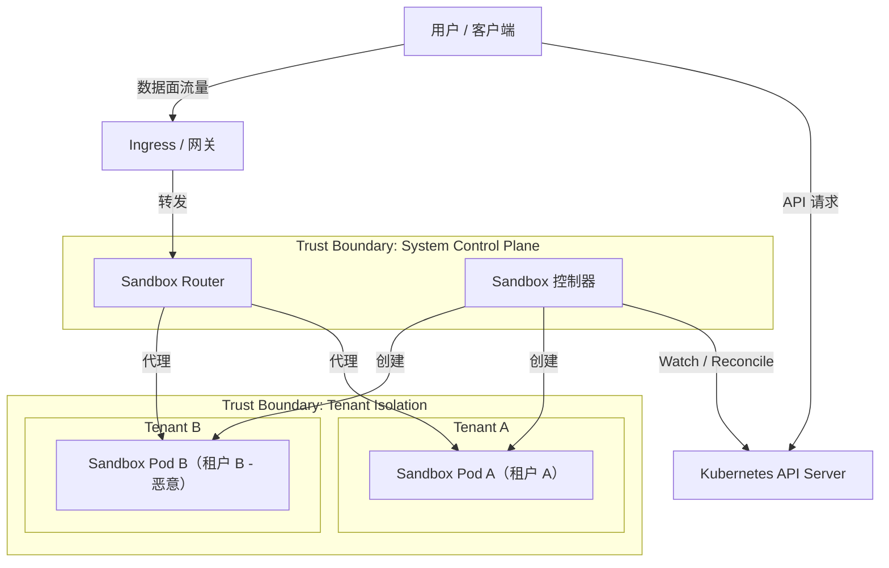
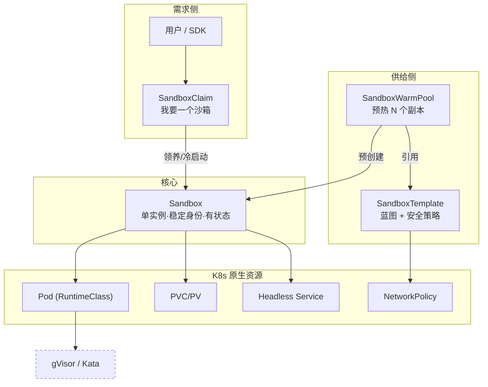
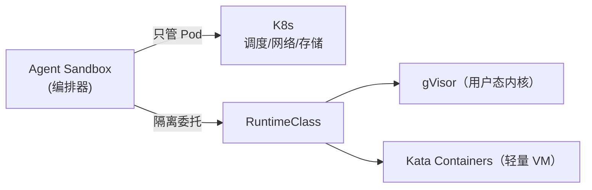

---

---

# agent-sandbox安装部署

**agent-sandbox 让隔离的、有状态的、单实例工作负载的管理变得简单，非常适用于 AI Agent 运行时、强化学习等场景。**

为 Kubernetes 开发一个 Sandbox 自定义资源定义（CRD）及其控制器。其目标是提供一套声明式的、标准化的 API，用于管理那些需要具备“长时间运行、有状态、单实例容器、稳定身份”等特征的工作负载——就像基于 Kubernetes 原语构建的轻量级单容器虚拟机体验。

Agent Sandbox是一个沙箱编排器（sandbox orchestrator）。它把底层的容器隔离委托给安全的“沙箱运行时”（如 gVisor 或 Kata Containers），方式是管理那些被配置为使用这些运行时的 Pod（通过 RuntimeClass）。

github: https://github.com/kubernetes-sigs/agent-sandbox.git
官网：https://agent-sandbox.sigs.k8s.io/

[gvisor](https://github.com/google/gvisor) :它是一个用户态内核（以 runsc 作为 OCI 运行时），在容器和宿主机内核之间加了一层隔离，提供比普通 runc 更强的沙箱边界

## 概述

### 核心：Sandbox

`Sandbox` CRD 是 agent-sandbox 的核心。它提供了一套声明式 API，用于管理单个具有稳定身份和持久存储的有状态 Pod。这非常适用于那些既不适合 Deployment 的无状态、副本化模型，也不适合 StatefulSet 的编号式、稳定模型的场景。

`Sandbox` CRD 的关键特性包括：

* **稳定身份（Stable Identity）：** 每个 Sandbox 都拥有稳定的主机名和网络身份。
* **持久存储（Persistent Storage）：** Sandbox 可配置持久存储，在重启后依然保留。
* **生命周期管理（Lifecycle Management）：** Sandbox 控制器管理 Pod 的生命周期，包括创建、按计划删除、暂停与恢复。

### 扩展（Extensions）

`extensions` 模块在核心 `Sandbox` API 之上提供了额外的 CRD 和控制器，以支持更高级的功能。

* `SandboxTemplate`：提供了一种定义可复用模板的方式，用于创建 Sandbox，便于管理大量相似的 Sandbox。
* `SandboxClaim`：允许用户从 `SandboxWarmPool` 创建 Sandbox，屏蔽了底层 Sandbox 配置的细节。
* `SandboxWarmPool`：管理一个由预热的 Sandbox 组成的池，可快速分配给用户，从而缩短新 Sandbox 启动就绪所需的时间。

## 架构

agent-sandbox 遵循 Kubernetes 控制器模式。用户创建 Sandbox 自定义资源，控制器负责管理底层的运行时资源。

### 架构图



## 安装agent-sandbox

标准安装（核心 + 扩展）

```sh
(base) postgres@slpc:~$ kubectl apply -f https://github.com/kubernetes-sigs/agent-sandbox/releases/latest/download/sandbox-with-extensions.yaml
namespace/agent-sandbox-system created
customresourcedefinition.apiextensions.k8s.io/sandboxclaims.extensions.agents.x-k8s.io created
customresourcedefinition.apiextensions.k8s.io/sandboxes.agents.x-k8s.io created    # 	核心 CRD：声明一个有稳定身份、有持久化、可暂停/恢复的单容器沙箱
customresourcedefinition.apiextensions.k8s.io/sandboxtemplates.extensions.agents.x-k8s.io created  # 扩展 CRD：模板化定义
customresourcedefinition.apiextensions.k8s.io/sandboxwarmpools.extensions.agents.x-k8s.io created  # 从预热池秒级认领
serviceaccount/agent-sandbox-controller created    # 预热 Pod 池
clusterrole.rbac.authorization.k8s.io/agent-sandbox-controller created
clusterrole.rbac.authorization.k8s.io/agent-sandbox-controller-extensions created
clusterrolebinding.rbac.authorization.k8s.io/agent-sandbox-controller created
clusterrolebinding.rbac.authorization.k8s.io/agent-sandbox-controller-extensions created
service/agent-sandbox-controller created
deployment.apps/agent-sandbox-controller created  # 控制器Deployment
```

预热池（WarmPool）是 Agent Sandbox 的核心卖点——把冷启动从"调度+拉镜像+建容器"的秒级压缩到毫秒级认领。

安装后，创建第一个 Sandbox

```yaml
apiVersion: agents.x-k8s.io/v1beta1
kind: Sandbox
metadata:
  name: my-sandbox
spec:
  podTemplate:
    spec:
      containers:
      - name: python
        image: python:3.12-slim
        command: ["sleep", "3600"]
```

```sh
kubectl apply -f sandbox.yaml

# 查看 Sandbox 状态与生成的 Pod
kubectl get sandbox my-sandbox
kubectl get pod -l agents.x-k8s.io/sandbox=my-sandbox
```

Agent Sandbox 本身只是编排层——它管理的是带 RuntimeClass 的 Pod，真正的内核级隔离来自底层选用的沙箱运行时（gVisor 或 Kata Containers）。如果集群节点上没装这两个之一，Pod 会回退到普通 runc 运行，隔离强度只剩容器命名空间级别，跑不可信代码（AI Agent 生成的任意执行）时风险明显放大。

`kubectl get runtimeclass` 可查看节点上可用的运行时；如果为空或只有 runc，建议在节点上安装 gVisor（runsc）或 Kata Containers（kata）后再配置 spec.podTemplate.spec.runtimeClassName 指定。这一步与前面几轮聊过的 Firecracker / CubeSandbox 主题直接呼应——Kata 背后正是 KVM + QEMU 这套硬件虚拟化底座，Agent Sandbox 只是把它包装成了 Kubernetes 声明式 API。

### 安装gvisor

在每个 worker 节点：下载并安装二进制

```sh
# 用 .tar.bz2 避免依赖 zstd；若用 .tar.zstd 则需先 apt-get install -y zstd
VER=release-20260907.0
BASE=https://github.com/google/gvisor/releases/download/$VER

curl -fsSL -o /tmp/gvisor.tar.bz2 "$BASE/gvisor-x86_64.tar.bz2"
mkdir -p /tmp/gvisor && tar -xjf /tmp/gvisor.tar.bz2 -C /tmp/gvisor
ls /tmp/gvisor   # 确认里面有 runsc、containerd-shim-runsc-v1（可能还有 gvisor）

# 复制所有可执行文件到 PATH
for b in /tmp/gvisor/*; do
  [ -x "$b" ] && sudo install -m 0755 "$b" /usr/local/bin/
done

sudo runsc --version
```

安装gvisor:

```yaml
apiVersion: node.k8s.io/v1
kind: RuntimeClass
metadata:
  name: gvisor
handler: runsc
```

查看容器运行时类：

```sh
(base) postgres@slpc:~$ kubectl get runtimeclasses.node.k8s.io 
NAME     HANDLER   AGE
gvisor   runsc     21m
```

### Sandbox Router（可选）

[Sandbox Router](sandbox-router/) 是一个 HTTP 反向代理，用于将来自 SDK 和外部客户端的流量路由到沙箱 Pod。它适用于使用 Go 或 Python SDK 的工作负载，或那些无法直接对 Pod 进行端口转发（port-forward）的运行时环境（如 Kata Containers 和 gVisor）。

Agent Sandbox 把“创建”与“路由”分开。路由器只负责**数据面**：

```text
                    creates                  watches
  SDK client  ─────────────────►  K8s API  ─────────►  Controller  ── creates Pod + Service
  (clients/go/sandbox or
   the Python SDK)

  ┌─────────────┐ X-Sandbox-ID  ┌──────────┐  HTTP   ┌──────────┐
  │ HTTP client │  ───────────► │  Router  │ ──────► │ Sandbox  │
  │ (curl, SDK) │               │ (stateless)│       │   Pod    │
  └─────────────┘               └──────────┘         └──────────┘
```

## sandbox示例

sandbox示例:

```yaml
apiVersion: agents.x-k8s.io/v1beta1
kind: Sandbox
metadata:
  name: my-sandbox
spec:
  podTemplate:
    spec:
      runtimeClassName: gvisor   # 制定容器运行时类
      containers:
      - name: test
        image: busybox:1.37.0
        command: ["sleep", "36000"]
      restartPolicy: Never
```

查看：

```sh
(base) postgres@slpc:$ kubectl exec my-sandbox -- uname -a
Linux my-sandbox 4.19.0-gvisor #1 SMP Sun Jan 10 15:06:54 PST 2016 x86_64 GNU/Linux
```

## 工作原理

### 系统架构与组件

Agent Sandbox 的架构由以下部分组成：

- **Sandbox 控制器（核心与扩展）：** 运行在集群中（通常位于类似 `agent-sandbox-system` 的系统命名空间），具备管理 Pod、Service、PVC 和 Sandbox CRD 的权限。
- **Sandbox Pod（工作负载）：** 由控制器创建的短生命周期 Pod，用于运行用户工作负载（例如 AI Agent）。这些 Pod 通常运行不受信任的、由 LLM 生成的代码。
- **Sandbox Router（可选）：** 一个反向代理，根据 HTTP 请求头（例如 `X-Sandbox-ID`）把外部流量路由到正确的 Sandbox Pod。
- **Kubernetes API Server：** 编排所有资源的控制面。



### 整体设计

为 Kubernetes 开发一个 Sandbox 自定义资源定义（CRD）及其控制器。



Agent Sandbox 是 sandbox orchestrator，不自己实现隔离，而是通过 RuntimeClass 把隔离交给 gVisor/Kata。



> 容器运行时类（Runtime Class）： 你可以在不同的Pod设置不同的 RuntimeClass，以提供性能与安全性之间的平衡。

## kata

### kata安装部署

通过helm方式安装部署kata

```sh
(base) postgres@slpc:~/works/opensource/agent-sandbox$ export VERSION=$(curl -sSL https://api.github.com/repos/kata-containers/kata-containers/releases/latest | jq -r .tag_name)
(base) postgres@slpc:~/works/opensource/agent-sandbox$ export CHART="oci://ghcr.io/kata-containers/kata-deploy-charts/kata-deploy"
(base) postgres@slpc:~/works/opensource/agent-sandbox$ helm install kata-deploy "${CHART}" --version "${VERSION}"
Pulled: ghcr.io/kata-containers/kata-deploy-charts/kata-deploy:4.2.0
Digest: sha256:bb4950dfd421c662f6f39ccb645174893a32e8d5aef89311af319bc4728233b0
NAME: kata-deploy
LAST DEPLOYED: Thu Oct  8 15:40:00 2026
NAMESPACE: default
STATUS: deployed
REVISION: 1
DESCRIPTION: Install complete
TEST SUITE: None
(base) postgres@slpc:~/works/opensource/agent-sandbox$ kubectl get runtimeclasses.node.k8s.io 
NAME                                  HANDLER                               AGE
gvisor                                runsc                                 22d
kata-clh                              kata-clh                              14s
kata-clh-azure                        kata-clh-azure                        14s
kata-clh-azure-runtime-rs             kata-clh-azure-runtime-rs             14s
kata-clh-runtime-rs                   kata-clh-runtime-rs                   14s
kata-dragonball                       kata-dragonball                       14s
kata-fc                               kata-fc                               14s
kata-openvmm-azure-runtime-rs         kata-openvmm-azure-runtime-rs         14s
kata-qemu                             kata-qemu                             14s
kata-qemu-coco-dev                    kata-qemu-coco-dev                    14s
kata-qemu-coco-dev-runtime-rs         kata-qemu-coco-dev-runtime-rs         14s
kata-qemu-nvidia-cpu                  kata-qemu-nvidia-cpu                  14s
kata-qemu-nvidia-cpu-runtime-rs       kata-qemu-nvidia-cpu-runtime-rs       14s
kata-qemu-nvidia-gpu                  kata-qemu-nvidia-gpu                  14s
kata-qemu-nvidia-gpu-runtime-rs       kata-qemu-nvidia-gpu-runtime-rs       14s
kata-qemu-nvidia-gpu-snp              kata-qemu-nvidia-gpu-snp              14s
kata-qemu-nvidia-gpu-snp-runtime-rs   kata-qemu-nvidia-gpu-snp-runtime-rs   14s
kata-qemu-nvidia-gpu-tdx              kata-qemu-nvidia-gpu-tdx              14s
kata-qemu-nvidia-gpu-tdx-runtime-rs   kata-qemu-nvidia-gpu-tdx-runtime-rs   14s
kata-qemu-runtime-rs                  kata-qemu-runtime-rs                  14s
kata-qemu-se                          kata-qemu-se                          14s
kata-qemu-se-runtime-rs               kata-qemu-se-runtime-rs               14s
kata-qemu-snp                         kata-qemu-snp                         14s
kata-qemu-snp-runtime-rs              kata-qemu-snp-runtime-rs              14s
kata-qemu-tdx                         kata-qemu-tdx                         14s
kata-qemu-tdx-runtime-rs              kata-qemu-tdx-runtime-rs              14s
```

测试默认的dragonball：

```yaml
apiVersion: v1
kind: Pod
metadata:
  name: kata-test
spec:
  runtimeClassName: kata-dragonball
  containers:
    - name: test
      image: quay.io/libpod/ubuntu:latest
      command: ["uname", "-r"]
  restartPolicy: Never
```