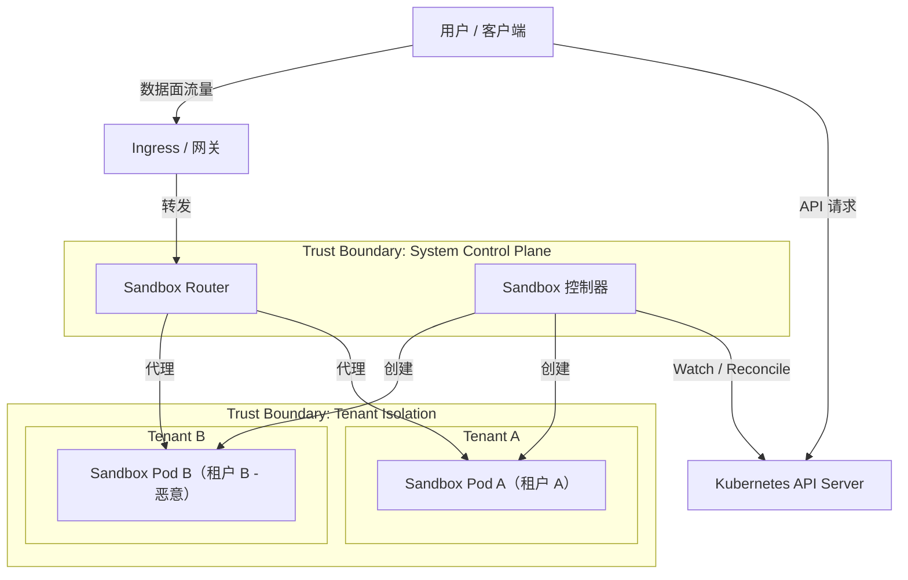
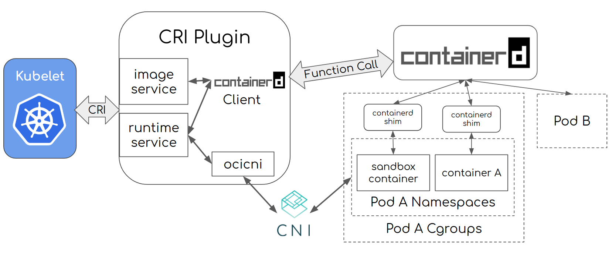
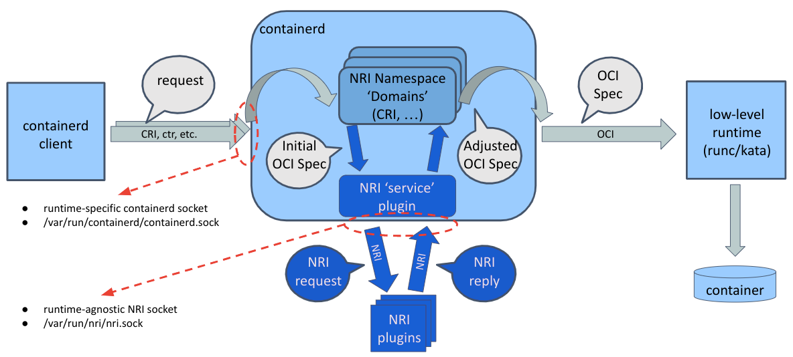

## agent-sandbox介绍

> 负载不同，k8s当前的原语不能满足agent负载的需求

AI智能体通常是隔离的、有状态的、单例工作负载。 它们充当生命周期管理（LLM）的数字工作空间或执行环境。 智能体需要一个持久的身份和一个安全的暂存区来编写和执行（通常是不受信任的）代码。 至关重要的是，由于这些长时间运行的智能体除了短暂的活动爆发外，大部分时间都处于空闲状态， 因此它们需要一个支持诸如暂停和快速恢复等机制的生命周期。

由于这些独特的特性，传统Kubernetes原语无法完美契合。

为了弥合这一差距，agent-sandbox项目引入了一个声明式、标准化的 API，专门针对单例、有状态工作负载（例如 AI 智能体运行时）量身定制。

该项目的核心是引入了 Sandbox CRD。它是一个轻量级的单容器环境，完全基于 Kubernetes 原语构建，提供以下功能：

- 针对不受信任代码的强隔离：当 AI 智能体自主生成和执行代码时，安全性至关重要。 Sandbox 自定义资源原生支持不同的运行时环境，例如 gVisor 或 Kata Containers。 这为多租户、不受信任的执行提供了必要的内核和网络隔离。
- 生命周期管理：与针对稳定、无状态流量优化的传统 Web 服务器不同， AI 智能体作为有状态的工作空间运行，在两次任务之间可能被闲置数小时。 Agent Sandbox 支持将这些闲置环境缩减至零以节省资源，同时确保它们可以从上次中断的地方恢复。
- 稳定的身份：协同的多智能体系统需要稳定的网络。 每个 Sandbox 都拥有稳定的主机名和网络身份，使不同的智能体能够无缝地相互发现和通信。

> Agent Sandbox是一个沙箱编排器（sandbox orchestrator）。它把底层的容器隔离委托给安全的“沙箱运行时”（如 gVisor 或 Kata Containers），方式是管理那些被配置为使用这些运行时的 Pod（通过 RuntimeClass）。

> [gvisor](https://github.com/google/gvisor) :它是一个用户态内核（以 runsc 作为 OCI 运行时），在容器和宿主机内核之间加了一层隔离，提供比普通 runc 更强的沙箱边界

### 概述

#### 核心：Sandbox

`Sandbox` CRD 是 agent-sandbox 的核心。它提供了一套声明式 API，用于管理单个具有稳定身份和持久存储的有状态 Pod。这非常适用于那些既不适合 Deployment 的无状态、副本化模型，也不适合 StatefulSet 的编号式、稳定模型的场景。

`Sandbox` CRD 的关键特性包括：

* **稳定身份（Stable Identity）：** 每个 Sandbox 都拥有稳定的主机名和网络身份。
* **持久存储（Persistent Storage）：** Sandbox 可配置持久存储，在重启后依然保留。
* **生命周期管理（Lifecycle Management）：** Sandbox 控制器管理 Pod 的生命周期，包括创建、按计划删除、暂停与恢复。

#### 扩展（Extensions）

`extensions` 模块在核心 `Sandbox` API 之上提供了额外的 CRD 和控制器，以支持更高级的功能。

* `SandboxTemplate`：提供了一种定义可复用模板的方式，用于创建 Sandbox，便于管理大量相似的 Sandbox。
* `SandboxClaim`：允许用户从 `SandboxWarmPool` 创建 Sandbox，屏蔽了底层 Sandbox 配置的细节。
* `SandboxWarmPool`：管理一个由预热的 Sandbox 组成的池，可快速分配给用户，从而缩短新 Sandbox 启动就绪所需的时间。

> 预热池（WarmPool）是 Agent Sandbox 的核心卖点——把冷启动从"调度+拉镜像+建容器"的秒级压缩到毫秒级认领。

### 架构

agent-sandbox 遵循 Kubernetes 控制器模式。用户创建 Sandbox 自定义资源，控制器负责管理底层的运行时资源。

#### 架构图

启动一个新的 Pod 会增加大约一秒钟的开销。 部署新版本的微服务时，这完全可以接受，但如果智能体在空闲后被调用，一秒钟的冷启动会中断交互的连续性。 它迫使用户或编排服务等待环境配置完成，模型才能开始思考或行动。SandboxWarmPool 通过维护一个预配置的 Sandbox Pod 池来解决这个问题，从而有效地消除了冷启动。 用户或编排服务只需针对 SandboxTemplate 发出 SandboxClaim， 控制器就会立即将一个预热的、完全隔离的环境交给智能体。

#### 系统架构与组件

Agent Sandbox 的架构由以下部分组成：

- **Sandbox 控制器（核心与扩展）：** 运行在集群中（通常位于类似 `agent-sandbox-system` 的系统命名空间），具备管理 Pod、Service、PVC 和 Sandbox CRD 的权限。
- **Sandbox Pod（工作负载）：** 由控制器创建的短生命周期 Pod，用于运行用户工作负载（例如 AI Agent）。这些 Pod 通常运行不受信任的、由 LLM 生成的代码。
- **Sandbox Router：** 一个反向代理，根据 HTTP 请求头（例如 `X-Sandbox-ID`）把外部流量路由到正确的 Sandbox Pod。它适用于使用 Go 或 Python SDK 的工作负载，或那些无法直接对 Pod 进行端口转发（port-forward）的运行时环境（如 Kata Containers 和 gVisor）。
- **Kubernetes API Server：** 编排所有资源的控制面。



#### 整体设计

### k8s -> containerd



我们用一个示例来演示在 Kubelet 创建单容器 Pod 的场景下 `cri` 插件如何工作：

* Kubelet 通过 CRI 运行时服务 API 调用 `cri` 插件来创建 Pod；
* `cri` 创建该 Pod 的网络命名空间，然后使用 CNI 对其进行配置；
* `cri` 使用 containerd 内部机制创建一个特殊的 [pause 容器](https://www.ianlewis.org/en/almighty-pause-container)（即沙箱容器）并启动它，然后将该容器放入该 Pod 的 cgroup 和命名空间中（为简洁起见，步骤有所省略）；
* Kubelet 随后通过 CRI 镜像服务 API 调用 `cri` 插件来拉取应用容器镜像；
* 如果该镜像在节点上不存在，`cri` 进一步使用 containerd 拉取该镜像；
* 接着 Kubelet 通过 CRI 运行时服务 API 调用 `cri`，使用已拉取的容器镜像在该 Pod 内创建并启动应用容器；
* 最后，`cri` 使用 containerd 内部机制创建应用容器，将其放入该 Pod 的 cgroup 和命名空间，然后启动该 Pod 的新应用容器。
  经过这些步骤，一个 Pod 及其对应的应用容器就被创建并运行起来了。

containerd会fork出运行容器所需的进程（shim和runc），但这些进程会被重新re-parent给系统init。容器本身并不与containerd的生命周期绑定，每个容器都有自己的一个shim，作为容器进程的直接父进程，也负责上报退出状态。



```protobuf
// ImageService defines the public APIs for managing images.
service ImageService {
    rpc ListImages(ListImagesRequest) returns (ListImagesResponse) {}
    rpc StreamImages(StreamImagesRequest) returns (stream StreamImagesResponse) {}
    rpc ImageStatus(ImageStatusRequest) returns (ImageStatusResponse) {}
    rpc PullImage(PullImageRequest) returns (PullImageResponse) {}
    rpc RemoveImage(RemoveImageRequest) returns (RemoveImageResponse) {}
    rpc ImageFsInfo(ImageFsInfoRequest) returns (ImageFsInfoResponse) {}
}

// Runtime service defines the public APIs for remote container runtimes
service RuntimeService {
    rpc CreateContainer(CreateContainerRequest) returns (CreateContainerResponse) {}
    rpc StartContainer(StartContainerRequest) returns (StartContainerResponse) {}
    rpc StopContainer(StopContainerRequest) returns (StopContainerResponse) {}
    rpc RemoveContainer(RemoveContainerRequest) returns (RemoveContainerResponse) {}
    // ...
}
```


RuntimeClass kata-dragonball 的完整调用链

```go
K8s Pod: runtimeClassName: kata-dragonball
        │
        ▼  CRI CreateContainer(sandbox) → runtime_handler = "kata-dragonball"
containerd CRI plugin
        │  查 [plugins."io.containerd.grpc.v1.cri".containerd.runtimes.kata-dragonball]
        │    runtime_type = "io.containerd.kata-dragonball.v2"
        │    runtime_path = "/opt/kata/runtime-rs/bin/containerd-shim-kata-v2"
        │    options.ConfigPath = ".../runtime-rs/runtimes/dragonball/configuration-dragonball.toml"
        ▼
containerd-shim-kata-v2  （runtime-rs 版本，进程内加载 runtime-rs）
        │  create.go: loadRuntimeConfig() 读 ConfigPath / KATA_CONF_FILE
        │  configuration-dragonball.toml → [hypervisor.dragonball]
        ▼
Dragonball VMM (dbs) 启动 microVM
        │
        ▼
guest 内 kata-agent → rustjail 创建容器进程
```
