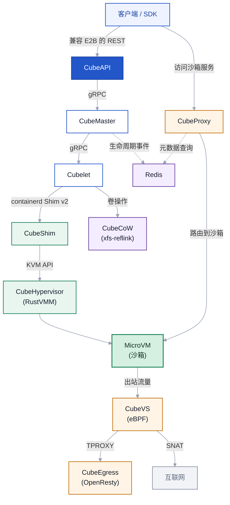
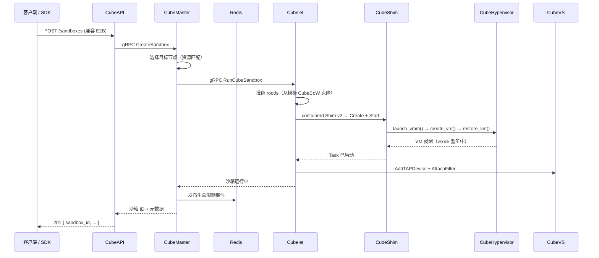

## CubeSandbox介绍
[CubeSandbox](https://cubesandbox.com/zh/)是一款基于RustVMM与KVM构建的高性能、开箱即用的安全沙箱服务。它既支持单机部署，也能方便地扩展到多机集群。对外兼容E2B SDK，可在60ms内创建具备完整服务能力的硬件隔离沙箱，并将内存开销控制在5MB以内。

它本质就是一个面向 AI 代码执行场景的 MicroVM 编排系统，用 MicroVM 作为隔离单元，配合 eBPF 做网络/系统调用审计，对外提供 E2B 兼容 API。

**特点：**
- 硬件级隔离：基于 RustVMM + KVM，每个沙箱都是硬件隔离的 MicroVM，拥有独立的 Guest OS 内核 —— 没有共享内核的容器逃逸风险。
- 原生兼容 E2B SDK

**优势：**
-  亚 60ms 启动 · 超高密度：平均冷启动 < 60ms，单实例额外内存 < 5MB —— 单节点可运行数千个 Agent。 
- 硬件级隔离：每个沙箱拥有独立的 Guest OS 内核 —— 没有共享内核的容器逃逸风险。KVM + eBPF 硬件级安全边界，可安全执行不可信的 LLM 生成代码。
- 无缝 E2B 迁移：原生兼容 E2B SDK —— 只需替换一个 URL 环境变量，业务代码零改动。
- 自动暂停与恢复：空闲沙箱自动快照挂起（零资源消耗），下次请求到达时透明恢复 —— 百毫秒级唤醒，调用方无感知。
-  快照 · 克隆 · 回滚：百毫秒级检查点 —— 回滚到任意保存状态或从同一检查点分叉多条探索分支。基于 CubeCoW Copy-on-Write 引擎与增量脏页追踪。
- 跨机暂停与恢复（Preview）：配合 S3 快照后端，已暂停的沙箱可在集群内任意兼容节点恢复，也可从快照在任意节点创建新沙箱 —— 沙箱不再绑定单一节点，节点维护或故障不再困住你的工作负载。


**CubeSandbox对比**
| 指标 | Docker 容器 | 传统虚拟机 | CubeSandbox |
| :--- | :--- | :--- | :--- |
| 隔离级别 | 低（共享内核 Namespace） | 高（独立内核） | 极致（独立内核 + eBPF） |
| 启动速度 | 200ms | 秒级 | 亚 60ms |
| 内存开销 | 低（共享内核） | 高（完整 OS） | 超低（< 5MB） |
| 部署密度 | 高 | 低 | 极致（单节点数千实例） |
| Agent 托管 | 需自行搭建 | 需自行搭建 | ✅ 原生支持（AgentHub） |
| 自动暂停 / 恢复 | / | / | ✅ 平台托管（百毫秒级恢复） |
| 跨机暂停 / 恢复 | / | / | ✅ S3 后端（preview） |
| 快照 / 克隆 / 回滚 | / | / | ✅ 亚秒级 |
| E2B SDK 兼容 | / | / | ✅ 即插即用 |


> MicroVM（微虚拟机）是一种极度精简的轻量级虚拟机——它保留了传统 VM 的硬件级隔离（每个实例有自己独立的 Linux 内核），但砍掉了传统 VM 的大部分设备模拟（没有 BIOS、虚拟 GPU、legacy 设备等），因此能像容器一样在几十到几百毫秒内冷启动，内存开销控制在个位数 MB 级别。

> E2B 是一个开源的安全云沙箱平台，专门为 AI Agent / AI 应用提供可运行代码的隔离环境。它的核心是一台台微型虚拟机（基于 Firecracker 等轻量 VMM），让模型生成的、不可信的代码在隔离环境里跑，而不是直接碰宿主机。

> E2B SDK 就是面向开发者的客户端库（官方提供 Python 和 JavaScript/TypeScript 两种），用来创建和控制这些沙箱。

> rootfs（root filesystem，根文件系统）是 Linux 内核启动时挂载的第一个文件系统，包含了系统进入用户态所需的所有基础目录、命令、库和配置——内核必须先挂载它，才能启动 /sbin/init 或 /init 这个第一个用户进程；没有 rootfs，内核本身跑不起来任何东西。


### 部署
前置条件：
- 裸金属服务器，KVM可用，或者开启嵌套虚拟化，保证KVM可用
- 系统 glibc 必须 ≥ 2.31
- 将 XFS 文件系统挂载到 /data/cubelet。（ 依赖 XFS reflink 实现 Copy-on-Write 快照）
- 操作系统推荐选择 OpenCloudOS 9（RPM 系）。Cube Sandbox 的 PVM 宿主机内核基于 OpenCloudOS 内核构建，选用 OpenCloudOS 9 可获得最佳兼容性，且无需处理发行版差异。

> PVM（Pagetable-based Virtual Machine）是一种基于页表的嵌套虚拟化框架，构建于 KVM 之上。与传统嵌套虚拟化不同，PVM 不依赖宿主 hypervisor 向 guest 暴露 Intel VT-x / AMD-V 等硬件虚拟化扩展，而是在 guest 内核层通过共享内存区域和影子页表（shadow page table）来完成特权级切换与内存虚拟化，对宿主 hypervisor 完全透明。

| 角色 | 建议规格 | 用途 |
| --- | --- | --- |
| 控制面节点 | ≥ 1 台；生产建议 3+；≥ 4C8G | 跑 Cube 的控制面组件 |
| 计算节点 | ≥ 1 台；建议 16C32G+ | 跑沙箱 |

可部署形式：
- 单机部署
- 多机集群部署（通过添加计算节点，向控制面注册下，计算节点只运行沙箱运行时组件）
- k8s部署（在最开始设计CubeSandbox时未考虑k8s部署，自v0.6.0版本开始支持k8s部署）


需要注意，本文档调研时CubeSandbox最新版本是v0.7.3版本，CubeSandbox发版本的节奏很快，且尚未1.0版本发布，所以后期可能会有变更，注意参考最新的官方文档。

### 整体架构
设计原则：硬件隔离，每个沙箱在 KVM MicroVM 中运行独立的 Linux 内核，不存在共享内核的逃逸面。


#### 控制面 vs 数据面
| 层               | 组件                                                                      | 职责                                            |
| ---------------- | ------------------------------------------------------------------------- | ----------------------------------------------- |
| **控制面** | CubeAPI、CubeMaster、WebUI、Redis                                         | API 网关、调度、状态协调、运维控制台            |
| **数据面** | Cubelet、CubeShim、CubeHypervisor、CubeCoW、CubeVS、CubeEgress、CubeProxy | VM 生命周期、存储、网络、安全策略执行、请求路由 |

控制面是**无状态**的——Redis 是沙箱元数据与生命周期事件的唯一可信源，任意 CubeAPI 或 CubeMaster 实例都可处理任意请求。

数据面是**节点本地**的——每个计算节点运行 Cubelet、CubeShim、CubeHypervisor、CubeVS、CubeEgress，**管理驻留在该主机上的沙箱**。





#### 核心组件

##### CubeAPI
兼容E2B的REST API网关。将E2B SDK调用转换为内部gRPC，处理鉴权回调并转发至CubeMaster。只需替换 API URL 等环境变量，即可从 E2B 云无缝切换到 Cube Sandbox。

##### CubeMaster
**集群级编排调度器**。接收沙箱创建/销毁/暂停/恢复请求，**依据资源可用性选择目标节点**，将工作分发给Cubelet，并将生命周期事件发布到 Redis。

> CubeMaster 是自研调度器，收到沙箱创建请求后，prefilter(候选集初筛) → filter（硬约束过滤器，cpu,mem,dist是） → score（软约束，加权打分） → postscore → 加权随机选择。

##### CubeProxy

反向代理与请求路由组件。支持两种路由模式，共享同一份 Redis 沙箱元数据：

- **Host 模式**：解析 `Host` 头中的 `<port>-<sandbox_id>.<domain>`。
- **路径模式**：解析 URL 中的 `/sandbox/<sandbox_id>/<port>/...`（在不便配置泛解析 DNS 与 TLS 时尤其方便，详见 [HTTPS 与域名指南](../guide/https-and-domain.md)）。

它配套独立部署的cube-lifecycle-manager服务，负责监听生命周期事件、透明地暂停空闲沙箱、并在请求到达时恢复已暂停的沙箱。cube-lifecycle-manager 通过 Redis 上的注册表实时发现所有在线的 CubeProxy 副本，因此 CubeProxy 可多副本扩展，不需要任何静态配置。

##### Cubelet
节点本地调度组件。**管理单节点上所有沙箱实例的完整生命周期**（创建 → 运行 → 暂停 → 恢复 → 快照 → 销毁）。与 containerd 集成完成镜像拉取，与 CubeCoW 集成完成卷管理。

```sh
# 调度                 计算节点负责执行创建                                    
CubeMaster ──gRPC──▶ Cubelet ──containerd Shim v2──▶ containerd-shim-cube-rs(CubeShim)
                                                   └─[进程内] VmmInstance::new → KVM
```

##### CubeShim
**containerd Shim v2** 接口，<u>作为容器运行时抽象与实际MicroVM之间的桥梁。</u>负责沙箱资源准备（rootfs、内存文件、内核）、VM 启动/恢复、vsock 通信，以及用于自动暂停的原地快照。

```sh
containerd
   │  (Shim v2 API)
   ▼
containerd-shim-cube-rs   ← CubeShim  （宿主机进程）
   │  (ttrpc/vsock)
   ▼
cube-agent                ← 跑在 MicroVM 内的 guest agent， 负责在虚机里执行 Create/Start/Exec 等，把容器进程跑在 guest 内核上。
   │
   ▼
container workload         ← 在 MicroVM 内运行
```
虚机外部（host）：containerd、containerd-shim-cube-rs（CubeShim，由 containerd 在宿主机上 spawn 的子进程）、Cubelet 以及它拉起的 VMM（RustVMM + KVM）、宿主内核。

虚机内部（guest）：cube-agent + container workload + guest 内核 / rootfs。
```
宿主机 (host)
┌─────────────────────────────────────────────┐
│  containerd                                  │
│  containerd-shim-cube-rs   ← CubeShim        │
│  Cubelet → VMM (RustVMM + KVM)   ← 管理面    │
└──────────────────────┬──────────────────────┘
                       │  ttrpc / vsock  ← 穿过 VM 边界
        ╔══════════════╧══════════════════════╗
        ║         MicroVM (guest)             ║
        ║   cube-agent (guest agent)          ║
        ║   guest kernel / rootfs             ║
        ║   container workload（用户进程/负载） ║
        ╚══════════════════════════════════════╝
```

##### CubeHypervisor

基于 **RustVMM** + **KVM** 构建的轻量级 VMM（虚拟机监视器）。管理 MicroVM 生命周期：vCPU 配置、内存区域、virtio 设备（block、net/vsock、fs）、启动、暂停、快照与恢复。经过 seccomp 加固，系统调用面最小化。

### CubeVS（网络虚拟化）

基于 eBPF 的内核态网络数据面。三个挂载在关键位置的 BPF 程序提供：

- **按沙箱粒度的 SNAT/DNAT**，无 iptables 规则膨胀。
- **有状态连接追踪**，支持协议感知的超时（TCP 11 状态机、UDP、ICMP）。
- **LPM-trie 网络策略**，线速执行。
- **ARP 代理**，用于点对点 TAP 链路。


##### CubeCoW（存储引擎）

基于 **Rust** 实现的精简配置卷管理库，通过内核 `FICLONE` ioctl 在 XFS (reflink) 上实现 O(1) 快照与克隆。核心特性：

- 快照仅为元数据操作（共享 extent，零字节拷贝）。
- 扁平快照模型——删除任一快照不影响其他快照。
- **增量脏页追踪**：快照仅持久化自上次快照以来发生变更的匿名（脏）内存页，未变更页通过 reflink 继续共享，从而最小化写放大和快照体积。
- Cubelet 通过 CubeCoW 完成所有 rootfs 与内存卷操作（创建、克隆、快照、删除）。

##### CubeEgress（安全代理）

部署在每台主机上的透明 **L7 出网代理**（OpenResty + Lua），通过 TPROXY 拦截每一个出站 HTTP/HTTPS 请求：

- **域名过滤**——按 SNI、host、method、scheme 或 path 放行/拒绝。
- **凭据注入**——追加 `Authorization` 头，使密钥永不进入沙箱。
- **访问审计**——每次决策都记录到按主机划分的 JSONL 审计日志。

沙箱信任由 CubeEgress 签发的根 CA（已预置于模板中），从而实现透明 TLS 检查。

##### WebUI

基于浏览器的管理控制台（`:12088`）。无需 CLI 即可完成沙箱、模板、节点及版本矩阵管理。详见 [WebUI 指南](../guide/webui.md)。

##### 请求生命周期

创建沙箱示例：
```python
from cubesandbox import Sandbox

# 创建沙箱，空闲 60 秒后自动销毁（默认 on_timeout="kill"）
sandbox = Sandbox.create(
    template="<your-template-id>",
    timeout=60,                # 单位：秒
)

print(sandbox.sandbox_id)
```

一次典型的 `Sandbox.create()` 调用在系统中的流转如下：




一个沙箱在它的生命周期里会处于以下几种状态之一：
| 状态 | 含义 |
| --- | --- |
| running | 正在运行，CPU/内存被实际占用，可以接收请求与执行代码 |
| pausing | 平台正在暂停沙箱（保存 VM 快照中），瞬时态 |
| paused | 沙箱已暂停，VM 内存已落盘为快照，不消耗 CPU 与内存，状态完整保留 |
| resuming | 平台正在从快照恢复沙箱，瞬时态 |
| terminated | 沙箱被显式销毁（kill）或因 on_timeout="kill" 超时被回收，无法恢复 |

##### 存储层
模板是创建沙箱时使用的可复用运行环境。它不仅包含来自 OCI 镜像的根文件系统，还包含沙箱启动所需的配置和预热后的 MicroVM 快照。

模板 = rootfs(ext4) + MicroVM 内存/磁盘快照 + 沙箱运行配置。制作流程：
1. 拉取 OCI 镜像 → 展开成 MicroVM 的 rootfs；
2. 用一个临时 MicroVM 按镜像配置把服务跑起来（如 envd 默认监听 49983）；
3. 等 HTTP 探针返回 2xx（表示环境"预热完成"）后，冻结此刻的文件系统 + 内存状态，生成快照；
4. 注册发布模板。


CubeSandbox不会把OCI镜像直接当作沙箱运行。它会拉取并展开镜像，将其转换为适合 MicroVM 使用的 rootfs，按镜像中的启动配置运行服务，然后生成可快速恢复的模板快照。原因有三层：
- 缺"机器"：MicroVM 需要 guest 内核 + 可启动磁盘（ext4）+ boot 布局。OCI 镜像只有 rootfs 层和 ENTRYPOINT/CMD/环境变量等容器元数据，本身无法 boot 一台 VM。
- 冷启动太慢：若每次都用镜像现拉、解包、起 VM、跑服务，沙箱创建延迟高、且不可控。（需要提前预热）
- 没法"克隆"：Cube 的隔离模型靠的是 XFS reflink（FICLONE）做 O(1) 的写时复制快照/克隆。这是块设备/文件系统层面的能力，容器镜像没有这种"整机能克隆"的形态。

```
模板（只读基础）
  └── FICLONE ──→ 沙箱 rootfs 卷 (CoW)
                      ├── FICLONE ──→ 快照 A
                      └── FICLONE ──→ 克隆 1、克隆 2、...
```


- 模板创建：OCI 镜像 → Buildkit → rootfs + 冷启动 → 内存快照 → 注册为模板。
- 沙箱启动：Cubelet 通过 CubeCoW 克隆模板的 rootfs 与内存卷（O(1)，零数据拷贝），随后 CubeShim 从内存快照恢复 VM。
- 增量快照：仅写入匿名（脏）页，基础页通过 reflink 与上一次快照共享。

启动快的根源：不是冷启动VM，而是在经过模板创建（预热）后直接回放快照，配合XFS reflink O(1) 克隆一台已有状态的VM。


