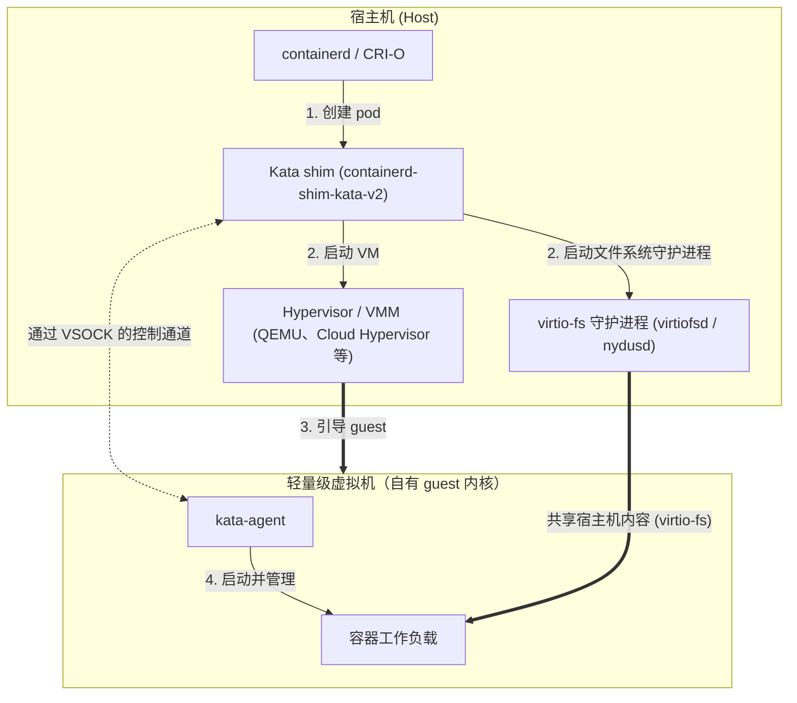
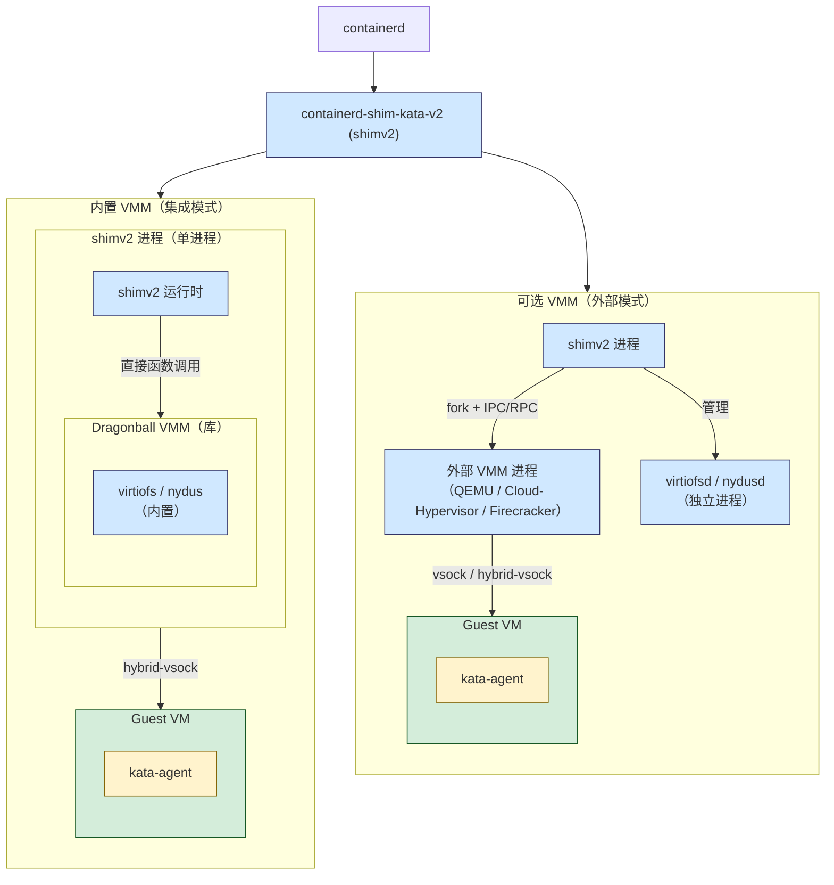
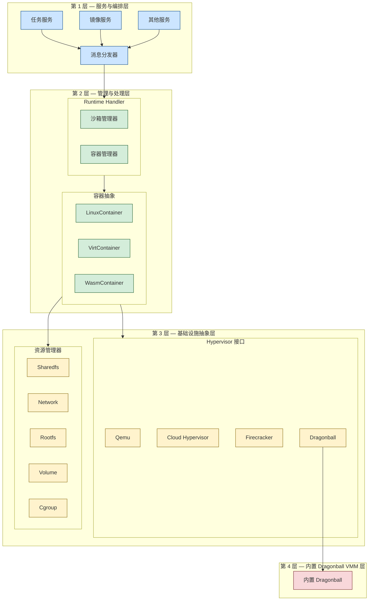

## Kata介绍

[Kata Containers](https://katacontainers.io/)致力于构建一种安全的**容器运行时**。

> 文档：https://kata-containers.github.io/kata-containers/          
> github: https://github.com/kata-containers/kata-containers

Kata解决的问题：容器共享内核的方案存在安全风险，容器的提权漏洞将会导致整个系统被侵入。

Kata Containers 是一个开源运行时，它将每个容器（或Kubernetes pod）运行在各自独立的轻量级虚拟机（VM）中。你获得的工作流在使用体验和性能上都与标准 Linux 容器相似，但具备硬件虚拟化带来的更强工作负载隔离能力。

Kata解决问题的思路：Kata给每个Pod独立的guest内核，用硬件虚拟化把Guest内核与宿主内核隔开，从而把"共享内核"导致的逃逸风险限制在Guest内核边界内。每个Pod起一个精简Guest内核+镜像rootfs，容器进行直接在Guest内核上跑，启动方式与普通容器一样。


为什么要使用 Kata Containers？

- **默认提供更强的隔离。** 每个 pod 都运行在拥有专用 guest 内核的自有虚拟机中。容器逃逸或 guest 内核漏洞会被限制在该虚拟机内部，而不会暴露所有其他工作负载所共享的宿主机内核。
- **运行不可信或多租户工作负载的构建基石。** 硬件虚拟化边界比仅靠命名空间和
  cgroup 难以跨越得多，因此你可以更有信心地在共享基础设施上运行第三方代码或互不信任的租户。
- **可直接替换的兼容性。** Kata 实现了 OCI 和 CRI shim 接口，因此可与 Kubernetes、containerd、CRI-O 和 Docker 配合使用。你可以按工作负载通过 `RuntimeClass`（或 Docker 的 `--runtime`）选择启用 —— 无需修改应用。
- **更小的宿主机攻击面和更高的灵活性。** 工作负载从不直接与宿主机内核通信，且每个 guest 都可以运行各自的内核版本与配置。

前提条件：

- 支持硬件虚拟化，并且`/dev/kvm`可用
- 兼容CRI的容器运行时。Kata通常使用containerd（至少使用 containerd v2.1.x ）。
- Kubernetes，建议至少使用 v1.22 版本

### 工作原理

Kata 实现了 Open Containers Runtime Specification（开放容器运行时规范）。更具体地说，它实现了一个 containerd shim，该 shim 提供了管理容器生命周期所需的约定接口。containerd 默认的运行时 runc 创建容器的过程如下：

当你调度一个 Kata pod 时，容器管理器会将其交给 Kata shim，由它启动 hypervisor 来引导一台轻量级虚拟机。随后，容器便运行在该虚拟机内、使用其自有的 guest 内核。容器的文件（包括其镜像的根文件系统）通过 virtio-fs 共享进 guest，通常由宿主机上的 `virtiofsd` 提供服务（`nydusd` 可以作为 virtio-fs 守护进程的替代品直接使用）。

使用默认的 `runc` 运行时，容器共享宿主机内核，仅依靠 Linux 原语（如命名空间、cgroup 和 seccomp）实现隔离。而使用 Kata 时，每个 pod 都运行在拥有自有 guest 内核的虚拟机中，从而在工作负载与宿主机之间增加了一层防御。



### 架构

Kata Containers Rust 运行时旨在最小化资源开销和启动延迟。它通过从传统的基于进程的管理转向更集成化的 Rust 原生控制流来实现这一点。



运行时采用**灵活的 VMM 策略**，同时支持 `内置` 和 `可选` 两种 VMM。用户可以在紧密集成的VMM（如 Dragonball，追求峰值性能）与外部 VMM（如 QEMU、
Cloud-Hypervisor、Firecracker，增强兼容性与模块化）之间选择。

#### A. 内置 VMM（集成模式）

内置 VMM 模式是面向用户的默认且推荐的配置，因为它提供更优的性能和资源效率。

在该模式下，VMM（`Dragonball`）**深度集成**进 `shimv2` 的生命周期。这消除了 IPC
开销，实现更低延迟的消息处理和紧密的 API 同步。此外，它还确保运行时与 VMM 共享
统一的生命周期，从而简化异常处理和资源清理。

* **集成管理**：`shimv2` 直接控制 VMM 及其关键辅助服务（`virtiofsd` 或 `nydusd`）。
* **性能**：通过消除外部进程开销和复杂的进程间通信（IPC），该模式实现更快的容器
  启动和更高的资源密度。
* **核心技术**：主要采用 **Dragonball**——为云原生场景专门优化和设计的原生 Rust VMM。

> **注意**：内置 VMM 模式是面向用户的默认且推荐的配置，因为它提供更优的性能和
> 资源效率。

#### B. 可选 VMM（外部模式）

可选 VMM 模式适用于有特定需求、必须使用外部 hypervisor 支持的用户。

在该模式下，运行时与 VMM 作为相互解耦的独立进程运行。运行时 fork 出 VMM 进程，
并通过进程间 RPC 与之交互。`containerd-shim-kata-v2`（简称 `shimv2`）以
**外部进程**的方式管理该 VMM。

* **解耦的生命周期**：`shimv2` 通过 vsock/hybrid vsock 与 VMM（如 QEMU、
  Cloud-Hypervisor 或 Firecracker）通信。
* **灵活性**：非常适合需要特定 hypervisor 硬件模拟或遗留兼容性的环境。

> **注意**：这种方式（可选 VMM）会因上下文切换和跨进程通信引入额外开销。此外，
> 跨进程边界管理资源——尤其是在异常情况下——会在错误检测与恢复方面带来显著的
> 复杂性。

#### 分层架构

Kata 4.0 运行时采用高度模块化的分层架构，旨在把高层服务请求与底层基础设施执行解耦。
这种设计便于扩展，使系统能够在单个统一的 Rust 二进制内支持多种容器类型和
Dragonball，同时也支持其他 hypervisor 作为可选 VMM。



##### 服务与编排层

* **服务层（Service Layer）**：运行时的入口，为外部调用方（如 `containerd`）提供
  专门的接口。它包括：

  * **Task Service（任务服务）**：管理容器化进程的生命周期。
  * **Image Service（镜像服务）**：处理容器镜像操作。
  * **Other Services（其他服务）**：可扩展框架，允许自定义模块。
* **Message Dispatcher（消息分发器）**：充当集中式的流量控制器。它解析来自服务层
  的请求，并路由到合适的 **Runtime Handler**，确保高效的消息多路复用。

##### 管理与处理层

* **Runtime Handler**：核心处理引擎。它抽象底层 workload，使运行时能够通过以下
  组件处理各种容器类型：

  * **Sandbox Manager（沙箱管理器）**：编排整个 Pod（Sandbox）的生命周期。
  * **Container Manager（容器管理器）**：管理 Sandbox 内的各个容器。
* **Container Abstractions（容器抽象）**：该框架对容器实现保持无关性，并为以下
  类型提供明确的支持路径：

  * **LinuxContainer**（标准/OCI）
  * **VirtContainer**（基于虚拟化）
  * **WasmContainer**（基于 WebAssembly）

##### 基础设施抽象层

该层为硬件与资源管理提供标准化的接口，与底层后端无关。

* **Hypervisor 接口**：可插拔架构，支持多种虚拟化后端，包括 **Qemu**、
  **Cloud Hypervisor**、**Firecracker** 和 **Dragonball**。
* **资源管理器（Resource Manager）**：用于管理关键基础设施组件的统一接口：

  * **Sharedfs、Network、Rootfs、Volume 和 cgroup 管理**。

##### 内置 Dragonball VMM 层

`Builtin Dragonball`块代表高性能运行时的核心，展示了运行时与hypervisor之间的深度集成。

##### 关键架构优势

* **统一性**：通过把这些层整合进单个二进制，运行时确保所有子模块状态一致，
  避免多进程运行时中常见的"脑裂"（split-brain）场景。
* **模块化**：**Message Dispatcher** 与 **Runtime Handler** 之间的清晰分离，
  让开发者无需修改现有核心逻辑即可引入新的容器类型（如 WASM）或 hypervisor。
* **效率**：把 `Dragonball` 作为库直接集成，可实现"零拷贝"资源管理和直接 API
  访问，相比传统的基于 RPC 的 hypervisor 交互，性能大幅提升。

### Dragonball

`Dragonball Sandbox` 是一个基于 Linux 内核虚拟机（KVM，Kernel-based Virtual Machine）的轻量级虚拟机管理器（VMM），并针对容器负载进行了优化：

- 容器镜像管理与加速服务
- 灵活且高性能的虚拟设备驱动
- 低 CPU 与内存开销
- 极短的启动时间
- 优化的并发启动速度

---

虚拟硬件接口：指的是VMM向guest呈现硬件时所用的抽象边界。让guest以为自己运行在“真实的硬件”之上，实际是VMM虚拟化的“硬件”。VMM所做的核心工作就是实现虚拟硬件接口。底层还是需要依赖宿主KVM提供的硬件虚拟化能力（最底层的虚拟硬件接口）实现。

Dragonball 的 CPU 虚拟化建立在 KVM 硬件辅助虚拟化（Intel VT-x / AMD-V） 之上：guest 的 vCPU 平时直接在物理 CPU 上执行，只有在特定事件（IO/MMIO/HLT/hypercall…）时才陷入（VM Exit）到 VMM 处理。

"硬件辅助虚拟化"指CPU/芯片组本身提供的虚拟化扩展：Intel 的 VT-x、AMD 的 SVM、二级地址翻译（Intel EPT / AMD NPT）、以及 IOMMU（VT-d / AMD-Vi）和机密计算（Intel TDX / AMD SEV）。Dragonball 并不直接操作这些硬件特性，而是通过KVM这个内核模块暴露的ioctl来"使用"它们。

```sh
KvmContext::new()      —— 探测硬件能力 (irqchip/memslots/MSR...)
   │
create_vm / create_vm_with_type —— 创建 VM（普通 或 TDX）
   │
set_tss_address        —— x86 VMX 前置
setup_interrupt_controller / create_pit —— 中断与定时器虚拟化
   │
address_space_manager::setup_kvm_memory_region
   │  └─ KVM_SET_USER_MEMORY_REGION → KVM 填 EPT/NPT（硬件二级翻译）
   │
vCPU 线程 KVM_RUN      —— CPU 在 VMX non-root 直接执行 guest
   │  └─ VM Exit (IO/MMIO/HLT/Hypercall) → run_emulation 软件处理
   │
快照: GET/SET_{REGS,SREGS,MSR,LAPIC,XSAVE} —— 硬件上下文保存/恢复

```

CPU 硬件做执行隔离（VT-x/AMD-V）与地址翻译（EPT/NPT）；KVM 做硬件抽象与陷入路由；Dragonball 只负责配置（建 VM、建内存槽、建 irqchip、设 TSS）和 VM Exit 的软件兜底。

VMX = Virtual Machine Extensions，是 Intel 在其 CPU 中引入的硬件虚拟化指令集扩展，也就是常说的 Intel VT-x。它是 CPU 层面新增的一组指令和一套状态机，让"一个物理 CPU 能高效地同时跑多个虚拟机"。

AMD 的对应技术叫 SVM（Secure Virtual Machine，即 AMD-V）。在 /proc/cpuinfo 里，Intel 的 CPU 会出现 vmx，AMD 会出现 svm。

VMX 把 CPU 的运行状态分成两种"操作模式"：

| 模式                   | 谁在跑                                   | 说明                                              |
| ---------------------- | ---------------------------------------- | ------------------------------------------------- |
| VMX root operation     | VMM / Hypervisor（KVM、Dragonball 所在） | 拥有全部特权，可执行 VMX 指令                     |
| VMX non-root operation | guest（虚拟机的 vCPU）                   | 普通 guest 代码在此执行，绝大多数指令直接由硬件跑 |

关键在于：guest 的代码平时真的在物理 CPU 上直接执行（这是硬件辅助虚拟化的性能来源），只有当它执行了"敏感指令"或触发了配置的事件时，CPU 才会自动切换到 root 模式，这叫 VM Exit；处理完后再由 VM Entry 切回 guest。

VMX 引入的关键硬件对象/指令：

- VMCS（Virtual Machine Control Structure）：每个 vCPU 一份的硬件控制结构，保存 guest 与 host 的寄存器状态、退出原因、控制位等；
- VM Entry / VM Exit：进出 guest 的硬件动作；
- VMX 指令：VMPTRLD、VMLAUNCH、VMRESUME、VMREAD、VMWRITE、VMCLEAR、INVEPT、INVVPID 等（只有 root 模式可执行）。

---

与k8s标准栈对比：

- 标准栈：containerd → containerd-shim-runc-v2 → runc → 容器进程
- Kata 栈：containerd → containerd-shim-kata-v2（Kata runtime）→ hypervisor/VM → kata-agent → 容器进程

Dragonball不是裸金属上的hypervisor——它是跑在 Host OS（Linux）用户态里的 VMM。但严格说，真正做 CPU/内存虚拟化的那部分在宿主内核里的 KVM，Dragonball只是它上面的用户态VMM。所以更准确的表述是：**KVM（内核里、贴着硬件）＋ Dragonball（用户态、管设备与生命周期）** 这一组合才是完整的 hypervisor 栈。

```
硬件 → Host OS Linux 内核（kvm.ko + kvm-intel/amd，暴露 /dev/kvm）
     → Dragonball（用户态：设备模型、镜像引导、生命周期）
     → Guest VM（vCPU 以 non-root 直接跑在硬件上）
```

- 在普通 runc 容器里：整个 Pod 的容器都跑在宿主内核上，彼此只是共享若干 namespace 的进程——所以宿主机 /proc 里能看到它们的 namespace 和 cgroup（路径类似 /kubepods/.../<pod></pod>/<container></container>.scope）。
- 在 Kata 里：Pod 的"sandbox"被实现成一台轻量 VM。Pod 内所有容器共享的是 guest 内核里的 namespace；宿主机侧只能看到那一个 shim 进程 + 一个 VM 进程，而容器真正的 namespace/cgroup 发生在 VM 内部，宿主 /proc 里完全看不到——这正是 Kata 强隔离的来源。

