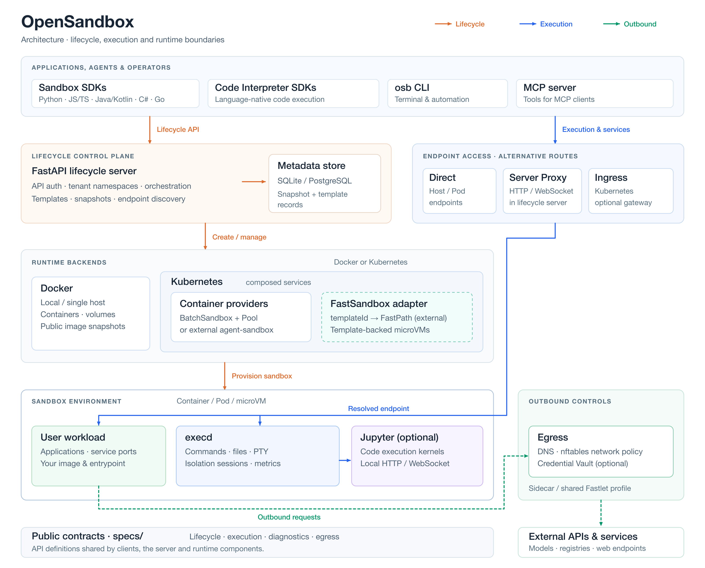
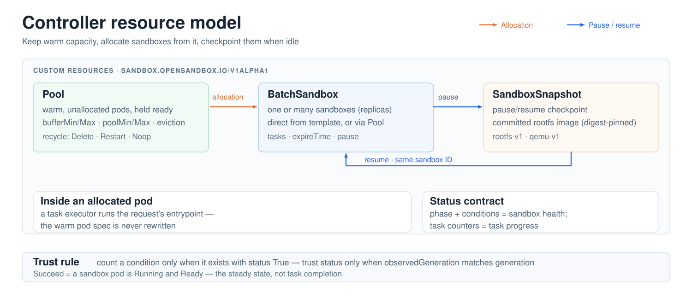
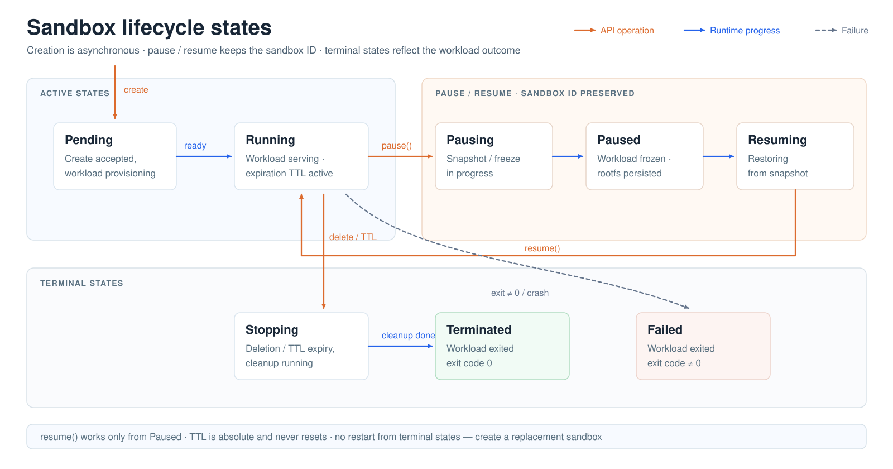
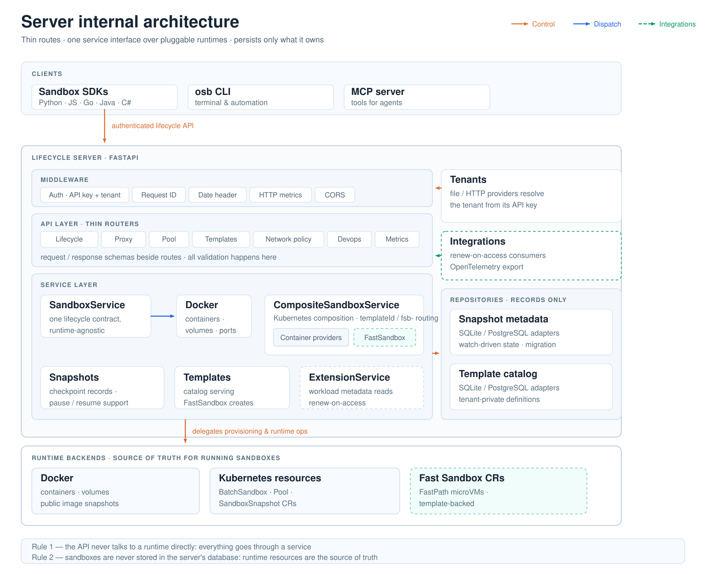

# OpenSandbox介绍

OpenSandbox 是一个面向 AI 应用的通用沙箱平台。它提供客户端 SDK 与工具、协议定义、生命周期控制平面、Docker 和 Kubernetes 运行时后端（同时支持容器工作负载和基于模板的 microVM），以及沙箱内的执行组件，用于命令、文件、代码解释器、浏览器自动化、桌面环境和训练工作负载。

## 架构

该架构区分了三条主要交互路径：

- **生命周期管理**（橙色箭头）：应用、Agent 和运维人员向 FastAPI 生命周期服务器发送生命周期请求（创建、列出、续期、暂停、恢复或删除沙箱，以及管理快照和模板）。服务器持久化元数据，并将资源开通与编排委派给配置的运行时后端。
- **执行与服务访问**（蓝色箭头）：对于命令、文件、PTY 和 Jupyter 代码执行，或访问用户工作负载服务，客户端绕过生命周期编排，直接连接已解析的端点——可以是通过宿主机/Pod 直连地址、生命周期服务器代理，或可选的 Kubernetes 入口网关。
- **出站管控**（绿色箭头）：沙箱向外部 API、模型提供方或 Web 服务发起的出站请求，可以通过出站管控进行过滤和保护（容器工作负载使用按沙箱的 sidecar，FastSandbox 使用共享的 Fastlet egress profile），并支持 DNS/nftables 策略以及可选的凭证保险库密钥注入。

运行时和网络能力取决于所选后端；该图展示的是共享架构，并不要求部署每一个组件。

OpenSandbox 围绕六个实用面（surface）来组织：

1. **客户端面（Client surface）** - 供应用、Agent 和运维人员使用的 SDK、`osb` CLI 以及 MCP 服务器。
2. **协议面（Protocol surface）** - `specs/` 下的 OpenAPI 契约，涵盖生命周期、诊断、沙箱内执行和出站策略。
3. **生命周期控制平面** - `server/` 下的 FastAPI 服务器，负责认证请求、校验配置、持久化服务器管理的记录，并将生命周期工作委派给配置的运行时服务。
4. **运行时后端** - 用于本地和单主机部署的 Docker，以及 Kubernetes（配备容器工作负载提供方 BatchSandbox 或 `kubernetes-sigs/agent-sandbox`），并可选集成 FastSandbox 以支持基于模板的 microVM。
5. **沙箱数据平面** - 容器或 microVM 内的用户工作负载和 `execd` 守护进程，可选支持 Jupyter/代码解释器。卷和出站集成取决于运行时。
6. **网络与安全面** - 端点解析、服务器代理、Kubernetes 入口网关路由、安全端点访问、出站策略执行、凭证保险库、资源限制以及安全容器运行时。

这种拆分是有意为之：SDK 和工具应依赖公共契约，服务器应负责生命周期编排，运行时提供方应负责平台相关的资源创建，而 `execd`/egress 应负责从沙箱网络和文件系统命名空间内部发生的操作。

### 运行时后端

#### Docker运行时

Docker 运行时是本地和单主机后端。它直接与 Docker 守护进程通信，管理容器、定时器、标签、卷、端口、可选 sidecar 以及快照。

核心职责：

- 拉取公共或私有镜像，包括按请求的镜像仓库认证。
- 创建容器，支持 CPU、内存、GPU、平台、capability、AppArmor、seccomp、PID 以及安全运行时设置。
- 将 `[runtime].execd_image` 中的 `execd` 二进制暂存到沙箱中，并在启动用户 entrypoint 之前安装引导启动器（bootstrap launcher）。
- 支持网络模式 `host`、`bridge` 以及自定义用户定义网络。
- 在非 host 网络模式下为 `execd` 和用户服务端点分配宿主机端口。
- 在服务器重启后为现有受管容器恢复到期定时器。
- 支持宿主机 bind 挂载、通过 `pvc` 卷模型支持的 Docker 命名卷，以及 OSSFS 支撑的挂载。
- 在请求 `networkPolicy` 且 Docker 网络兼容时挂载出站 sidecar。
- 将 Docker 支撑的持久快照创建为本地镜像，并从这些快照镜像恢复沙箱。

Docker 的暂停/恢复使用容器级暂停/恢复。对于带出站 sidecar 的沙箱，暂停时会先冻结沙箱容器再冻结 sidecar，而恢复时会先解冻 sidecar 再解冻沙箱容器。Docker 快照通过公共快照 API 暴露。

#### Kubernetes运行时

Kubernetes 运行时将实际的工作负载创建委派给由 `kubernetes.workload_provider` 选择的工作负载提供方。

受支持的提供方：

- `batchsandbox` - 由 OpenSandbox 的 Kubernetes 控制器和 `BatchSandbox` CRD 支撑的默认提供方。
- `agent-sandbox` - 用于 `kubernetes-sigs/agent-sandbox` 的提供方。

Kubernetes 服务器路径负责处理：

- Kubernetes 客户端初始化以及可选的 informer 支撑读取。
- 从镜像请求创建工作负载；当快照记录支持恢复时，`snapshotId` 启动会解析为已存储的可恢复镜像。
- BatchSandbox 和 agent-sandbox 清单的模板合并。
- 在提供方支持的情况下按请求的镜像拉取密钥。
- 将资源限制和 GPU 转换为 Kubernetes 扩展资源。
- 平台约束以及针对安全运行时的 RuntimeClass 集成。
- 卷、出站 sidecar 以及安全端点访问注解。
- 通过工作负载直接数据或入口网关配置进行端点解析。
- 将暂停/恢复委派给提供方。
- 从 Kubernetes 资源获取纯文本诊断信息。

#### BatchSandbox控制器

`kubernetes/` 下的 Kubernetes 控制器实现了 OpenSandbox 专用的 CRD，用于高吞吐和池化的沙箱交付：

- `BatchSandbox`：从 Pod 模板创建一个或多个沙箱副本。
- `Pool`：维护预热资源以实现快速分配。
- `SandboxSnapshot`：供 BatchSandbox 暂停/恢复以及公共快照工作流使用的快照记录。

BatchSandbox 同时支持基于模板的创建和通过 `extensions.poolRef` 的基于池的创建。它还支持用于批量和 RL 类工作负载的可选任务编排。

对于受支持的单副本 BatchSandbox 工作负载，rootfs 暂停/恢复路径会将沙箱文件系统提交为 OCI 镜像并释放运行时资源；恢复时从该镜像重建工作负载，同时保留沙箱 ID。配置了 QEMU 快照契约的工作负载则改用 VM 状态检查点与恢复路径。

公共快照 API 支持 Docker 和兼容的 `BatchSandbox` 工作负载。`DockerSnapshotRuntime` 将容器提交为本地镜像，而 `KubernetesSnapshotRuntime` 创建一个公共 `SandboxSnapshot` CR，将镜像提交并推送到 OCI 镜像仓库。这与内部暂停/恢复不同，后者在保留沙箱连续性的同时释放计算资源。公共快照支持并不扩展到每个 Kubernetes 提供方或 VM 运行时。

#### FastSandbox集成

在 Kubernetes 模式下，`FastSandboxService` 将 OpenSandbox 连接到外部 `fast-sandbox` 平台，以进行基于模板的 microVM 开通：

- **路由**：`CompositeSandboxService` 将带 `templateId` 的创建请求路由到 `FastSandboxService`，并按 `fsb-` ID 前缀路由对现有沙箱的操作。FastSandbox 是 Kubernetes 组合的一部分，而不是一个独立的 `runtime.type` 值。
- **控制协议**：通过 gRPC FastPath v2（端口 9090）与外部 `fast-sandbox` 控制平面通信。
- **状态**：FastPath 负责变更和实时运行时操作；Kubernetes LIST/WATCH 读取持久化的 `sandbox.fast.io/v1alpha2` 资源及其观测结果。
- **暂停/恢复**：委派给 FastPath，由其在恢复时还原检查点。客户端必须在还原后重新解析端点。
- **网络**：配置的 Fastlet 池提供共享的 Egress profile；适配器通过 FastPath Actions 发送网络策略。这与挂载按沙箱的容器 sidecar 不同。当前服务器适配器在此路径上拒绝 `credentialProxy.enabled` 创建标志和卷挂载。

## 核心API

### 沙箱生命周期管理API

定义从容器镜像或快照创建、管理和销毁沙箱环境的完整生命周期接口。

**核心功能：**
- **沙箱管理**：创建、列出、查询和删除沙箱实例，支持元数据过滤和分页
- **状态控制**：暂停和恢复沙箱执行
- **生命周期状态**：支持 Pending -> Running -> Pausing -> Paused -> Stopping -> Terminated 之间的转换，以及 `Failed` 的错误处理
- **资源与运行时配置**：指定资源限制和可选的 Kubernetes `resourceRequests`、镜像启动 `entrypoint`、`platform`、生命周期钩子、可选的 `secureAccess`、卷、环境变量和不透明的 `extensions`
- **镜像支持**：从公共或私有 registry 创建沙箱，包括 registry 认证
- **超时管理**：创建时可选 `timeout`（省略或设为 `null` 可禁用自动过期），并可通过 API 显式续期
- **端点访问**：获取沙箱内运行服务的公开访问端点，包括启用安全访问时所需的请求头；端点查找会通过 `OPEN-SANDBOX-ORIGIN` 响应头报告沙箱来源（fsb golden-image 沙箱为 `template`）
- **模板管理**：创建、列出、检查和删除 fsb golden-image 模板；模板构建是异步的（轮询直到 `Succeeded`）
- **快照管理**：从沙箱创建快照，按来源/名称过滤列出快照，以及删除快照

**主要端点（基础路径 `/v1`）：**
- `POST /sandboxes` - 从镜像、快照或模板创建沙箱，支持超时和资源限制
- `GET /sandboxes` - 列出沙箱，支持状态/元数据过滤和分页
- `GET /sandboxes/{sandboxId}` - 获取沙箱完整详情（包括启动来源和 entrypoint）
- `DELETE /sandboxes/{sandboxId}` - 删除沙箱
- `POST /sandboxes/{sandboxId}/snapshots` - 从沙箱创建快照
- `GET /snapshots` - 列出快照，支持按来源沙箱、精确名称和状态过滤以及分页
- `GET /snapshots/{snapshotId}` - 获取快照状态和元数据
- `DELETE /snapshots/{snapshotId}` - 删除快照
- `POST /sandboxes/{sandboxId}/pause` - 暂停沙箱（异步）；若已暂停则返回 `409 Conflict`
- `POST /sandboxes/{sandboxId}/resume` - 恢复已暂停的沙箱
- `POST /sandboxes/{sandboxId}/renew-expiration` - 设置沙箱的绝对过期时间
- `PATCH /sandboxes/{sandboxId}/metadata` - Patch 沙箱元数据（JSON Merge Patch，RFC 7396）
- `GET /sandboxes/{sandboxId}/endpoints/{port}` - 获取访问端点和所需请求头；支持签名端点的 `expires` 参数
- `GET/PUT/PATCH/DELETE /sandboxes/{sandboxId}/networkpolicy` - 检查和管理沙箱出口网络策略（fsb 将意图持久化到 Sandbox CR；其他后端代理沙箱侧的 egress 服务）
- `POST/GET/PATCH/DELETE /sandboxes/{sandboxId}/credential-vault`（以及脱敏后的 `credentials` / `bindings` 读取） - 管理沙箱 Credential Vault（fsb 通过 FastPath handler relay 将修订中继到 egress 持有的 vault；其他后端代理沙箱侧的 egress 服务；值只写且从不返回）
- `POST /templates` - 创建 fsb 模板（异步 golden-image 构建）
- `GET /templates` - 列出模板，支持元数据过滤和分页
- `GET /templates/{templateId}` - 获取模板状态和制品引用
- `DELETE /templates/{templateId}` - 删除模板

**过期时间更新：** `renew-expiration` 将 `expiresAt` 设置为所提供的时间戳，该时间戳可以早于、等于或晚于当前过期时间。配置的 `server.max_sandbox_timeout_seconds` 仅适用于创建时的 `timeout`；它不会限制过期时间更新。

### 沙箱内代码执行 API

定义用于在沙箱环境中执行代码、命令和文件操作的接口，提供完整的代码解释器和文件系统管理能力。请转发生命周期端点解析返回的请求头，包括需要时的 `X-EXECD-ACCESS-TOKEN`。不要硬编码 execd 地址，也不要假定仅凭生命周期 API key 就能授权直接访问沙箱。

**核心功能：**
- **代码执行**：有状态的代码执行，支持 Python、JavaScript 及其他语言，并具备 context 生命周期管理
- **命令执行**：Shell 命令执行，支持前台/后台模式以及用于查询状态/输出的轮询端点
- **文件操作**：完整的文件和目录 CRUD 操作
- **实时流式输出**：通过 SSE（Server-Sent Events）进行实时输出流传输
- **系统监控**：实时监控 CPU 和内存指标
- **访问控制**：通过 `X-EXECD-ACCESS-TOKEN` 进行基于 token 的 API 认证

### 沙箱诊断 API

定义结构化路由上下文和尽力而为的故障排查描述符，用于沙箱诊断日志和事件。Context 标识运行时后端及其诊断标识符。日志和事件描述符要么内联嵌入纯文本内容，要么返回下载 URL。

### 沙箱出口运行时 API

定义由沙箱内的`egress sidecar`直接暴露的运行时出口策略接口。与生命周期操作不同，该 API 需要先解析 egress 端口的沙箱端点，然后直接调用 sidecar 端点。

**核心功能：**
- **策略检查**：获取当前强制执行的出口策略及派生的运行时模式
- **策略变更**：使用 sidecar merge 语义在运行时 Patch 出口规则
- **直接访问 sidecar**：通过沙箱端点解析访问，而非通过服务器端生命周期转发
- **可选的 sidecar 认证**：当 egress sidecar 要求认证时，支持特定于端点的请求头

## Kubernetes运行时：batchsandbox 

### Kubernetes控制器
该 controller 是支撑容器沙箱的 Kubernetes operator。它持续 watch 三个自定义资源，并将它们转化为运行中的沙箱，具备 pod 级调度、用于恒定时间交付的预热池、可选的任务编排以及基于快照的 pause/resume。生命周期 server 代表 API 客户端创建和管理这些资源，但这些资源是普通的 Kubernetes 对象——可见、可审计，并且可以直接使用。

## Lifecycle Server

Lifecycle server 是 OpenSandbox 部署的控制面：一个带认证的 HTTP API，所有 SDK、CLI 和 MCP 客户端都与之通信，无论沙箱由什么运行时承载。它负责生命周期编排——校验请求、执行访问控制、持久化 server 管理的记录——并将实际的沙箱工作委托给配置好的运行时后端（Docker、Kubernetes 或 Fast Sandbox 集成）。

### lifecycle server架构

server 是一个 FastAPI 应用，按层组织，每一层都可以在接口之后被替换：

- **API 层**（`api/`）——薄 HTTP 路由（生命周期、代理、pool、模板、网络策略、诊断、指标）及其请求/响应 schema。所有校验都在这里完成。
- **中间件**（`middleware/`）——横切关注点：认证、request ID、日期 header、HTTP 指标、CORS。
- **服务层**（`services/`）——生命周期状态机和运行时集成，见下文。
- **仓储层**（`repositories/`）——仅用于 server 管理记录的持久化。
- **租户层**（`tenants/`）——可插拔身份 provider，从请求的 API key 解析租户。
- **集成层**（`integrations/`）——可选附加组件，例如访问时续期消费者和 OpenTelemetry 指标。

两条规则定义了分层，二者都是为了保持控制面职责清晰且可替换：

1. **API 从不直接与运行时通信。** 一切都要经过服务接口，因此后端细节不会越过边界泄漏——这也是 API 层能保持很薄、运行时能仅靠配置就完成替换的原因。
2. **沙箱不是 server 数据库里的行。** Docker 容器、Kubernetes 资源或 fast-sandbox CR 才是 source of truth。server 只持久化它拥有的内容（快照元数据和模板目录），这正是存储后端可替换、故障转移可处理的前提。

### 设计决策
#### 一个契约，多个可插拔运行时
所有运行时都实现同一个 `SandboxService` 接口，由配置（`runtime.type`）选择：Docker 用于本地和单机部署，Kubernetes 用于通过 controller 或 agent-sandbox 承载容器工作负载，Fast Sandbox 用于基于模板的 microVM。在 Kubernetes 下，`CompositeSandboxService` 将容器工作负载 provider 与 `FastSandboxService` 组合起来——携带 `templateId` 的创建请求或 `fsb-` 前缀 ID 会路由到 Fast Sandbox，其余路由到容器 provider。API、响应模型和 SDK 在三者之间完全一致。

#### 异步生命周期与绝对过期时间
<u>创建会在沙箱真正运行之前返回（`Pending`），客户端轮询状态或使用 SDK 就绪辅助方法。这使 API 对慢运行时保持非阻塞——准备一个 pod 或 microVM 绝不能让 HTTP 请求一直挂着。</u>过期时间是绝对 TTL，而不是空闲超时：server 或运行时重启不会重置它，因此沙箱的生命周期仅从创建时间就能审计。

沙箱被观察到为 `Pending` 或 `Running`，经过 `Pausing` / `Paused` / `Resuming` / `Stopping` 转换，最终进入 `Terminated`（退出码 0）或 `Failed`（非零）。`resume()` 刻意是暂停态操作，绝不是通用重启：已经退出的工作负载是 `Terminated` 或 `Failed`，对此诚实的回答是创建替代沙箱，而不是静默复活。在 Kubernetes 上 pause 会保留沙箱 ID 并恢复 root filesystem——选择启用 QEMU 模式时甚至恢复 guest 内存。。

对于 Docker 沙箱，创建响应中的 `createdAt` 会保存在容器 label `opensandbox.io/created-at` 中，并被后续读取复用。没有该 label 的旧容器使用 Docker 的创建时间。由 server 管理的 pause/resume 转换会将主容器的状态和时间戳记录在 `~/.opensandbox/metadata/_transition/` 下；只要该 metadata 目录保留，成功持久化的记录就能在 server 重启后存活。存储的时间戳仅在其状态与观察到的容器状态一致时才会使用。Docker 的 `FinishedAt` 仍然是容器终止的时间戳，包括 server 之外的终止。对于带 timeout 的沙箱，过期时间始终是原始请求时刻的时钟读数加上该 timeout；pause/resume 不会延长它。

对于 Kubernetes BatchSandbox 工作负载，`DELETE /sandboxes/{id}` 返回 `204`，SDK 的 `kill()` 在删除被接受后即返回。请轮询 `GET /sandboxes/{id}`：清理完成前它报告 `Stopping`，随后返回 `404`。在正常的受管删除下，非池化沙箱以及使用默认 `Delete` 策略的 pool 会等待 pod 消失；pool 的 `Noop` 策略会保留进程，因此其 `404` 并不能确认运行时已终止。

#### 端点解析是契约的一部分

客户端从不猜测如何访问沙箱服务。`GET /sandboxes/{id}/endpoints/{port}` 会返回两种形式之一的可达地址，具体取决于运行时和部署拓扑：直接地址（Docker host 映射或 pod IP），或 ingress gateway 路由。

#### 限定范围的持久化，限定范围的 HA

server 管理的记录——快照元数据和模板目录——默认持久化到 SQLite，显式配置后使用 PostgreSQL。默认部署是**单 active**：一个副本，升级期间有短暂 API 中断，使用 SQLite。
