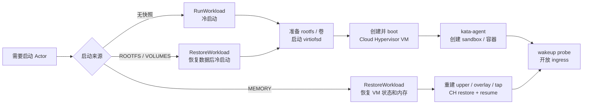
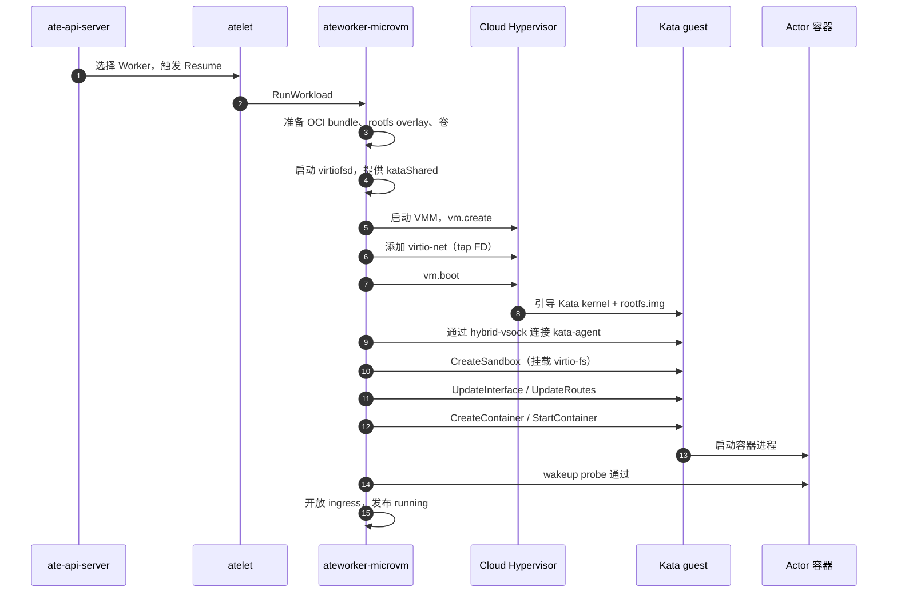

## 关于Substrate的几个问题

### substrate中microvm与kata的关系？

substrate并没有直接使用kata运行时。

标准kata:

```
Kubernetes / CRI
  -> containerd
  -> containerd-shim-kata-v2
  -> kata-runtime
  -> VMM（QEMU / Cloud Hypervisor / ...）
  -> kata-agent
```

Substrate的路径是：

```
atelet
  -> ateworker
  -> Cloud Hypervisor
  -> kata-agent
```

具体差异：

- 不使用 kata-runtime 和 kata shim。ateworker-microvm自己启动Cloud Hypervisor，自己创建VM、配置网络、挂载共享目录。
- 一个Actor一个 microVM，不是标准Kata 的“一个 Pod 一个 VM”。一个 Actor的多个容器共享这个VM；一个 Worker Pod 又可以承载多个 Actor。
- Kata只提供 guest 内能力：kata-agent 的 ttrpc API、guest kernel、guest rootfs、virtiofsd 等。
- rootfs 由宿主机组装：OCI 镜像作为只读 lower，每 Actor 可写 upper 放在宿主机，通过 virtio-fs 共享给 guest。guest 不自己挂 overlay，rootfs 写入消耗宿主机磁盘，而不是 guest 内存。
- 快照不用 Kata 的 checkpoint：使用 Cloud Hypervisor 的 VM 快照，rootfs upper 和卷由 ateworker 单独打包。

### substrate中启动microvm的流程？

先分两条路径：

- **冷启动**：没有可恢复快照时走 `RunWorkload`；从 `ROOTFS` / `VOLUMES` 快照恢复时走 `RestoreWorkload`，但底层仍冷启动一个完整 microVM。
- **热恢复**：有可用的 `MEMORY` 快照，包括模板的 golden 快照或 Actor 最近快照。走 `RestoreWorkload`，直接恢复 Cloud Hypervisor 的 VM 状态和内存，不重新走完整 boot。

模板 golden 快照可用时，Actor 首次启动通常也走 `MEMORY` 恢复；没有可用快照才冷启动。



#### 冷启动主线



1. **控制面调度**

   - `ate-api-server` 为 Actor 选择 Worker。
   - 没有快照时，`atelet` 调 `RunWorkload`；有快照时调 `RestoreWorkload`，后者根据保真度选择内存恢复或冷启动。
   - `RunWorkloadRequest` 带上 Actor 目录、容器列表和运行时资产路径。
   - microVM Worker 必须有 `/dev/kvm`。
   - `atelet` 按 `SandboxConfig` 从对象存储拉取或复用缓存的 `cloud-hypervisor`、`virtiofsd`、`vmlinux`、`rootfs.img`，把路径传给 ateworker；这些资产不在 Worker 镜像里。
2. **准备 rootfs 和共享目录**

   - 为每个容器准备 OCI bundle。
   - lower 是只读 OCI 镜像 rootfs，upper 是宿主机上的每 Actor 可写目录。
   - 宿主机用 overlayfs 合并 lower/upper，容器 rootfs 放到共享目录的 `<container-id>/rootfs`。
   - Actor 的多个容器共享同一个 microVM，但每个容器有自己的 overlay rootfs 和 kata container id。
   - `DurableDir`、CSI 卷、system-info 卷也放进同一共享目录。
   - 启动一个 `virtiofsd`，通过 `kataShared` virtio-fs 共享给 guest。
   - rootfs 写入落在宿主机磁盘，不占 guest RAM。
3. **创建 Cloud Hypervisor VM**

   - 启动 Cloud Hypervisor VMM，创建 API socket。
   - `vm.create` 配置：
     - vCPU 数：`ceil(cpuMillicores / 1000)`，最少 1。
     - guest RAM：Actor 的 `memoryBytes`，最少 128 MiB。
     - 直接引导 Kata `vmlinux`。
     - Kata `rootfs.img` 作为只读 virtio-pmem，挂载为 `/dev/pmem0p1`，使用 DAX。
     - `kataShared` virtio-fs 设备。
     - hybrid-vsock，CID 3，供 `kata-agent` 使用。
     - virtio-console，输出 guest 日志。
   - 在 Actor 的网络命名空间创建 tap，把 tap FD 通过 `SCM_RIGHTS` 传给 Cloud Hypervisor，作为 virtio-net。
   - Cloud Hypervisor 和 `virtiofsd` 放在 Actor 的 cgroup 中，受 Actor 的 CPU 和内存限额约束。
   - 调用 `vm.boot` 启动 guest。
4. **guest 内启动**

   - guest kernel 引导 Kata rootfs，启动 `kata-agent`。
   - ateworker 等 vsock socket 出现，再通过 hybrid-vsock 建立 ttrpc 连接。
   - 调用 `CreateSandbox`，让 agent 挂载 `kataShared`。
   - 调用 `UpdateInterface`、`UpdateRoutes`、`AddARPNeighbors` 配置 guest 网络。
   - 对每个容器调用 `CreateContainer` 和 `StartContainer`。
   - 启动 stdout/stderr 转发和 guest 统计采集。
5. **就绪**

   - 等所有启用了 wakeup probe 的容器返回 200。
   - 开放 ingress，Actor 进入 running。
   - 之后请求通过 `atunnel` 转发到 guest 内的容器。

#### 热恢复和冷启动的差别

`MEMORY` 快照恢复不是重新 boot，而是：

1. 从 tar 恢复每个容器的 rootfs upper。
2. 重建宿主机 overlay，启动 `virtiofsd`。
3. 改写快照里的 socket 和资产路径。
4. 重建 tap，因为快照里的 virtio-net 使用 FD，恢复时需要新 FD。
5. 启动 Cloud Hypervisor，执行 restore，默认用 `userfaultfd` 按需恢复 guest 内存。
6. resume，重新连接 `kata-agent`，reseed guest CRNG，等 wakeup probe。

`ROOTFS` / `VOLUMES` 快照没有 guest 内存，恢复时仍走冷启动，只是先把 rootfs upper 或卷放回去。

#### 关键代码

- `cmd/ateworker-microvm/run.go`：`RunWorkload`、`coldBootActor`、`buildVMConfig`
- `cmd/ateworker-microvm/internal/kata/overlay_linux.go`：宿主机 overlay 和 `virtiofsd`
- `cmd/ateworker-microvm/internal/kata/agentclient.go`：kata-agent ttrpc 调用
- `cmd/ateworker-microvm/checkpoint.go`、`restore.go`：挂起和恢复

### 为什么不直接采用RuntimeClass + Kata?

核心原因是Pod作为k8s调度的基本单位，无法满足大规模高密度沙箱的要求。且要求沙箱具有checkpoint暂停恢复的能力。Pod的语义中没有快照/暂停/恢复，无法满足要求。

所以Substrate创造了Actor作为调度的基本单位，复用k8s的基础物理节点资源管理能力，提供WorkerPool。将Actor调度到WorkerPool中的一个Worker Pod中。对Actor进行checkpoint暂停恢复。

### 为什么采用PostgreSQL作为专用存储？

Substrate 需要的是一个专门承载 Actor 控制面动态状态的事务型数据库。PostgreSQL 提供了事务、行锁、租约、事务性事件、索引和成熟运维能力；Kubernetes 的 CRD/etcd 更适合低频、声明式的基础设施资源，Actor 的创建、调度、恢复、挂起、迁移都会频繁更新状态，不适合百万级 Actor 的高频状态变化。

Substrate 有意把状态分成两类：

| 数据                                               | 存储                  | 原因                                    |
| -------------------------------------------------- | --------------------- | --------------------------------------- |
| WorkerPool、SandboxConfig                          | Kubernetes CRD / etcd | 低频、声明式，需要 RBAC、审计和平台策略 |
| Actor、Worker、ActorAssignment、ActorTemplate、Tag | PostgreSQL            | 高频、强一致、需要事务和复杂查询        |
| 快照数据                                           | 对象存储              | 大对象，不适合放数据库                  |

Substrate要实现超卖以及100ms级恢复，就需要绕过k8s控制面的调度和一致性延迟。因此，Actor的动态状态必须放在一个独立、低延迟、可扩展的状态存储里。

需要原子分配和并发控制，这是PostgreSQL最关键的价值之一。

一次 Actor 调度不是简单写一行记录，而是要在同一个事务里完成：

- 检查 Worker 是否还有容量。
- 占用 Worker 的容量。
- 把 Actor 绑定到 Worker。
- 创建 ActorAssignment。
- 更新 Actor 状态。
- 追加一条 Worker 事件。

这些操作必须原子完成，否则会出现：

- 两个 Actor 被分配到同一个 Worker，导致容量超卖。
- 同一个 Actor 被重复绑定。
- Actor 状态和 assignment 不一致。
- 多个 ate-api-server 副本同时调度，互相覆盖。

PostgreSQL 提供了：

- SELECT ... FOR UPDATE 行锁。
- 事务。
- 版本号条件更新。
- 唯一约束和外键。
- SKIP LOCKED 批量清理。

代码里，BindActorToWorker 会先锁 Worker 行，再检查容量、更新 Actor、插入 assignment，最后提交。这样并发调度会被行锁串行化，容量检查才是可靠的。

Substrate 选择 PostgreSQL，不仅是因为它“比 etcd 快”，而是因为它需要一种支持事务、行锁、租约、事件、授权和复杂查询的专用状态库，来承载百万级 Actor 的高频生命周期；etcd/CRD 适合低频声明式资源，不适合这个角色。更准确地说，Substrate 需要的是“专用事务型状态存储”，PostgreSQL 是满足这些需求且运维成熟的选择。
