# Agent Substrate介绍

## 什么是 Agent Substrate？

Agent Substrate 是一个经过安全加固的零信任运行时，用于运行沙箱化智能体，旨在安全地运行数百万个智能体和工具，密度比标准容器高 10 倍。Substrate 专为自主智能体时代打造，可在 400 毫秒以内快速恢复运行，每秒激活超过 1500 次。智能体获得隔离的计算、身份、网络和存储；敏感凭据不会被不可信代码触及。它支持多种沙箱技术（包括 microVM 和 gVisor），并为所有沙箱提供一致的生命周期和管理。

其核心是，Agent Substrate 将更大规模的“Actor”（智能体等有状态工作负载）映射到规模更小的就绪“Worker”池中。由于智能体大部分时间都在等待模型、工具或人类，Substrate 会为闲置 Actor 生成快照并将其移出内存，在请求到达时再恢复。

Substrate 是一个不强制特定方案的运行时，而不是智能体 SDK。它运行的工作负载不一定是 AI 智能体，不过其隔离和调度模型的目标正是自主、不可信且大部分时间闲置的智能体。它运行在标准 Kubernetes 之上：Pod、自动扩缩容和 NetworkPolicy。它额外提供面向智能体的调度、快照、身份和网络代理。这使智能体、推理、训练和强化学习工作负载能够共享同一基础设施平面。

**Agent Substrate 是构建在 Kubernetes 之上的系统，用于管理类智能体工作负载，** 以比单独使用 Kubernetes 更高的规模、效率和更低的延迟运行。它把 Kubernetes 控制平面从关键路径中移除，通过将更大规模的“Actor”（智能体等应用）映射到更小规模的就绪“Worker”（Kubernetes Pod）集合，实现更低延迟。Agent Substrate 利用类智能体应用大部分时间处于空闲状态这一特点，实现高强度多路复用。

[](https://ate.dev)

## 性能与多路复用

Substrate 的核心开发体验和“智能体基础设施”能力：

1. **Actor 瞬移：** 在需要时将 Actor 挂起并恢复到池中的任意可用 Worker 上。
2. **全状态持久化：** 工作内存（RAM）和文件系统状态都会捕获到快照中，并在休眠周期之间完整恢复，不会丢失进行中的会话或工具状态。
3. **10–30 倍超售：** 将大量有状态 Actor 复用至少量预热 Worker Pod 上，只在智能体主动思考或执行工具时支付计算成本。

## 框架无关与兼容性

Agent Substrate 与框架和智能体运行框架（agent harness）无关。因为它在 gVisor 或 microVM 沙箱中运行标准 OCI 容器镜像，并在工作负载之外实施安全策略，所以无需修改 SDK 即可承载任意技术栈构建的智能体：

* **智能体开发工具包（Agent Development Kit，ADK）：** 将会话状态作为 Actor 状态保留在多次调用之间。
* **LangChain：** 为 LangChain 智能体和工具调用提供开箱即用的执行环境。
* **Claude Code、Codex 和 Antigravity：** 高密度、有状态的编码环境，在会话之间保留系统和文件系统状态，同时隔离不可信代码执行。
* **模型上下文协议（Model Context Protocol，MCP）：** 将沙箱化 MCP 服务器部署为 Substrate Actor，并为其提供每个 Actor 独立的身份和出站控制。

## 架构

**其核心是，Agent Substrate 将更大规模的“Actor”（智能体等应用）映射到规模更小的就绪“Worker”池中，利用类智能体应用大部分时间空闲的特点实现高强度多路复用。它提供管理 Actor 生命周期的功能，例如创建/销毁、挂起/恢复，实时把 Actor 分配给 Worker，并把入站流量路由到它们。**

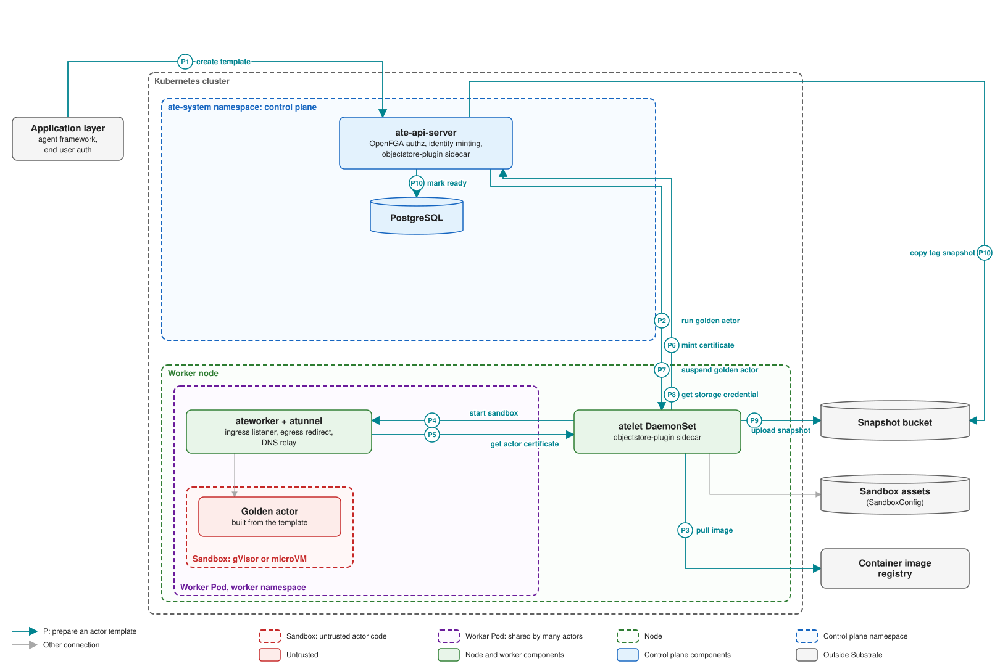

Actor: 指类智能体工作负载的一个实例。（此类工作负载特征： 通常具有极强的突发性：大部分时间在等待输入或事件，然后处理这些事件，接着回到等待。它们真正做事的时间往往很短，而等待时间可能没有上限。由于它们经常运行不可信逻辑，通常运行在沙箱中）

### 将 Actor 生命周期与 Worker（Kubernetes Pod）解耦

由于许多智能体运行不可信代码，我们需要在某种沙箱中运行它们。Agent Substrate 设计为支持多种沙箱技术，常见选项包括 [gVisor](http://gvisor.dev) 和 [Kata Containers](https://katacontainers.io/) 等 microVM。两者都支持挂起和恢复的概念，这是 Agent Substrate 功能的核心。

Agent Substrate 从挂起和恢复出发。当 Actor 空闲时，我们挂起它，释放其占用的资源。当需要处理事件时，再恢复该 Actor。为避免经过 Kubernetes 调度器的延迟，我们预先启动长期运行的“Worker”Pod，它们只是等待工作的沙箱。事件到达时，我们把它分配给一个 Worker，由该 Worker 恢复 Actor。这样就能把大量 Actor 复用到少量 Worker 上，在实现更高密度和效率的同时降低延迟。

### 聚焦的控制平面

Agent Substrate 包含一个小型、聚焦的控制平面组件，专注于 Actor（智能体沙箱）的大规模、高 QPS 和低延迟挂起/恢复操作。它依赖 Kubernetes 控制平面进行基础设施和 Worker（Pod）供给，这些都是低频操作，非常契合 Kubernetes 在基础设施生命周期管理和工作负载资源隔离方面的优势。

### 智能体感知路由

为了实现按需恢复 Actor，我们需要能够拦截并检查网络流量。Agent Substrate 包含一个轻量级、感知 substrate 的网络代理，可以检查入站流量并在需要时触发 Actor 恢复。

### 与Kubernetes的关系

Kubernetes 是运行现代工作负载的行业标准平台。它旨在支持各种工作负载，并能扩展到非常大的集群。Agent Substrate 利用 Kubernetes 进行基础设施供给和 Worker 生命周期管理，即 Kubernetes Pod。它构建在 Pod 和 Pod 自动扩缩容等 Kubernetes 特性之上，同时提供智能体专属调度和控制以实现更低延迟。以 Kubernetes 作为底层系统，可以在端到端智能体部署所需的所有工作负载类型之间实现一致的基础设施管理，并支持跨智能体、推理和训练周期的 RL 场景做整体基础设施优化。

#### 为什么 Agent Substrate 需要专用控制平面？

* 空闲 Pod 仍然消耗资源。虽然 Kubernetes 可扩展性很强，但计算容量有限且有真实成本。无论是 CPU 时间、内存空间，还是每节点 Pod 数量，类智能体工作负载的效率都很差。
* Kubernetes API server 并非为处理数百万资源而设计。它擅长在多个控制器之间异步协调资源，但不擅长存储海量离散资源，也不擅长处理巨大的写流量。
* 在 Kubernetes 上调度工作负载需要多个异步过程收敛，加上多次网络跳转、镜像拉取等步骤，成本会累积。让 Pod 在几秒内运行起来，对运行数小时或数天的 Pod 来说很好；但对只运行几毫秒到几秒的工作负载来说，这种延迟不可接受。
* 状态管理很困难。Kubernetes 提供了管理状态的 API，即 PersistentVolume，但它并非为数百万卷、数据量差异巨大且高速挂载/解绑而设计。

为 Actor 使用专用的 Agent Substrate 控制平面，使我们能够实现大规模、低延迟控制。我们仍然依赖 Kubernetes 进行基础设施供给，例如 Worker Pod，以及工作负载隔离，这正是 Kubernetes 擅长的部分。

> substrate与k8s的关系： substrate依赖k8s提供基础设施和Worker供给，将低频操作，基础设施物理节点管理等交给k8s，而高频操作，Actor挂起/恢复等交给substrate，基础设施，物理节点的管理如果不交给k8s，就需要substrate自己去做，而复用k8s的这部分能力，是substrate的一个设计选择。

#### 高层设计

Substrate 管理员把 Agent Substrate 部署到 Kubernetes 集群中。他们配置将用于执行 Actor 的 WorkerPool，并准备 substrate 控制平面以供使用。Worker Pod 被启动，等待分配。

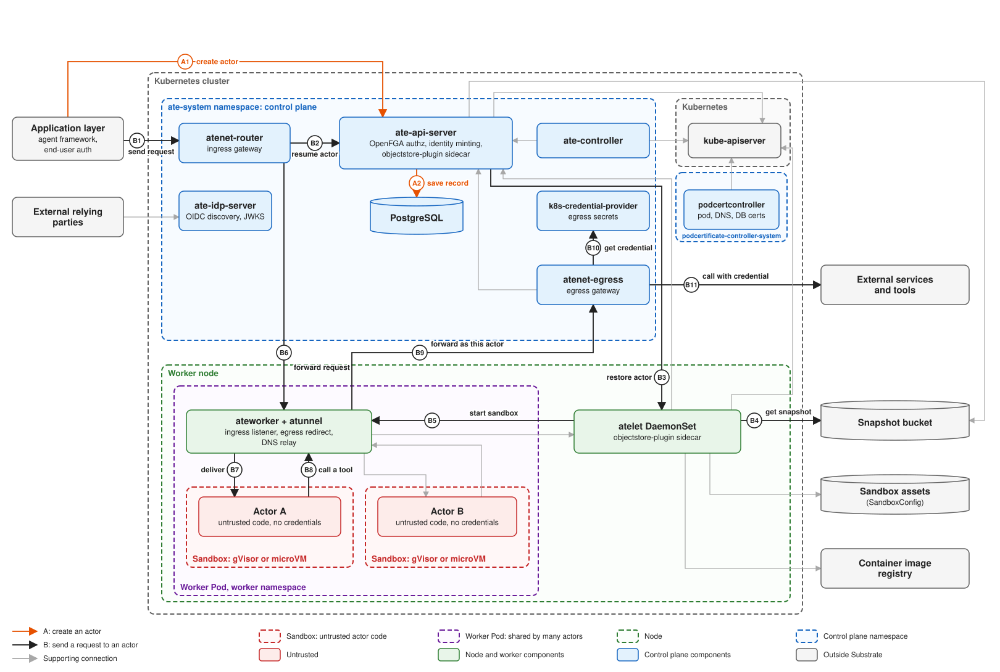

<font color=blue>智能体开发者定义一个，即 ate API 资源，它描述实例化该Actor意味着什么：运行哪个OCI镜像、需要多少内存、行为参数等。</font> <font color=red>Agent Substrate 使用该 ActorTemplate 创建 Actor 的“golden snapshot”，以后将用来快速启动该 Actor 的实例。</font>

<font color=green>智能体用户或上层系统请求实例化一个Actor。他们指定使用哪个ActorTemplate以及其他参数。</font> <u>Agent Substrate 在其控制平面存储中创建 Actor 记录，跟踪该 Actor 的状态，挂起或运行中。</u>

<font color=green>当针对该 Actor 实例的请求到达时，Agent Substrate 的代理拦截请求。它查询控制平面，判断该 Actor 当前是否正在运行。如果没有，就把 Actor 分配给一个 Worker，这涉及告诉节点级组件，即 ，把 Actor 最近的快照恢复到该节点上的 Worker 中。随后请求被转发给 Actor。</font>

最终，用户或上层系统用完该 Actor，或者它已空闲一段时间。它可以请求 Agent Substrate 挂起该 Actor，创建快照并释放 Worker。下次针对该 Actor 的请求到达时，它会再次被恢复，可能在不同的 Worker 上。

### API 资源模型

Agent Substrate 根据持久化需求和状态转换频率，把资源分为两类。

- 基础设施层面（低频）
- 工作负载层面（高频）

#### 系统配置（声明式）

> 基础设施资源层面

这些资源定义系统的期望状态，用于管理操作和 Actor 环境定义。

* **SandboxConfig**（Kubernetes CRD）：集群作用域资源，保存某个运行时家族的沙箱二进制文件，即 gVisor runsc 二进制文件或 microVM kernel/firmware/config。列出某个沙箱类别（`gvisor` 或 `microvm`）的沙箱运行时版本和资产。每个 `WorkerPool` 为其类别解析一个 `SandboxConfig`。
* **WorkerPool**（Kubernetes CRD）：声明预热Worker容量，即一组预先启动的 Worker Pod。它由`atecontroller`协调为 Kubernetes `Deployment`。它管理一组已初始化、准备接收恢复后 Actor 状态的待命 Worker Pod。可选的 `spec.template` 字段配置 Worker Pod 的节点选择、toleration、priority class 和 node affinity。
* **ActorTemplate**（ate API 资源）：Actor版本的不可变定义。Actor“类”的定义：容器镜像和快照配置。它封装生成golden快照所需的容器镜像、配置和环境。创建`ActorTemplate`默认会触发创建`Golden Snapshot`。把`snapshotConfig.goldenSnapshotConfig.mode`设为`GOLDEN_SNAPSHOT_MODE_DISABLED`可跳过。模板被视为不可变：新版本应创建新模板，而不是编辑现有模板。它类似 Pod 模板，但面向可 checkpoint 的工作负载ActorTemplate 通过 substrate gRPC API 创建和管理，例如 `kubectl ate create actor-template`，并存储在控制平面状态存储中；它们不是 Kubernetes 对象。

```
K8s Worker 物理节点 (node1/node2/node3，物理机)
  └── kubelet
       └── substrate Worker Pod (普通 K8s Pod)
            └── ateworker 容器
                 ├── Actor A (gVisor/microVM 沙箱)
                 ├── Actor B (gVisor/microVM 沙箱)
                 └── Actor C ...
```

> 逻辑关系：一个k8s Worker节点上可以跑多个substrate Worker Pod；一个substrate Worker Pod里又可以跑多个Actor沙箱。

#### 动态实例状态（基于数据库）

> 工作负载层面

这些资源表示单个 Actor 和 Worker 的高频、短暂状态。它们存储在高性能、低延迟的状态存储 PostgreSQL 中，以支持实时操作。(因为变化太频繁，不适合etcd)

- <font color=blue>：ActorTemplate 的一个具体实例。</font> Actor 记录跟踪其全局唯一标识符、物理位置，即 Worker IP、生命周期状态，例如 `RUNNING` 或 `SUSPENDED`，以及版本特有的状态元数据。
- **Worker**：WorkerPool 中 Worker Pod 的表示。它跟踪 Worker 的唯一标识符、状态，即 `ACTIVE`、`UNAVAILABLE` 或 `DRAINING`、容量和已分配资源，以及它当前承载的 Actor，每个 Actor 由一个 `ActorAssignment` 子资源表示。
- Atespace: Actor 所属的隔离边界，也是其身份的前半部分。Actor 通过 (atespace, name) 寻址，因此同一个名字可以存在于两个 atespace 中。Atespace 是全局作用域，不是 Kubernetes 命名空间。ActorTemplate 和 Tag 也位于 atespace 中，而 WorkerPool 位于 Kubernetes 命名空间中。必须先有 atespace 才能在其中创建任何资源，且只有当其 Actor、ActorTemplate 和 Tag 都消失后才能删除它。
- Tag：从挂起 Actor 创建的、持久的 atespace 作用域快照记录，或由 ate-api-server 为模板 golden 快照创建。每个 Tag 在对象存储中持有自己的快照副本，可以限定在自己的 atespace 中，也可以跨 atespace 发布。

#### 双层模型

Agent Substrate 使用这种双层模型来同时优化可靠性和性能：

1. **可扩展性**：把数百万 Actor 的高频、大规模管理卸载到专用状态存储，避免每秒数千次更新压垮主集群控制平面。
2. **延迟**：实现 100ms 恢复需要低延迟状态查找和原子 Worker 分配，绕开标准 Kubernetes API server 的最终一致性和可变延迟。
3. **治理**：把基础设施资源，即 WorkerPool 和 SandboxConfig，保留为 Kubernetes 对象，使平台团队能对其应用熟悉的 RBAC、审计和策略执行；而工作负载定义，即 ActorTemplate，则通过 substrate API 管理，由该 API 自己认证和授权调用方

### 资源模型

上述 Kubernetes 资源和控制平面记录，及其关系和基数，以 UML 类图表示：

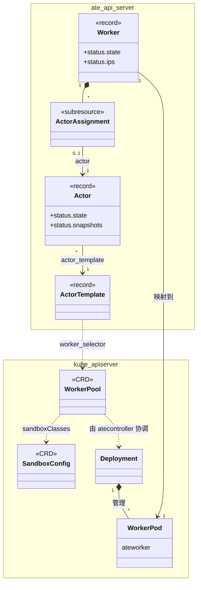

### 系统组件

#### 控制平面（`ate-api-server`）

系统的大脑。它向数据平面和 CLI 暴露 gRPC API，用于管理 Actor 生命周期。

* **状态存储**：在 PostgreSQL 中跟踪 Actor 到 Worker 的映射。
* **调度器**：为恢复请求选择一个就绪 Worker。
* **工作流引擎**：编排多步 Resume/Suspend 序列，包括锁获取、存储下载和沙箱恢复。
* **身份验证与授权**：认证每个 RPC，并用嵌入式 OpenFGA 模型按 atespace 授权。

#### 节点监督程序（`atelet` + `ateworker`）

节点级子系统管理沙箱的物理执行和快照移动。

* **atelet**：作为 DaemonSet 运行在每个节点上的轻量监督程序。它管理本地 Worker Pod，并与控制平面通信。
* **ateworker**：运行在每个物理 Worker Pod 内部的 Worker 容器镜像，即 `ateworker-gvisor` 或 `ateworker-microvm`，每个沙箱类别一个。它为 `atelet` 提供 gRPC 接口，以触发 `RunWorkload`、`CheckpointWorkload` 和 `RestoreWorkload` 操作。这种分离确保物理 Pod 生命周期与沙箱化智能体进程解耦。
* **生命周期管理**：`ateworker` 进程调用沙箱运行时，在物理 Pod 边界内对进程做 checkpoint 或恢复：gVisor 用 `runsc`，microVM 用 Kata + Cloud Hypervisor 栈。注意：gVisor 后端目前需要带有 `--allow-connected-on-save` 标志的 `runsc` 版本，以绕过 checkpoint 期间网络恢复的一个 bug。
* **存储搬运**：外部快照通过*对象存储插件*移动，这是一个 sidecar，在其 Pod 内通过 Unix socket 提供 `objectstore.v1` gRPC API。`atelet` 的 sidecar（`NodeProvider`）上传和获取快照文件；`ate-api-server` 的 sidecar（`ControlProvider`）复制和删除整个快照。两个主进程都不直接为快照与对象存储通信。内置插件 `cmd/objectstore-plugin` 用 GCS 或 S3 支撑该 API；sidecar 上的 `ATE_STORAGE_BACKEND`，未设置或 `gcs`，或 `s3` 配合 `AWS_*` 变量，选择后端，见 `manifests/ate-install/atelet.yaml`、`ate-api-server.yaml` 以及 kind overlay 中的 S3 示例。同一个 `atelet` sidecar 还提供 `AssetProvider`，获取所有沙箱资产；只有当插件无法服务某个 `gs://` 资产时，`atelet` 才匿名读取它，这覆盖 `gs://gvisor` 这样的公共 bucket。插件把每次下载暂存到 `atelet` 无法读取的位置，只有 sha256 匹配时才复制到 `atelet` 缓存；它拒绝快照位置下的任何 URL。`atelet` 会再次校验 sha256，并且自身没有对象存储凭据或设置。
* **沙箱资产缓存**：`atelet` 为每个 Actor 运行的沙箱二进制文件维护一个节点本地、内容寻址缓存，并给每个 Actor 提供指向它的硬链接。它预热每个本地 Worker 的默认运行时，并在 Worker 目录下保持其链接，同时按字节预算淘汰，绝不淘汰 Actor 或 Worker 仍在使用的资产。见[沙箱资产缓存](sandbox-asset-cache.md)。

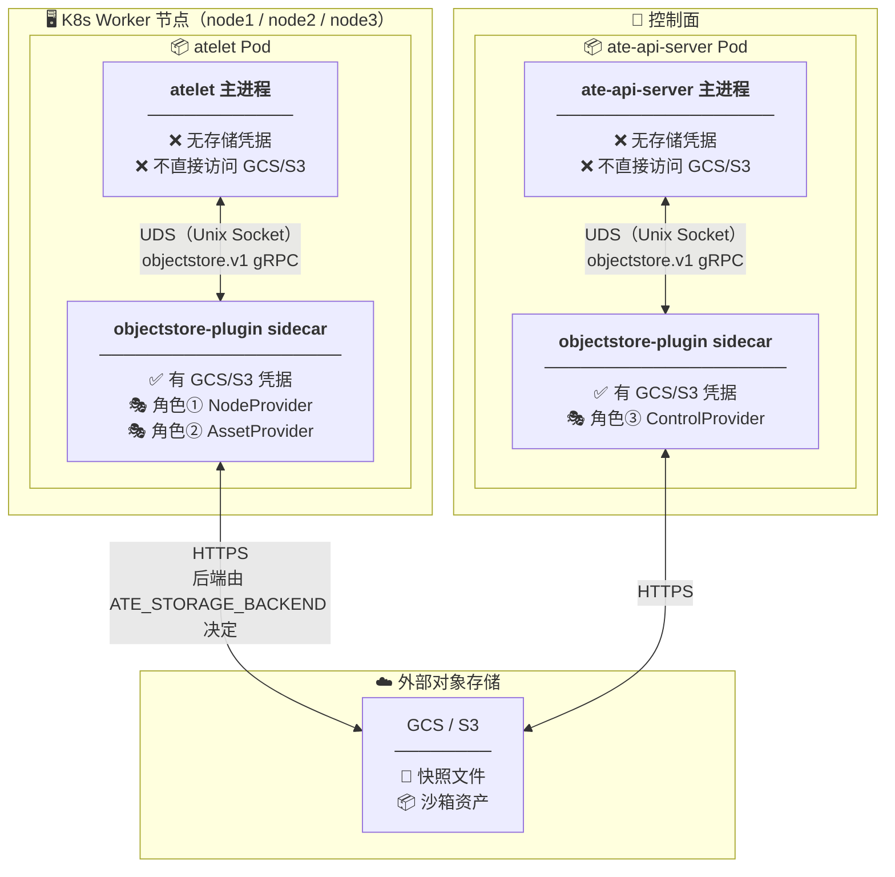

atelet 上传 / 获取快照（NodeProvider）

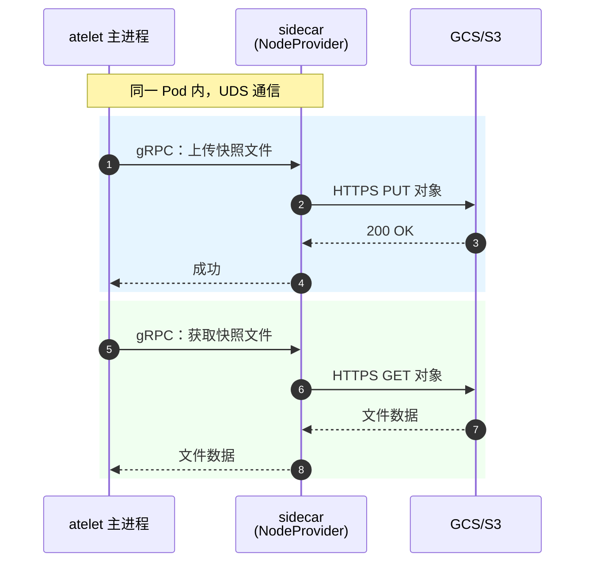

ate-api-server 复制 / 删除快照（ControlProvider）

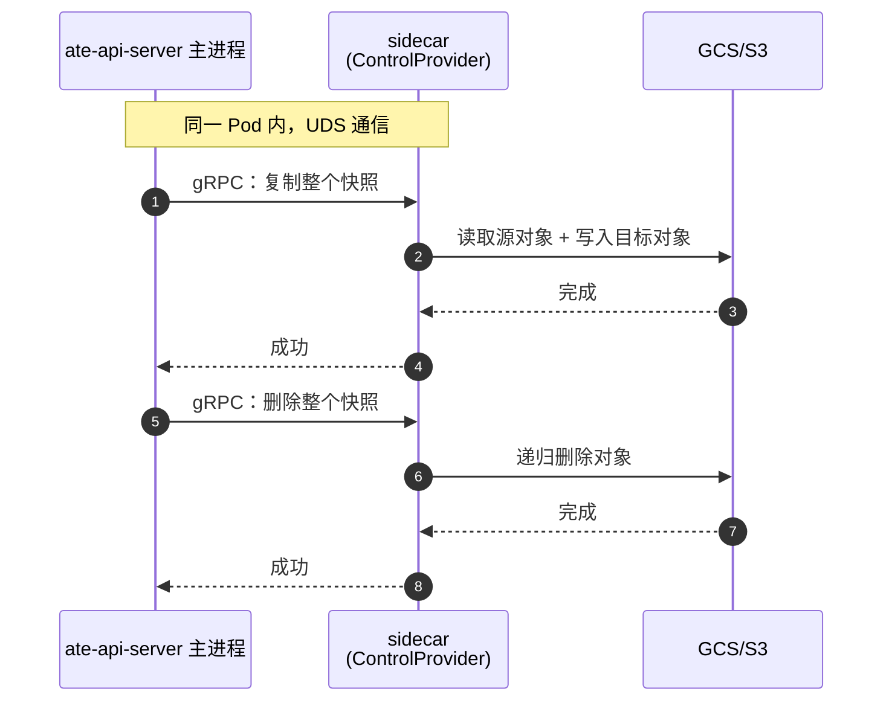

### 沙箱类别

`WorkerPool` 选择**沙箱类别**，即 `spec.sandboxClasses[].name`，每个类别都有对应的 `ateworker` 镜像。沙箱二进制文件本身不会烘焙进 Worker 镜像，而是在运行时来自 `WorkerPool` 为其类别解析的集群作用域 [`SandboxConfig`](../reference/api-guide.md#3-sandboxconfig-the-sandbox-itself)，可以是显式 `configRef`，也可以是类别默认值。每份快照都记录其创建时所在的沙箱运行时，内存恢复会在仍提供该运行时的 Worker 上运行，因此升级运行时后恢复仍可复现。各类别对工作负载可见的差异见[沙箱类别](../reference/sandbox-classes.md)。

* **gVisor**（`ateworker-gvisor`，默认）：在 `runsc` 下运行工作负载，实现内核级沙箱隔离。==挂起和恢复使用 gVisor 原生的沙箱进程树 checkpoint/restore==。`DurableDir` 卷和每个容器的 rootfs overlay 会保存为独立文件系统 checkpoint bundle，即 `fs/` 和 `rootfs/`。`MEMORY` 快照会把它们从进程 checkpoint 中拆出。`VOLUMES` 和 `ROOTFS` 快照只用 `runsc fscheckpoint` 保存所需 bundle，不含内存，并在冷启动时恢复它们。
* **microVM**（`ateworker-microvm`）：在 [Cloud Hypervisor](https://www.cloudhypervisor.org/) VMM 上的 [Kata Containers](https://katacontainers.io/) guest 中运行工作负载。挂起和恢复捕获仅含内存的 VM 快照，并用 `userfaultfd` 按需分页恢复。容器 rootfs 写入由宿主机支撑：overlay 在宿主机上组装，即只读 OCI 镜像 lower 加上每 Actor 可写 upper，并通过单一 virtio-fs 共享提供给 guest，因此消耗的是可回收的宿主机页缓存，而不是 guest RAM。`ROOTFS` 和 `MEMORY` 快照把 upper 作为独立 tar 一起打包，`ROOTFS` 恢复会把它放回并以其冷启动。`DurableDir` 卷也通过同一共享传输，并同样打包为 tar，因此 `VOLUMES` 快照无需任何 guest 内存即可捕获它们。每个卷是共享中的一个子目录，所以 Actor 可以有多个卷而不会增加设备成本。

#### 快照

三层快照：快照层级越高，保存的状态越完整，恢复越快（不用冷启动），但体积越大

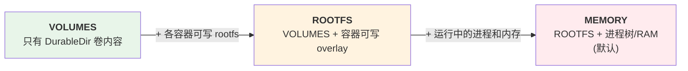

关于卷与rootfs:

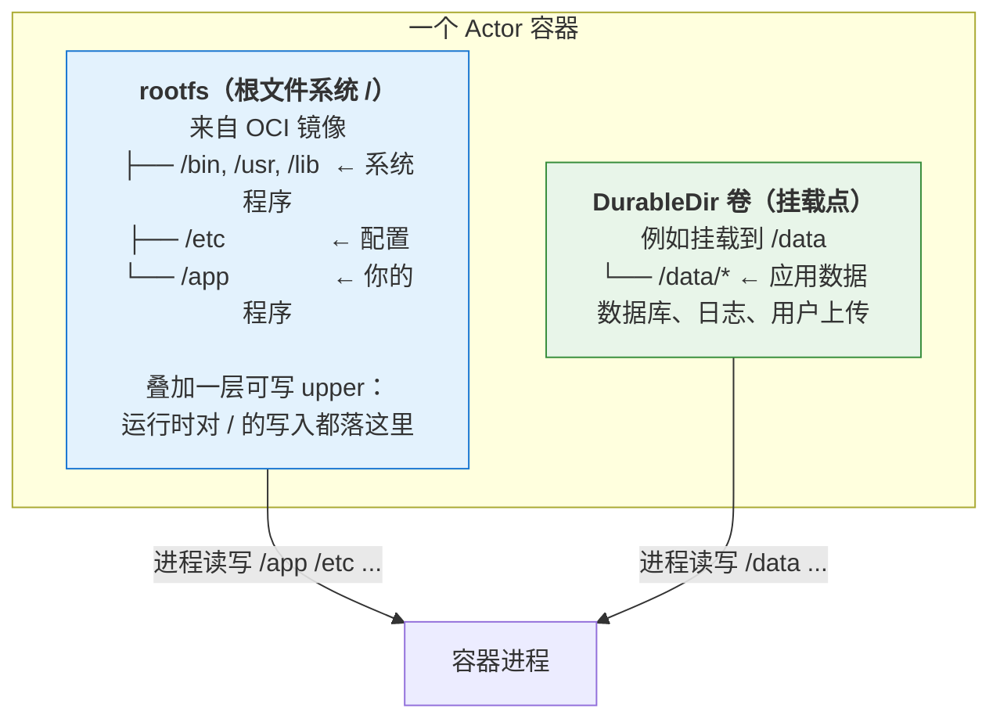

快照恢复行为：

- VOLUMES 保住卷，但 rootfs 改动丢了 → 你 pip install 的包、/app 的改动都没了，应用得能从零启动。
- ROOTFS 把 rootfs 改动也保住 → 装过的包、改过的代码都在，但要重启进程。
- MEMORY 连进程内存都保住 → 完全不重启，直接接着跑。

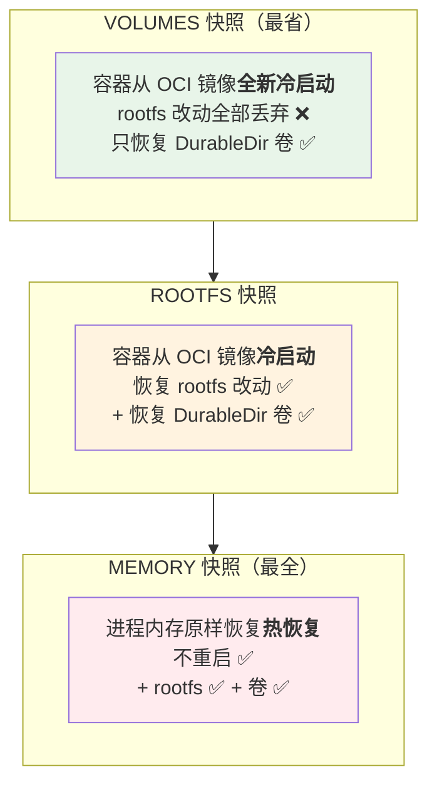

gVisor 方式（默认，进程级沙箱）：gVisor 用 runsc 做内核级隔离。核心：进程树/RAM 和文件系统是拆开存的。

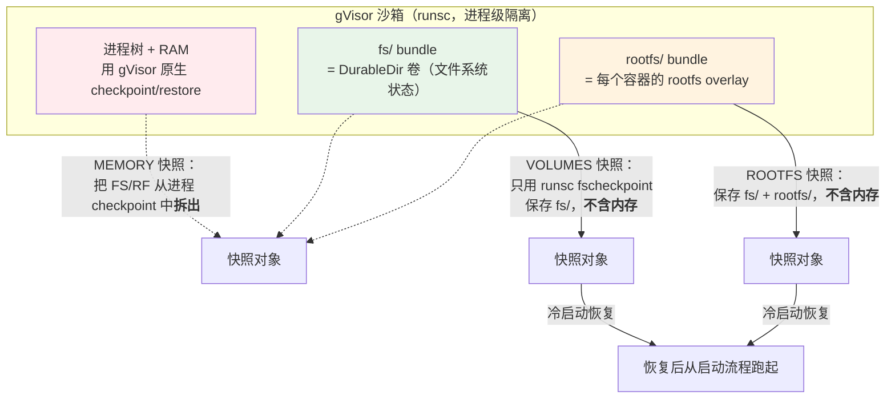

microVM 方式（VM 级沙箱）: microVM 用 Kata + Cloud Hypervisor 跑一个完整 VM。核心差异：rootfs 写入放在宿主机上，通过 virtio-fs 共享给 guest，内存和文件系统彻底分离。

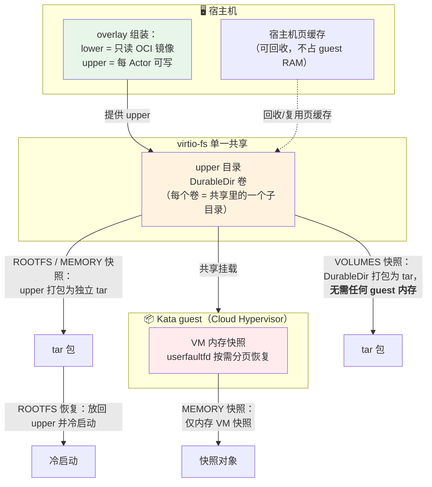

### 网络栈（`atenet` + `atunnel`）

> 安全隔离边界除了执行层面，还有网络层面。执行层面将破坏隔离在VM内（kata），网络层面限制入站与出站，即限制网络边界。限制它访问的范围，限制它传播的范围。

处理智能体感知的 ingress 路由、按需恢复和执行策略的 egress。

* **入站路由**：`atenet-router` 运行 Envoy 和 `ext_proc` 外部处理器。上层系统连接到路由器，并通过 `ate-target-actor` 提供 Actor 目标，格式为 `<atespace>/<actor>`。ext_proc 调用控制平面恢复 Actor 并解析其当前 Worker assignment。`Host` 仍是应用的 authority，不用于选择 Actor。
* **Worker 隧道**：解析 assignment 后，`atenet-router` 向 Worker 上 8443 端口的 `atunnel` 监听器建立 mTLS `CONNECT` 隧道。`atunnel` 由 `ateworker` 托管，通过其私有 veth 接口把请求转发给活跃 Actor。Worker Pod 的 80 端口不是直接的 Actor 入站路径。使用 `--upstream-connect=false` 时，Envoy 路由器改为通过 443 端口的 HTTPS 访问 `atunnel`。
* **任意端口入站**：客户端通过 HTTP `CONNECT` 请求访问 Actor 默认端口 80 以外的端口，在 authority 中指定端口，例如 `CONNECT <actor-dns>:9090`，而不是使用单独的头或字段。`atenet-router` 在专用监听器上终止 `CONNECT`，并把隧道流量按普通请求的同一入站路径重新送入，因此长寿命隧道内的每个请求仍会恢复 Actor，并在它迁移 Worker 时独立重新路由。目前只支持隧道上的 HTTP(S) 流量，非默认端口上的裸 TCP 或其他非 HTTP 协议尚不能这样访问。
* **出站过滤与凭据注入**：Actor 的出站流量通过 `atunnel` 隧道到 `atenet-egress`，后者执行目标策略并解析凭据替换效果，而不会在沙箱中放置环境凭据，见[网络出站契约](../guides/network-egress.md)和[出站凭据注入](../guides/egress-credential-injection.md)。
* **延迟**：数据平面通过绕开 Kubernetes 的最终一致性并执行原子物理分配，针对低延迟激活做了优化。

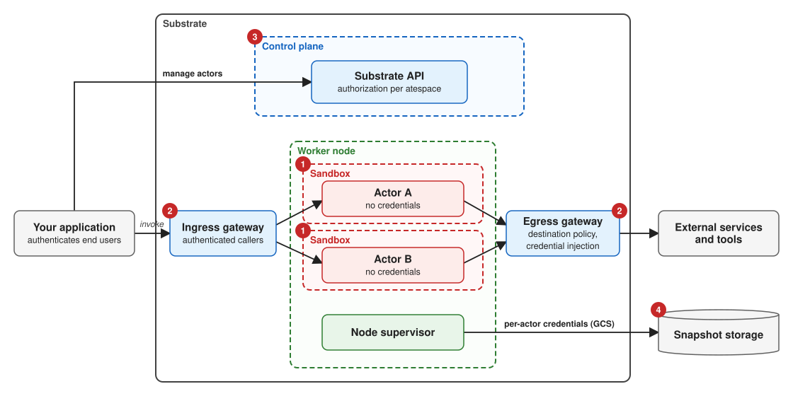

## Actor 生命周期

Actor 的生命周期遵循状态驱动序列。请求通过网络栈到达 Actor，如果它被挂起，网络栈会把它恢复到 Worker 上，见 UML 时序图：

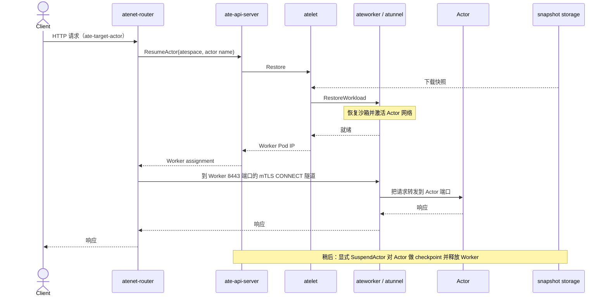

Actor 的 `state` 会经历以下状态，见 UML 状态机图：

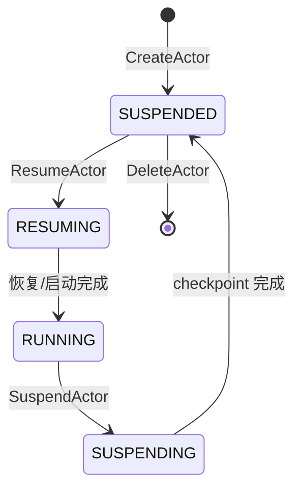

同步和异步 `SuspendActor` 都会经过 `SUSPENDING`，让 Actor 停留在 `SUSPENDED`，并在节点上保留快照本地副本，即 `locality`。区别在于快照何时上传到对象存储：

* 异步挂起，默认，下，`SuspendActor` 在本地 checkpoint 写入后立即返回，此时 `durableSnapshot` 为 `PENDING`。`atelet` 在后台上传快照，即 `--snapshot-upload-delay`，并上报，使 `durableSnapshot` 变为 `COMPLETED`。
* 同步挂起下，`atelet` 在 `SuspendActor` 返回前上传快照，因此 `durableSnapshot` 立即为 `COMPLETED`。
* 只要最新快照有 `locality`，`ResumeActor` 就从该节点上的本地文件恢复。挂起后经过 `--snapshot-detach-delay`，或在 `ResumeActor` 期间该节点没有空间时，`atelet` 会删除本地文件，必要时先上传快照，并清除 `locality` 和 `status.assignedNode`。

对处于 `SUSPENDED` 的 Actor 调用 `SuspendActor`，无论哪种模式都会原样返回。

### 阶段 1：创建（`CreateActor`）

用户或框架调用 `CreateActor`，传入唯一 ID 和对 `ActorTemplate` 的引用。

* **状态**：Actor 以 `ACTOR_STATE_SUSPENDED` 状态注册到数据库中。
* **状态**：记录用元数据初始化，并引用从关联 ActorTemplate 派生出的 **Golden Snapshot**，即版本 0。这确保 Actor 在首次请求时可以立即被灌入预热 Worker。

### 阶段 2：激活（`ResumeActor`）

由网关上的入站请求或显式 API 调用触发。

1. **触发**：网关暂停请求，向控制平面询问 Actor 位置。
2. **分配**：控制平面从 `WorkerPool` 中占用一个预热 Worker。
3. **灌入**：`atelet` 监督程序与 Worker Pod 内的 `ateworker` 进程协作，把 ActorTemplate 的 golden 外部快照，首次运行时，或 Actor 自己的外部快照，后续运行时，恢复到沙箱中。
4. **状态**：状态转换为 `ACTOR_STATE_RUNNING`。Actor 现在拥有活跃的 Worker IP。
5. **响应**：控制平面把 Worker assignment 返回给网关。网关向该 Worker 上的 `atunnel` 打开认证隧道，由其把原始请求转发给活跃 Actor。

### 阶段 3：休眠（`SuspendActor`）

由显式 `SuspendActor` 调用触发。

1. **Checkpoint**：`atelet` 指示 `ateworker` 冻结进程并捕获内存加磁盘快照。
2. **持久化**：`atelet` 在节点上保留快照本地副本，并上传到持久存储，例如 GCS。使用 `DURABILITY_MODE_SYNCHRONOUS` 时，上传在 `SuspendActor` 返回前完成。默认异步模式下，`SuspendActor` 在本地 checkpoint 写入后返回，由 `atelet` 在后台上传。
3. **回收**：物理 Worker 被清理并归还给 `WorkerPool`。
4. **释放**：同步挂起会从对象存储删除 Actor 之前持有的外部快照。异步挂起保留该快照，因为它自己的快照还不持久。它会在更新快照首次变为持久后的第一次挂起时被删除，或由 `DeleteActor` 删除。从 tag 借用的快照不受影响，因为 tag 拥有它。
5. **状态**：状态转回 `ACTOR_STATE_SUSPENDED`，Actor 的 `status.snapshots` 记录其恢复所用的外部快照。

快照可以被赋予 tag，tag 由 Atespace 拥有并按其寻址。同一个 tag 名可以存在于不同 Atespace 中。tag 是不可变别名和保留钉：它持有创建时制作的外部快照副本，因此比创建它的 Actor 更长寿；发布它允许从其他 Atespace 复用，而不改变其 `atespace/name` 地址。删除 tag 会删除该副本；带 tag 的 Atespace 在 tag 删除前不能被删除。

### 阶段 4：恢复（`RevertActor`）与删除（`DeleteActor`）

处于 `ACTOR_STATE_RUNNING` 或 `ACTOR_STATE_CRASHED` 的 Actor，或最新快照在节点本地的 `ACTOR_STATE_SUSPENDED` Actor，可以通过 `RevertActor` 回到其持久快照对应的 `ACTOR_STATE_SUSPENDED`。回退会终止任何活跃沙箱，丢弃任何节点本地 checkpoint 或部分进行中的快照，并保留 Actor 最后一次完成的外部快照，使后续 `ResumeActor` 从该 checkpoint 恢复。

任何状态的 Actor，例如 `ACTOR_STATE_RUNNING`，都可以从控制平面删除。workflow 会终止 Worker 上运行的容器、解绑挂载卷，并在删除记录前释放 Worker assignment。

删除后，Actor 的状态，即内存加磁盘快照，会被垃圾回收。

## 状态管理与持久化

快照最多捕获 Actor 状态的三层累积内容，由 `ActorTemplate` 上的 `snapshotConfig.preferredFidelity` 控制：

1. **`VOLUMES`**：挂载到 Actor 容器中的 `DurableDir` 卷的内容。
2. **`ROOTFS`**：`VOLUMES` 加上自启动以来写入每个容器可写 rootfs overlay 的文件。
3. **`MEMORY`**：`ROOTFS` 加上运行中的进程树和 RAM 状态，`MEMORY` 是默认。

`MEMORY` 和 `ROOTFS` 状态与 `ActorTemplate` 绑定，即 `actorTemplateUid`。`MEMORY` 状态还与其捕获时的 `sandboxRuntime` 版本绑定。挂起时更换 Actor 的模板会保留其 `VOLUMES` 数据，并使其下次恢复时冷启动容器。如果没有任何提供该快照运行时版本的 Worker 有空间，恢复会回退到 `ROOTFS` 并在默认运行时下冷启动。

快照通过 `objectstore-plugin` 持久存储在对象存储中，即 GCS 或 S3。这使 Actor 挂起期间 `WorkerPool` 中的 Worker 容量可以被回收。

## 请求暂存（atenet 路由器）

当针对挂起Actor的请求到达时，路由器会先恢复它再路由：

```
Envoy --(ext_proc RequestHeaders)--> router.handleRequestHeaders
    --> ActorResumer.ResumeActor --> ateapi ResumeActor (gRPC)
```

请求暂存让atenet路由器能够“暂存”一个入站请求：当目标 Actor 因 WorkerPool 暂时饱和而尚无法服务时，路由器持续重试恢复，直到 Actor 可路由或有界等待时间耗尽，而不是立即向客户端返回 503。

## 沙箱资产缓存（atelet）

每个 Actor 都运行在来自集群作用域 `SandboxConfig` 的沙箱二进制文件上：一个 gVisor release，或一个 microVM kernel、VMM 和 guest 镜像。`atelet` 为这些资产维护**一个节点本地、内容寻址的缓存**，并给每个 Actor 提供指向它的**硬链接**。不会按 Actor 复制任何内容：无论多少 Actor 和 Worker 使用，一个资产在每个节点上只下载一次，缓存按字节预算淘汰，且绝不会淘汰仍被使用的资产。

```sh
root@node3:/var/lib/ate# ls
actors  atelet-otlp.sock  cache-boot-id  image-cache  sandbox-asset-cache  sandbox-asset-scratch  snapshot-cache  workers  worker-support.sock
```

## 核心工作原理

核心工作流：

- 准备Actor模板。
- 从模板创建Actor并服务请求。

### 创建 Actor 模板


创建模板会运行一次 golden Actor，对其做快照，并保留该快照。从模板创建的 Actor 从它启动。

| 步骤 | 发生什么                                                                                                                                 | 检查什么                                                                                               |
| :--- | :--------------------------------------------------------------------------------------------------------------------------------------- | :----------------------------------------------------------------------------------------------------- |
| P1   | 应用创建 Actor 模板。`ate-api-server` 存储它，后台 reconciler 开始构建 golden 快照。                                                   | OpenFGA 允许调用方在该 atespace 中创建模板。容器镜像必须按 digest 固定。                               |
| P2   | reconciler 在模板 atespace 中创建 golden Actor，选择 Worker，并通知该节点的 `atelet` 运行它。                                          | `atelet` 只接受 `ate-api-server` 的身份。                                                          |
| P3   | `atelet` 把容器镜像拉入节点层缓存，该节点所有 Actor 共享。节点还获取 SandboxConfig 指定的沙箱资产，例如 runsc 或 guest 内核和 rootfs。 | 镜像按 digest 获取，可用时采用节点凭据提供程序配置。每个沙箱资产必须匹配 SandboxConfig 固定的 sha256。 |
| P4   | `atelet` 通知 `ateworker` 启动沙箱。                                                                                                 | 调用留在节点内。                                                                                       |
| P5   | `atunnel` 向 `atelet` 请求 Actor 证书。                                                                                              | `atelet` 只接受自己节点上的 Worker。                                                                 |
| P6   | `atelet` 请求 `ate-api-server` 签发证书。                                                                                            | 只签发给该 Actor 被分配到的 Worker。                                                                   |
| P7   | 工作负载就绪并完成预热后，reconciler 挂起 golden Actor，`atelet` 对其内存和磁盘做 checkpoint。                                         | 只有 `ate-api-server` 能下令挂起。                                                                   |
| P8   | `atelet` 用该 Actor 的 JWT 交换存储凭据。                                                                                              | 在 GCS 上，凭据只覆盖该 Actor 的快照位置，S3 使用插件自己的 Pod 凭据。                                 |
| P9   | `atelet` 上传 golden 快照。                                                                                                            | 沙箱从不接触存储。                                                                                     |
| P10  | 控制平面把快照复制到 tag，删除 golden Actor，并把模板标记为就绪。                                                                        | golden Actor 的本地目录在删除时移除。                                                                  |

除非模板设置了 golden 出站策略，否则 golden Actor 没有网络出站。

### 创建Actor并服务请求


在 **A** 中，应用创建 Actor。在 **B** 中，它向 Actor 发送请求，使 Actor 在 Worker 上恢复，随后 Actor 调用外部工具。

| 步骤 | 发生什么                                                                                               | 检查什么                                                                                                                   |
| :--- | :----------------------------------------------------------------------------------------------------- | :------------------------------------------------------------------------------------------------------------------------- |
| A1   | 应用请求 `ate-api-server` 从模板创建 Actor。                                                         | 调用方已认证，OpenFGA 允许其在该 atespace 创建 Actor 并使用模板。                                                          |
| A2   | `ate-api-server` 把 Actor 保存为挂起状态。它指向模板 golden 快照而不复制，首个请求前不运行任何东西。 | 随附 PostgreSQL 用 NetworkPolicy 限制只有带客户端证书的 `ate-api-server` 可访问；托管数据库用提供商网络和 IAM/TLS 控制。 |
| B1   | 应用向 `atenet-router` 发送针对 `<atespace>/<actor>` 的请求。                                      | 调用方的 mTLS 身份必须在路由器允许列表中。                                                                                 |
| B2   | 路由器请求 `ate-api-server` 恢复 Actor 并返回其 Worker。                                             | OpenFGA 允许路由器，或授权用户/editor，在该 atespace 恢复 Actor。                                                          |
| B3   | `ate-api-server` 通知所选节点的 `atelet` 恢复 Actor。                                              | `atelet` 只接受 `ate-api-server` 的身份。                                                                              |
| B4   | `atelet` 下载 Actor 快照。                                                                           | 在 GCS 上，凭据授予对该 Actor 快照前缀的读写权限，以及对模板 source tag 前缀的只读权限，S3 使用插件自己的 Pod 凭据。       |
| B5   | `atelet` 通知 `ateworker` 从快照启动沙箱。如果节点未缓存镜像，`atelet` 先拉取。                  | 调用留在节点内。                                                                                                           |
| B6   | 路由器把请求转发给 Actor Worker Pod 中的 `atunnel`。                                                 | `atunnel` 只接受路由器身份，NetworkPolicy 只放行路由器。                                                                 |
| B7   | `atunnel` 把请求投递给 Actor 沙箱。                                                                  | 它只投递给请求中命名的 Actor。                                                                                             |
| B8   | Actor 调用工具。沙箱外的 nftables 把连接送到 `atunnel`。                                             | DNS 只回答 Actor 出站策略中的名称。其他协议被丢弃。                                                                        |
| B9   | `atunnel` 用该 Actor 的证书把调用转发给 `atenet-egress`。                                          | 该证书只签发给 Actor 被分配到的 Worker。                                                                                   |
| B10  | `atenet-egress` 获取出站规则命名的凭据。                                                             | 只有 `atenet-egress` 能访问凭据提供程序。                                                                                |
| B11  | `atenet-egress` 调用外部服务并注入凭据。                                                             | 不在 Actor 出站策略中的目标被拒绝。凭据从不进入沙箱。                                                                      |

### 关键组件

* **Actor：** 核心有状态计算原语，按 atespace 分组，通过 Run 或 Resume 调度到 Worker。
* **Actor 网络：** 每 Actor 私有网络命名空间，gVisor 用点对点 veth，microVM 用 tap 设备。沙箱外的 nftables 规则把其所有流量送到 `atunnel`。
* **Actor 路由：** 入站请求通过 `ate-target-actor: <atespace>/<actor>` 标识目标 Actor。
* **ate-api-server：** 控制平面 API，管理 Actor 生命周期、调度、OpenFGA 授权和 Actor 凭据签发。其 `objectstore-plugin` sidecar 复制和删除快照，并签发每 Actor 存储凭据。
* **ate-controller：** Kubernetes 控制器，把 WorkerPool 转为 Worker Deployment 及其 NetworkPolicy。
* **ate-idp-server：** 提供公共 OIDC discovery 文档和 JWKS，依赖方用它校验 Actor JWT。
* **atelet：** 每节点监督程序，即 DaemonSet，协调沙箱生命周期和 checkpoint/restore，并为其节点上的 Actor 代理凭据。其 `objectstore-plugin` sidecar 搬运快照。
* **atenet-egress：** 多租户 Envoy 出站正向代理，执行声明式出站策略并注入凭据。
* **atenet-router：** Envoy ingress 代理，带 `ext_proc` 处理器，通过 mTLS 认证调用方、解析 Worker assignment 并路由到 `atunnel`。
* **ateworker：** 每个 Worker Pod 内的运行时 daemon，运行沙箱，即 `gVisor` 或 `Cloud Hypervisor` microVM，并包含 `atunnel`。
* **atunnel：** 终止来自 `atenet-router` 的 mTLS ingress，把每个 Actor 被重定向的出站 TCP 隧道到 `atenet-egress`，并中继按出站策略过滤的 DNS。
* **文件系统支持：** 容器 rootfs overlay 和工作目录被捕获进快照，并在 Actor 销毁时擦除。
* **k8s-credential-provider：** 给 `atenet-egress` 提供出站规则引用的 Kubernetes Secret。
* **Kubernetes：** 底层集群基础设施，提供节点隔离和网络策略。
* **对象存储：** 快照 bucket，按 atespace 和 Actor 分区，GCS 上按 Actor 限定，以及 SandboxConfig 指定的沙箱资产存储位置。
* **podcertcontroller：** Substrate 的 Kubernetes 控制器，位于 `podcertificate-controller-system` 命名空间，为 Pod 身份、Service DNS 和数据库访问签发短期 mTLS 证书。
* **Substrate 数据库：** PostgreSQL 或托管 PostgreSQL 服务。随附安装用 NetworkPolicy 限制只有带客户端证书的 `ate-api-server` 能经 TLS 访问；托管安装用提供商网络和 IAM 控制。
* **Worker Pod：** 预置 Pod，承载多个 Actor，每个 Actor 位于自己的沙箱中。

